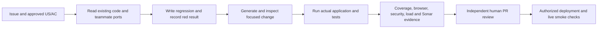
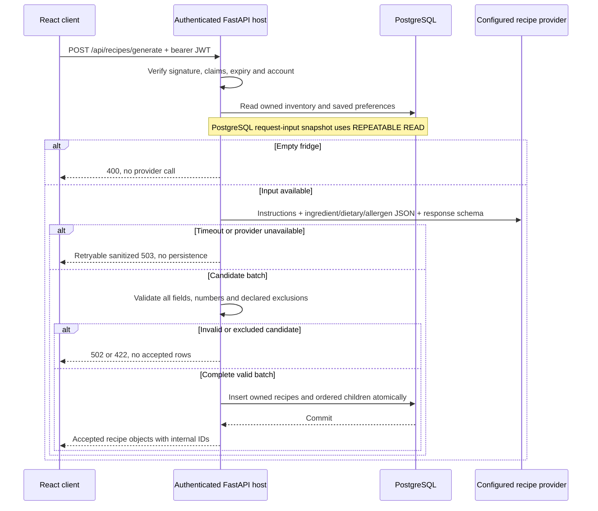

# AI tooling and runtime recipe pipeline

Refs #16, #45. The repository includes AGENTS.md, reusable prompts and an AI contribution/incident log. The development workflow uses Codex for repository inspection, integration, regression generation, schema changes, browser checks and CI diagnosis. That is broader than inline autocomplete. Human team members own the changes and final review.

This is a documented workflow, not a claim that every older commit followed TDD. PR #49 has an actual test-only red commit before the green implementation. See the contribution and mistakes logs for reproducible evidence and limits.

## Runtime pipeline

The shared instructions and schema are in `backend/src/fridgely_recipes/provider.py`. Both providers receive the current ingredient names and exact preference lists with a 2400-token output limit. The OpenAI adapter uses Responses with `store:false`. The Cloudflare adapter uses Workers AI JSON Mode for Llama 3.3 70B. The host applies a 28-second generation budget with a shorter connection timeout. [Server configuration](cloud-deployment.md#recipe-provider-settings)

Validation checks the complete batch before storage. Declared exclusion comparison is trimmed/casefolded name matching, not a synonym taxonomy, allergy certification or medical advice. No recipe operation deducts inventory. Controlled providers belong only to isolated tests. Missing production credentials yield the actual retryable error; no fixture replaces the live service.
