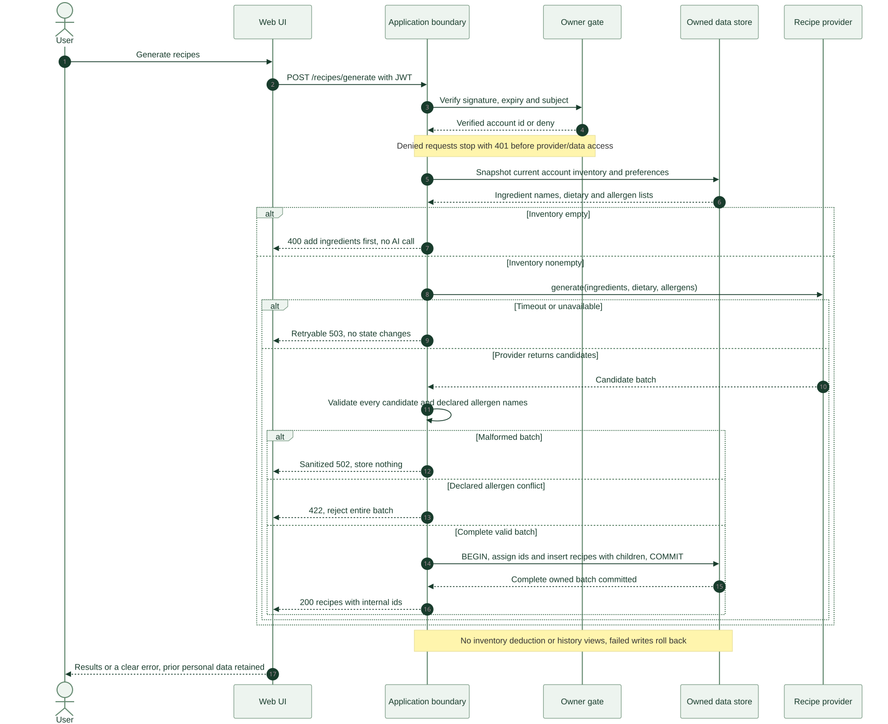
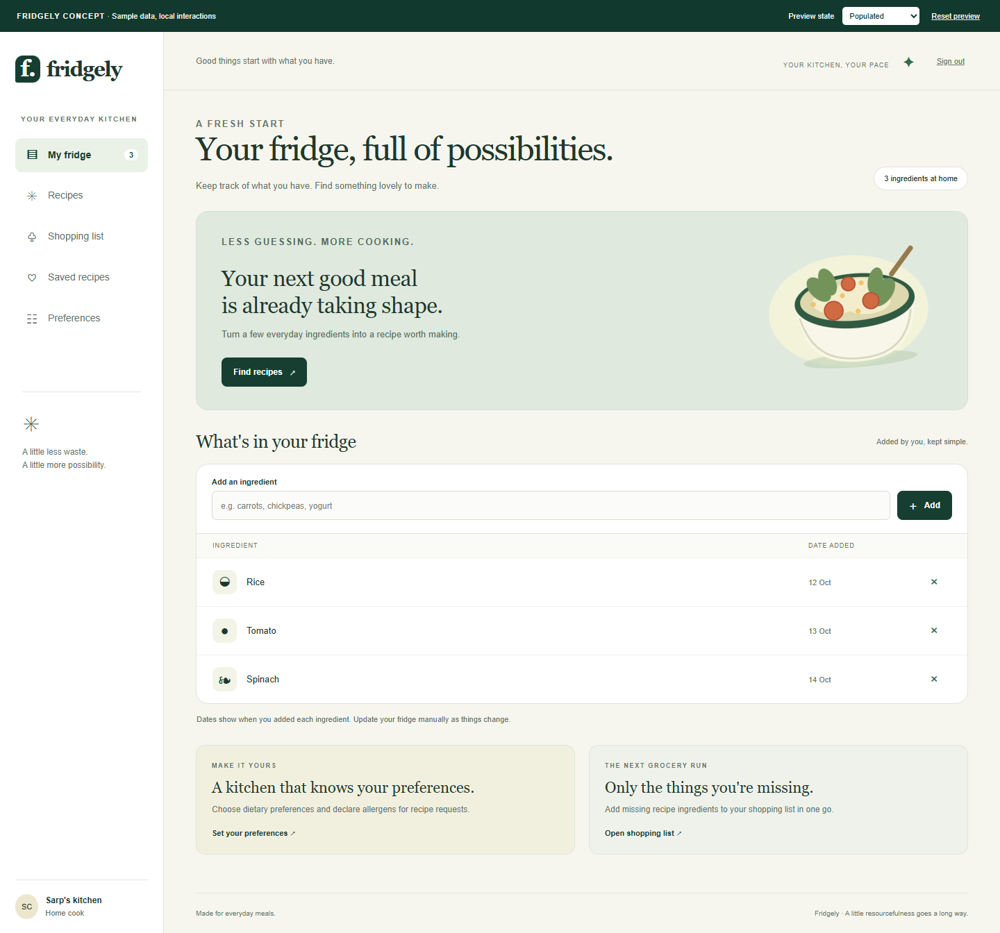

# Fridgely requirements analysis report

CMPE 331 Software Engineering Concepts · Proposed analysis baseline · 14 October 2026

## 1. Purpose and baseline

This analysis translates Fridgely's approved requirements into domain/data structures and behavioral models before implementation. The [charter](CHARTER.MD) defines scope and roles. [Requirements revision 4839cdf](https://github.com/SarpCizer/CMPE331-Project/tree/4839cdfdf7f53f226373380f41c307886d08906a) contains the 15 user stories, 48 functional acceptance criteria and nine quality requirements approved by Yeşim in [PR #4](https://github.com/SarpCizer/CMPE331-Project/pull/4#pullrequestreview-5483856402). That revision was merged to `main` before `analysis_work` was created.

The models and preliminary UI are proposals for analysis review. They preserve the approved definitions and do not constitute a database/framework selection or a working backend. The charter sets the analysis report milestone at 18 October 2026, 23:59 Europe/Istanbul; this PR prepares the artifacts for review ahead of that milestone.

## 2. Domain model

An Account owns one logical PreferenceProfile and zero or more inventory entries, accepted recipes, shopping entries, favorites and recipe-view records. An accepted Recipe has one or more ingredients and ordered cooking steps. Every recipe is private to its owner. Favorite and RecipeView are associations to an owned recipe; their uniqueness expresses one saved favorite and one most-recent view per account/recipe.

The [domain model](analysis/data/domain-model.md) separates business concepts from infrastructure. A JWT, browser and external recipe provider are collaborators, not required database entities. Inventory names and dates represent manually entered food and addition time; no quantities, expiry or automatic deduction are introduced. AI-generated cooking time and calories remain estimates.

## 3. Preliminary E-R model and integrity

The [logical E-R model](analysis/data/er-model.md) includes ten entities: account, two preference types, inventory entry, recipe, recipe ingredient, recipe step, shopping entry, favorite and recipe view. Composite favorite/view keys and recipe owner references prevent cross-account associations. Unique normalized account email and account/shopping-name keys preserve registration and shopping behavior under concurrent requests.

The [data dictionary](analysis/data/data-dictionary.md) specifies keys, validation, ownership, collection cardinalities, candidate indexes and transaction boundaries. A complete recipe batch is validated before recipes and children are committed together. Invalid output, an excluded declared allergen or a provider failure must not leave partial accepted results. Recipe details record a view; saving or generating a recipe alone does not.

This E-R model is retained even if MongoDB is chosen. The dictionary provides a candidate mapping with embedded preference lists and recipe arrays plus owner-qualified references. A NoSQL design must preserve the same uniqueness, ownership and atomicity; document embedding alone does not make a whole multi-recipe batch atomic.

## 4. Behavioral models

Activity-style flowcharts are used for each of the 15 stories because they make success paths, validation decisions and state changes visible without selecting a production framework. Three sequence diagrams expand interactions with the most consequential cross-boundary behavior. No use case is omitted.

| Model group | Coverage | Main decisions |
|---|---|---|
| Identity and profile | [US-01](analysis/behavior/US-01.md), [US-02](analysis/behavior/US-02.md), [US-03](analysis/behavior/US-03.md) | Atomic email uniqueness, no verification step, valid signed token, empty preference replacement |
| Fridge | [US-04](analysis/behavior/US-04.md), [US-05](analysis/behavior/US-05.md), [US-06](analysis/behavior/US-06.md) | Nonblank names, immutable addition dates, owner-only manual deletion |
| Recipes and failures | [US-07](analysis/behavior/US-07.md), [US-08](analysis/behavior/US-08.md), [US-09](analysis/behavior/US-09.md) | Empty-fridge block, whole-batch validation, declared-allergen rejection, bounded provider errors, view tracking |
| Shopping | [US-10](analysis/behavior/US-10.md), [US-11](analysis/behavior/US-11.md) | Normalized name comparison, idempotent additions, manual list edits without fridge mutation |
| Saved and viewed recipes | [US-12](analysis/behavior/US-12.md), [US-13](analysis/behavior/US-13.md), [US-14](analysis/behavior/US-14.md) | Unique favorites, retained history on removal, detail-view-only upsert, newest-first order |
| Ownership | [US-15](analysis/behavior/US-15.md) | Validate signature/expiry, derive owner from token, scope all collections and object operations |

The [generation sequence](analysis/behavior/generation-sequence.md) shows authenticated input capture, provider invocation, validation alternatives and all-or-nothing persistence. The [shopping sequence](analysis/behavior/shopping-sequence.md) explains repeated/concurrent missing-item requests. The [authorization sequence](analysis/behavior/authorization-sequence.md) shows where unauthorized requests terminate before data or feature logic. Storage failures roll back; a successful detail-open response requires a committed history update.

## 5. Requirement/model consistency

[Traceability](analysis/traceability.md) and [criterion-level mappings](analysis/coverage.json) connect all 48 exact acceptance criteria to behavioral models, data entities and preliminary UI states. The validation script compares criterion wording directly to the approved definitions and checks model/source pairs and links. This structural check supplements manual review; it cannot prove semantic correctness automatically.

The analysis explicitly preserves: name-only inventory; addition dates rather than expiry; no automatic inventory deduction; owner-isolated recipes and personal data; whole-batch 422/502 rejection; clear retryable 503 errors; normalized missing-name matching; stable shopping IDs; idempotent favorites; and most-recent detail-view history. The stricter batch semantics already present in the approved API/tests govern US-07's wording about withholding conflicting recipes. The requirements and charter were not rewritten.

Non-functional constraints are mapped in the same traceability document. Ownership and credential handling shape the data model; provider timeout/validation shape behavior; responsiveness, focus and estimates shape the mockup. Performance, persistence, production accessibility, deployment and cryptographic-security results require an implemented application and are not claimed here.

## 6. Preliminary frontend design

The [interactive local concept](analysis/frontend/index.html) and [screen/state guide](analysis/frontend/README.md) begin the ongoing frontend design work. The concept includes sign-in/register presentation, fridge, preferences, recipe suggestions/details, shopping, favorites and recent history. A separate reviewer toolbar exposes empty/loading/error/expired-session states. HTML/CSS/JavaScript, system fonts and an original inline vector illustration make it locally reviewable without external services.

The [design brief](analysis/frontend/design-brief.md) records permitted content, excluded features and information to retain during AI-assisted UI iterations. It is a project-specific reference, not an invented course-supplied policy. The final production stack remains undecided. Authentication and AI suggestions in this prototype are demonstrative; no credentials or provider calls are made.

## 7. Open decisions and next steps

The data dictionary identifies A-01 through A-06 as analysis proposals: private accepted recipe snapshots, preference storage mapping, uniqueness under concurrency, a history timestamp tie-breaker, request-start input snapshots and committed history updates. Review these with the team before physical schema/API implementation. Backend/database/frontend selection, JWT algorithm/lifetime, exact preference vocabulary, retention and deployment remain software-design work.

After analysis review, resolve comments, obtain approval, and prepare the submission version according to the course instructions. Continue frontend iterations and use the approved models to guide implementation and the existing red acceptance suite. See [validation evidence and limits](analysis/validation.md) for what has actually been checked.
