# Fridgely requirements analysis report

CMPE 331 Software Engineering Concepts | Revised 17 October 2026 | Analysis revision for review

## 1. Scope and approved baseline

Fridgely helps account holders manually manage ingredient names and their addition dates, request AI-generated recipes, maintain a shopping list and retain favorite/viewed recipes. The [charter](CHARTER.MD) defines the product and roles. This analysis follows the 15 user stories, 48 numbered functional acceptance criteria and nine quality requirements at [approved requirements revision 4839cdf](https://github.com/SarpCizer/CMPE331-Project/tree/4839cdfdf7f53f226373380f41c307886d08906a), approved in [requirements PR #4](https://github.com/SarpCizer/CMPE331-Project/pull/4#pullrequestreview-5483856402) and merged into main.

The behavioral models are Data Flow Diagrams (DFDs). The domain model and preliminary E-R model describe business data separately. Every current analysis diagram is embedded in the figure appendix of this report and its PDF; links provide editable sources and detailed process specifications. Analysis PR #5 is under review. This revision does not assert approval or submission. The charter's analysis milestone is 18 October 2026, 23:59 Europe/Istanbul.

The approved charter and requirements are unchanged. Name-only inventory, addition timestamps, private recipes, manual additions/deletions and no automatic deduction remain the scope. Receipt OCR, expiry alerts, quantity arithmetic and native mobile apps are excluded. The frontend concept is supplementary design exploration, not implemented authentication or AI.

## 2. Domain and logical data model

Figure 01 is the [conceptual domain model](analysis/data/domain-model.md). One Account owns a logical PreferenceProfile and zero or more inventory entries, accepted recipes, shopping entries, favorites and recipe-view associations. Every Recipe belongs to one account and contains at least one ingredient and one ordered cooking step. At most one favorite and one latest-view association reference each owned recipe. A browser, JWT and external AI provider are boundary collaborators, not required business entities.

Figure 02 is the [preliminary E-R model](analysis/data/er-model.md). Its ten logical entities remain applicable if a NoSQL database is chosen. [The data dictionary](analysis/data/data-dictionary.md) provides types, key constraints, ownership, indexes and a candidate MongoDB mapping. UUID is an opaque application-assigned identifier, not a final physical schema choice.

| Entity | Key / principal attributes | Required meaning |
|---|---|---|
| ACCOUNT | account_id; unique normalized_email; password_hash | Case-insensitive email uniqueness; salted hash only; no verification-email step |
| DIETARY_PREFERENCE | (account_id, position); display_value; nonunique derived value_key | Preserve saved dietary-list strings, order and repeated values |
| ALLERGEN_EXCLUSION | (account_id, position); display_value; nonunique derived value_key | Preserve saved allergen-list strings/order/repeats; derived keys are comparison data |
| INVENTORY_ENTRY | entry_id; account_id; name; normalized_name; added_at | Nonblank manually added name; immutable server UTC addition time, not expiry |
| RECIPE | recipe_id; account_id; title; minutes; calories_per_serving; servings | Complete owned snapshot; positive minutes/servings and nonnegative estimated calories |
| RECIPE_INGREDIENT | (recipe_id, position); name; normalized_name | Nonempty ordered ingredient collection with nonblank names |
| RECIPE_STEP | (recipe_id, position); instruction | Nonempty ordered cooking instructions |
| SHOPPING_ENTRY | entry_id; account_id; name; normalized_name | Unique (account_id, normalized_name); existing ids stable on repeated add-missing requests |
| FAVORITE | (account_id, recipe_id) | Unique owner/recipe association; composite FK to the same owned recipe |
| RECIPE_VIEW | (account_id, recipe_id); last_viewed_at | One latest detail-view timestamp per owned recipe; newest first |

Both preference arrays are atomically replaced, including replacement with empty arrays. Ordinal row keys retain the saved API values; normalization for comparison must not silently change those lists. The same lists are supplied to the next recipe request. Normalized inventory/shopping names and email uniqueness remain as specified by the approved decisions.

The complete provider batch is validated before any accepted recipe is committed. A malformed candidate rejects the batch with 502, a declared allergen conflict with 422, and timeout/unavailability with retryable 503. Accepted recipes and children commit atomically with application-generated ids. No generation creates a history view. Opening details commits a history upsert; removing a favorite removes only the association. Recipes and any prior history remain available.

If MongoDB is selected, preference arrays and recipe children may be embedded while preserving order. Owner-qualified references and unique association indexes still apply. Embedding one recipe does not make a whole multi-recipe batch atomic; the selected persistence design must provide equivalent transaction semantics. No physical schema, migration or database engine is selected by this analysis.

## 3. DFD notation, hierarchy and store dictionary

The diagrams use Yourdon-DeMarco-style circles for data transformations, rectangles for external entities, parallel horizontal lines for persistent stores and labeled arrows for data. They do not use decision diamonds, yes/no branches or sequence-message lifelines. Arrows indicate data exchanged, not execution order. Validation outcomes, atomicity and allowed writes are defined by the process constraints in section 4 and the linked model documents. The [notation guide](analysis/behavior/README.md) includes sources and editable typed-node data.

Figure 03 is the system context DFD. Figure 04 decomposes the system into eight logical responsibilities. These responsibilities do not select microservices or a deployment architecture. Figures 05-19 are per-story functional views; their union describes the detail of each responsibility, rather than claiming that each view alone is a complete independent decomposition of a parent process.

| Store | Logical contents | E-R mapping |
|---|---|---|
| D1 | Accounts | ACCOUNT |
| D2 | Ordered dietary/allergen lists | DIETARY_PREFERENCE and ALLERGEN_EXCLUSION |
| D3 | Fridge inventory | INVENTORY_ENTRY |
| D4 | Accepted recipes and children | RECIPE, RECIPE_INGREDIENT, RECIPE_STEP |
| D5 | Shopping entries | SHOPPING_ENTRY |
| D6 | Favorite associations | FAVORITE |
| D7 | Recipe views | RECIPE_VIEW |
| D0 | Compact access-analysis view of personal records | Aggregate of D2-D7, not an additional entity |

Context/level-1 external interfaces balance through six data groups: AUTH_IN (registration/sign-in credentials), AUTH_OUT (account/token result), PERSONAL_IN (personal request plus token), PERSONAL_OUT (feature data or sanitized errors), AI_IN (ingredient names and preference lists) and AI_OUT (candidate/failure data). Level 1 refines PERSONAL_OUT into access errors and preference, fridge, recipe/history, shopping and favorite results. Every external/store exchange passes through a process.

## 4. Per-story process specifications

Shared authorization rule: every protected operation verifies JWT signature and expiry, derives account identity from the verified subject and checks referenced objects before data access. IDs in request bodies, such as recipeId in POST /favorites, require the same owner check as URL IDs. A client-supplied owner id is ignored or rejected; it never selects another account. Missing/invalid/expired tokens yield 401; foreign objects yield 403/404 without mutation. Registration and sign-in are public exceptions.

Shared inventory rule: only manual inventory add/delete writes D3. Generation, opening details, shopping edits, favoriting and history cannot deduct ingredients or automatically restock the fridge. All state-changing errors roll back; public provider errors omit secrets and raw diagnostics.

### US-01: register an account

Figure 05. [Approved definition](requirements/US-01.md); [DFD and full process specification](analysis/behavior/US-01.md).

- Reject malformed email or a password shorter than eight characters with 400 and no write.

- Enforce normalized email uniqueness atomically; a duplicate produces 409 and no second account.

- Successful output excludes password/hash and requires no email-verification step. The logical preference lists are initially empty.

### US-02: sign in

Figure 06. [Approved definition](requirements/US-02.md); [DFD and full process specification](analysis/behavior/US-02.md).

- A valid credential match produces a signed JWT with finite expiry. Wrong credentials produce 401 without a token.

- JWT algorithm/lifetime remain software-design choices. Public results never expose password hashes.

### US-03: save and read preferences

Figure 07. [Approved definition](requirements/US-03.md); [DFD and full process specification](analysis/behavior/US-03.md).

- Replace both arrays atomically; empty arrays clear prior entries. Returned saved arrays preserve submitted values, ordering and repeats. Normalized lookup keys must not rewrite the saved/API values.

- US-07 reads the latest committed lists for its generation request and passes those saved values to the provider.

### US-04: add a fridge ingredient

Figure 08. [Approved definition](requirements/US-04.md); [DFD and full process specification](analysis/behavior/US-04.md).

- Blank trimmed names produce 400 without an inventory write. Nonblank names receive a server id and UTC addedAt.

- addedAt is addition time, never expiry or freshness. No quantity arithmetic is modeled; repeated inventory names are not silently deduplicated.

### US-05: list fridge contents

Figure 09. [Approved definition](requirements/US-05.md); [DFD and full process specification](analysis/behavior/US-05.md).

- An empty array is a successful empty-fridge result and the UI shows a clear empty state.

- A list read does not write inventory or change original addedAt; display labels are addition dates.

### US-06: delete an ingredient

Figure 10. [Approved definition](requirements/US-06.md); [DFD and full process specification](analysis/behavior/US-06.md).

- A nonexistent id yields 404; a foreign id is denied with 403 or hidden with 404. No denied/missing request changes any entry.

- A successful deletion changes only the selected inventory record.

- The no-deduction criterion is also modeled by US-08 and US-12: opening or saving a recipe has no D3 write.

### US-07: generate complete recipes

Figure 11. [Approved definition](requirements/US-07.md); [DFD and full process specification](analysis/behavior/US-07.md).

- Empty fridge: 400 and no AI input flow. Snapshot request input from current committed owned records.

- Validate every candidate before any accepted result is written. Malformed candidates yield 502; declared excluded allergens yield whole-batch 422 under the approved contract.

- Only accepted batches allocate internal ids and atomically persist recipes plus ingredients and ordered steps. Provider timeout/unavailability yields retryable 503 within the required bound; no partial batch is saved.

- Successful response is the complete recipe array specified by the approved API, not summaries. Generation does not create history views.

### US-08: present recipe details

Figure 12. [Approved definition](requirements/US-08.md); [DFD and full process specification](analysis/behavior/US-08.md).

- This functional view combines detail presentation 5.1 and history maintenance 5.2 as aggregate process 5.0; US-14 shows their internal exchange.

- Details include title, supplied ingredients, ordered steps, minutes, calories per serving and serving count. UI labels generated cooking time and calories as estimates.

- Malformed provider output is rejected during generation in US-07/US-09, before any recipe can be read here.

- A successful detail response includes the history upsert behavior specified by US-14.

### US-09: return safe generation errors

Figure 13. [Approved definition](requirements/US-09.md); [DFD and full process specification](analysis/behavior/US-09.md).

- This is the failure projection of US-07, not an independent public error endpoint. Each new generation request authenticates again under US-15.

- Timeout/unavailability is 503 with retryable true; malformed output is 502; declared allergen conflict is 422. Raw provider diagnostics/credentials never enter public error data.

- There are no data-store write flows: inventory, preferences, shopping, favorites and history remain unchanged and no partial recipe is accepted.

- Retry is a new user request using current data, not an unbounded automatic retry. Success processing and current-store inputs are shown in US-07.

### US-10: add missing ingredients

Figure 14. [Approved definition](requirements/US-10.md); [DFD and full process specification](analysis/behavior/US-10.md).

- Trim and case-normalize ingredient names for comparison only. Missing names are unique recipe names absent from the fridge; existing shopping names are not inserted again.

- Repeated/concurrent requests use owner/name uniqueness and retain existing item ids. An empty missing set is a successful no-op.

### US-11: manage the shopping list

Figure 15. [Approved definition](requirements/US-11.md); [DFD and full process specification](analysis/behavior/US-11.md).

- A blank name yields 400 without list changes. List reads return the owned items or empty array. New items return 201.

- Owner/name uniqueness is the existing D-07 deduplication rule; repeated normalized names retain the existing entry. Missing deletion targets return 404 and foreign targets 403/404.

### US-12: save a favorite

Figure 16. [Approved definition](requirements/US-12.md); [DFD and full process specification](analysis/behavior/US-12.md).

- POST /favorites is collection creation that references a recipe. Validate its body recipeId ownership before the association is saved.

- Repeated saves upsert the same account/recipe key and produce one favorite.

- Saving alone has no recipe-view write; a prior detail view may already exist.

### US-13: list and remove favorites

Figure 17. [Approved definition](requirements/US-13.md); [DFD and full process specification](analysis/behavior/US-13.md).

- Remove only the favorite association. The accepted recipe and any existing D7 viewed-history record remain available; no D4/D7 deletion flow exists.

### US-14: record and read viewed history

Figure 18. [Approved definition](requirements/US-14.md); [DFD and full process specification](analysis/behavior/US-14.md).

- Only a successful detail-open event produces view data. Generation or favoriting alone sends no history write.

- Use one account/recipe view record; reopening refreshes lastViewedAt, not an additional record. Order by most recent view; recipe-id tie breaking is an explicitly proposed deterministic detail.

### US-15: authorize all personal references

Figure 19. [Approved definition](requirements/US-15.md); [DFD and full process specification](analysis/behavior/US-15.md).

- Validate token signature and expiry against server time, not merely JWT shape. Invalid/expired/missing token data produces 401 before feature access.

- Derive the account from the verified subject. Client owner fields are ignored or rejected; they never select someone else's account.

- Check every referenced object regardless of HTTP method or whether an id appears in a URL or request body. A collection mutation with recipeId is not exempt. A foreign object is denied with 403/404 and no write.

- D0 is a compact view of D2-D7 for access analysis, not an extra table. Feature mutation flows expand into the feature DFDs and preserve their allowed-write restrictions. Registration/sign-in are the public exceptions.

## 5. Requirement/model consistency and traceability

[Criterion-level mappings](analysis/coverage.json) retain all 48 approved criteria verbatim and link each to a primary and supporting DFD. [Traceability](analysis/traceability.md) also maps the nine quality requirements. These checks establish artifact coverage; semantic review remains necessary.

| Consistency point | Current model behavior |
|---|---|
| Recipe response shape | Generation returns the complete recipe array required by the approved API, including internal ids, fields and ordered children |
| Saved preference fidelity | Ordinal preference keys preserve submitted strings, order and repeated values; derived normalization keys do not deduplicate saved lists |
| References on collection mutations | Process 8.0 checks body recipeId and all other referenced object IDs, even when the route creates an association |
| Missing versus foreign inventory id | A missing id is 404; a foreign id is 403/404; neither path mutates inventory |
| Criterion realized by another operation | US-08 AC-2 links to generation/failure rejection; US-06 AC-3 links to details/favorites for no deduction; US-03 AC-3 links to provider input |
| Detail and history responsibilities | US-08 uses aggregate process 5.0; US-14 shows the internal 5.1 detail / 5.2 history exchange consistently |

The whole-batch malformed/allergen rules follow the existing approved API and tests. The approved requirement text is not rewritten to fit the models. Favorite and history uniqueness, addition dates, original saved preference values and all scope exclusions are preserved. A-01 through A-06 in the data dictionary identify analysis proposals such as storage layout, request-start snapshots and history timestamp tie breaking, rather than silently introducing approved behavior.

## 6. Quality constraints and preliminary frontend

Ownership and credential handling shape all protected transformations. Bounded AI failures preserve the 30-second timeout target and no-partial-state rule. Stored data must survive restarts. Performance, cryptography, multi-user security, persistence and deployment require implementation tests; diagram validation is not evidence of those results.

The [frontend concept](analysis/frontend/README.md) remains a supplementary first design pass. It includes identity presentation, fridge, preferences, recipe suggestions/details, shopping, favorites and viewed history, with empty/loading/error/session states. It uses local sample data and fixed recipes; sign-in, filtering and expiry are illustrative. No production account/token/provider behavior is implemented. The project-specific [design brief](analysis/frontend/design-brief.md) records content, exclusions and accessibility goals for further iteration.

## 7. Validation and review status

The structural validator checks all 15 stories and 48 exact criteria, 17 typed DFD sources, process-mediated edges and process inputs/outputs, context/level-1 interface groups, ten E-R entities, 19 source/image pairs and every report diagram/link. An independent semantic audit reviewed ownership, response shape, preference fidelity, deletion outcomes and criterion mapping. The [review response](analysis/review-response.md) lists concrete changes for the three requested corrections.

The revised PDF embeds all 19 analysis diagrams below, with source links for editing. Text uses portrait pages and diagram sheets provide room for labels. Every final page is rendered and visually inspected before delivery; the validation record reports actual results. The frontend's prior browser checks are recorded as the 14 October baseline and are not claimed as new backend verification.

This analysis revision awaits Yeşim's approval in [PR #5](https://github.com/SarpCizer/CMPE331-Project/pull/5). It is not evidence of submission to learn.bilgi. Further design choices remain open; no approval or passing application-test result is implied.

## Appendix: embedded analysis diagrams

All current domain, E-R and behavioral DFD figures are included directly in the PDF. Editable sources and the process constraints are linked above.

### Figure 01: Domain model

### Figure 02: Preliminary E-R model

### Figure 03: System context DFD

### Figure 04: Level 1 DFD

### Figure 05: US-01 data flow diagram

### Figure 06: US-02 data flow diagram

### Figure 07: US-03 data flow diagram

### Figure 08: US-04 data flow diagram

### Figure 09: US-05 data flow diagram

### Figure 10: US-06 data flow diagram

### Figure 11: US-07 data flow diagram

### Figure 12: US-08 data flow diagram

### Figure 13: US-09 data flow diagram

### Figure 14: US-10 data flow diagram

### Figure 15: US-11 data flow diagram

### Figure 16: US-12 data flow diagram

### Figure 17: US-13 data flow diagram

### Figure 18: US-14 data flow diagram

### Figure 19: US-15 data flow diagram

