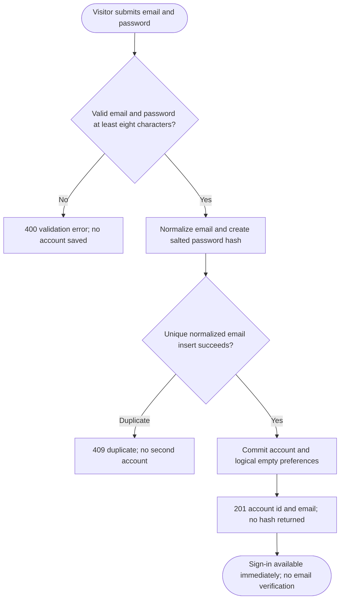

# US-01: Register an account

Requirement: [US-01](../../requirements/US-01.md). Covers AC-1, AC-2, AC-3. Each numbered criterion in that file is AC-1, AC-2, etc.

Visitor only. The unique-email insert is the concurrency guard; a prior lookup alone is insufficient. Invalid input never persists an account. No verification email step is introduced.

Notation: activity-style flowchart; diamonds are decisions, arrows are control flow and rounded terminals are start/end. The US-15 gate terminates immediately on denied access; the continuation edge means authorization succeeded. System/storage failures return an error and roll back any transaction; they are not shown as successful exits.

[Editable Mermaid source](US-01.mmd)

