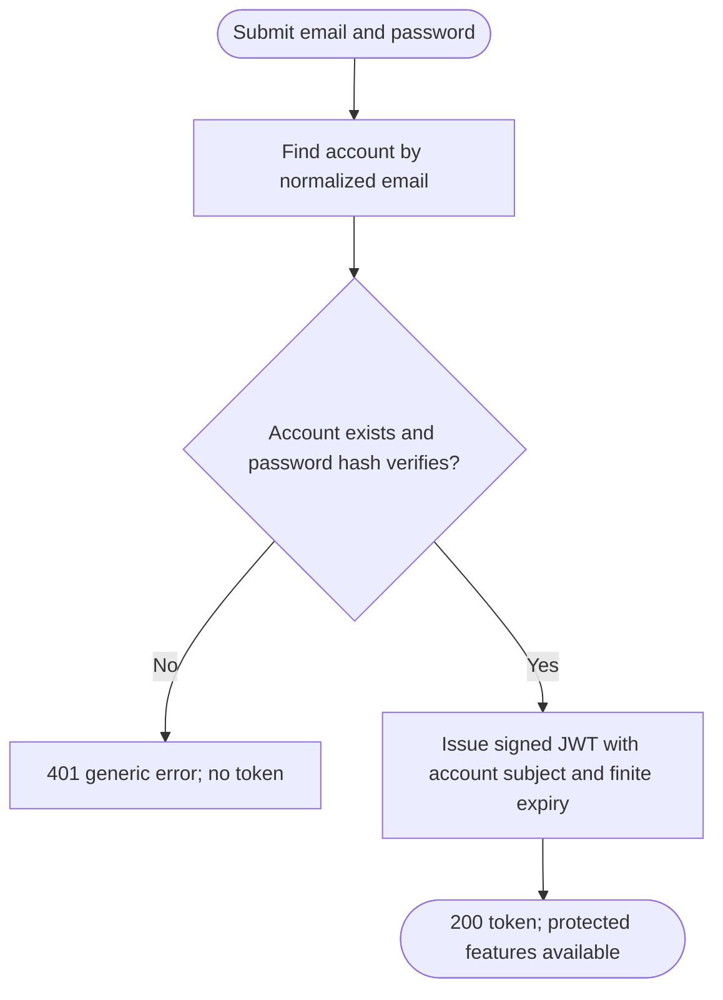

# US-02: Sign in

Requirement: [US-02](../../requirements/US-02.md). Covers AC-1, AC-2. Each numbered criterion in that file is AC-1, AC-2, etc.

JWT signing key, algorithm and lifetime remain design choices. Do not return account hashes or distinguish nonexistent email from wrong password in the public error.

Notation: activity-style flowchart; diamonds are decisions, arrows are control flow and rounded terminals are start/end. The US-15 gate terminates immediately on denied access; the continuation edge means authorization succeeded. System/storage failures return an error and roll back any transaction; they are not shown as successful exits.

[Editable Mermaid source](US-02.mmd)

