# US-03 DFD: save and read preferences

Use-case DFD view. Requirements: [US-03](../../requirements/US-03.md). [Notation, store dictionary and hierarchy](README.md).

[Editable DFD data source](US-03.dfd.json). Rectangles are external entities, circles transform data, parallel lines are data stores and labeled arrows carry data. Arrows do not specify execution order or branch conditions. Numbering identifies the parent logical process; a per-story view may show a related process as a reference.

## Data exchanged

| Source | Data | Destination |
|---|---|---|
| Account holder | Preference replacement or query and access token | 2.1 Replace or read preference lists |
| D2 Ordered preference lists | Saved dietary and allergen lists in position order | 2.1 Replace or read preference lists |
| 2.1 Replace or read preference lists | Atomic replacement lists preserving values and order | D2 Ordered preference lists |
| 2.1 Replace or read preference lists | Saved preference lists or sanitized error | Account holder |

## Process constraints

1. All protected input is authenticated and owner-scoped under process 8.0 (US-15). Every referenced object ID, including recipeId in a request body, is checked against the verified account before a read/write. Client owner IDs are rejected or ignored.
2. Replace both arrays atomically; empty arrays clear prior entries. Returned saved arrays preserve submitted values, ordering and repeats. Normalized lookup keys must not rewrite the saved/API values.
3. US-07 reads the latest committed lists for its generation request and passes those saved values to the provider.
