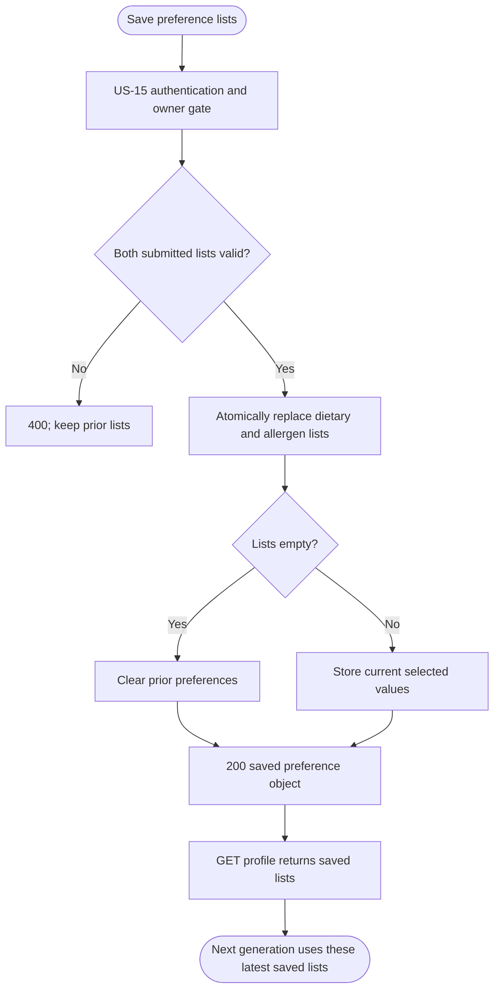

# US-03: Save dietary and allergen preferences

Requirement: [US-03](../../requirements/US-03.md). Covers AC-1, AC-2, AC-3. Each numbered criterion in that file is AC-1, AC-2, etc.

An empty replacement clears old values rather than merging them. List-vocabulary validation is a proposed design detail; approved empty lists remain valid. Both lists must change together.

Notation: activity-style flowchart; diamonds are decisions, arrows are control flow and rounded terminals are start/end. The US-15 gate terminates immediately on denied access; the continuation edge means authorization succeeded. System/storage failures return an error and roll back any transaction; they are not shown as successful exits.

[Editable Mermaid source](US-03.mmd)

