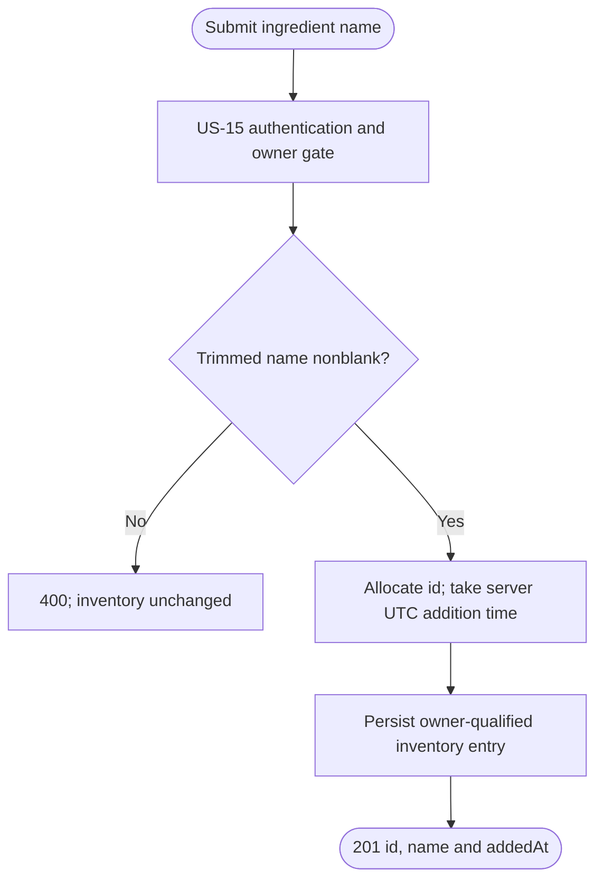

# US-04: Add an ingredient manually

Requirement: [US-04](../../requirements/US-04.md). Covers AC-1, AC-2, AC-3. Each numbered criterion in that file is AC-1, AC-2, etc.

The timestamp is addition time, never an expiry date. The server generates id and time; the browser cannot choose an owner or rewrite addedAt. No quantity field or inventory-name uniqueness rule is added.

Notation: activity-style flowchart; diamonds are decisions, arrows are control flow and rounded terminals are start/end. The US-15 gate terminates immediately on denied access; the continuation edge means authorization succeeded. System/storage failures return an error and roll back any transaction; they are not shown as successful exits.

[Editable Mermaid source](US-04.mmd)

