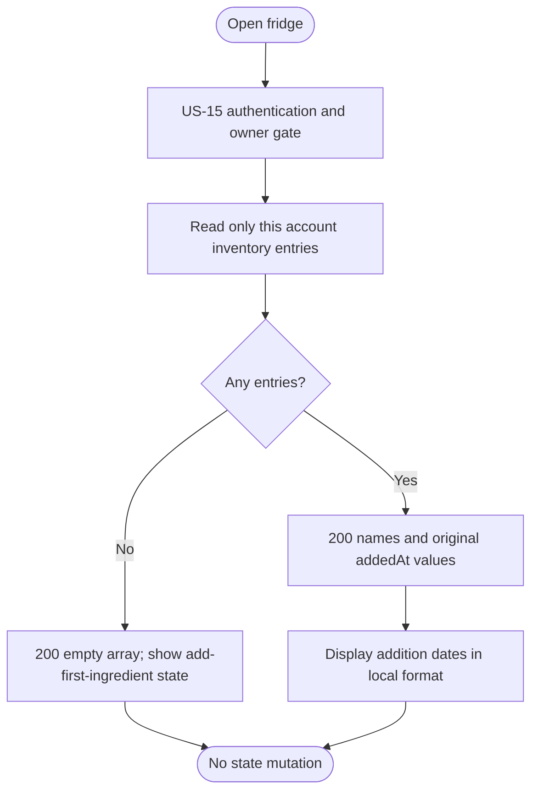

# US-05: List fridge ingredients and dates

Requirement: [US-05](../../requirements/US-05.md). Covers AC-1, AC-2, AC-3. Each numbered criterion in that file is AC-1, AC-2, etc.

Listing never refreshes addition timestamps. The interface labels dates "Added", with no freshness/expiry inference. Sorting/filtering is a presentation choice that must not hide records from the underlying collection.

Notation: activity-style flowchart; diamonds are decisions, arrows are control flow and rounded terminals are start/end. The US-15 gate terminates immediately on denied access; the continuation edge means authorization succeeded. System/storage failures return an error and roll back any transaction; they are not shown as successful exits.

[Editable Mermaid source](US-05.mmd)

