# US-05 DFD: list fridge contents

Use-case DFD view. Requirements: [US-05](../../requirements/US-05.md). [Notation, store dictionary and hierarchy](README.md).

[Editable DFD data source](US-05.dfd.json). Rectangles are external entities, circles transform data, parallel lines are data stores and labeled arrows carry data. Arrows do not specify execution order or branch conditions. Numbering identifies the parent logical process; a per-story view may show a related process as a reference.

## Data exchanged

| Source | Data | Destination |
|---|---|---|
| Account holder | Inventory query and access token | 3.2 Read owned inventory |
| D3 Fridge inventory | Owned ingredient names and original addedAt | 3.2 Read owned inventory |
| 3.2 Read owned inventory | 200 complete ingredient list or empty list/error | Account holder |

## Process constraints

1. All protected input is authenticated and owner-scoped under process 8.0 (US-15). Every referenced object ID, including recipeId in a request body, is checked against the verified account before a read/write. Client owner IDs are rejected or ignored.
2. An empty array is a successful empty-fridge result and the UI shows a clear empty state.
3. A list read does not write inventory or change original addedAt; display labels are addition dates.
