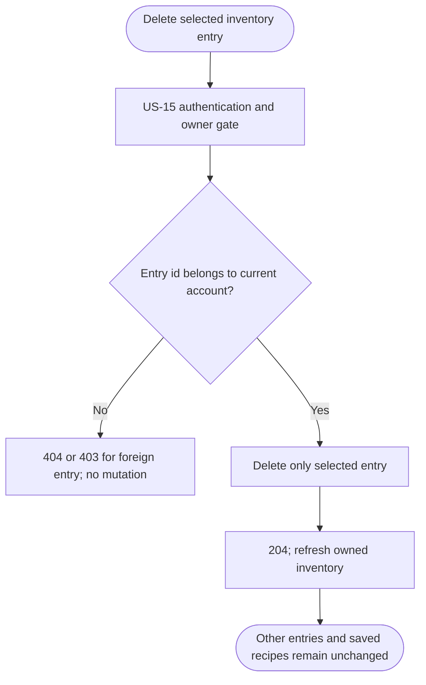

# US-06: Delete an ingredient manually

Requirement: [US-06](../../requirements/US-06.md). Covers AC-1, AC-2, AC-3. Each numbered criterion in that file is AC-1, AC-2, etc.

Missing IDs return 404. A foreign ID is denied with 403 or hidden with 404 under US-15. Opening or favoriting a recipe never invokes this deletion path.

Notation: activity-style flowchart; diamonds are decisions, arrows are control flow and rounded terminals are start/end. The US-15 gate terminates immediately on denied access; the continuation edge means authorization succeeded. System/storage failures return an error and roll back any transaction; they are not shown as successful exits.

[Editable Mermaid source](US-06.mmd)

