# US-07 DFD: generate complete recipes

Use-case DFD view. Requirements: [US-07](../../requirements/US-07.md), [US-08](../../requirements/US-08.md), [US-09](../../requirements/US-09.md). [Notation, store dictionary and hierarchy](README.md).

[Editable DFD data source](US-07.dfd.json). Rectangles are external entities, circles transform data, parallel lines are data stores and labeled arrows carry data. Arrows do not specify execution order or branch conditions. Numbering identifies the parent logical process; a per-story view may show a related process as a reference.

## Data exchanged

| Source | Data | Destination |
|---|---|---|
| Account holder | Generation request and access token | 4.1 Validate and accept recipe batch |
| D3 Fridge inventory | Owned inventory ingredient names | 4.1 Validate and accept recipe batch |
| D2 Ordered preference lists | Latest saved dietary and allergen lists | 4.1 Validate and accept recipe batch |
| 4.1 Validate and accept recipe batch | Ingredient names and saved preference lists | Recipe AI service |
| Recipe AI service | Recipe candidates or provider failure data | 4.1 Validate and accept recipe batch |
| 4.1 Validate and accept recipe batch | Complete validated owned recipe batch | D4 Accepted recipes and children |
| D4 Accepted recipes and children | Committed complete recipe objects | 4.1 Validate and accept recipe batch |
| 4.1 Validate and accept recipe batch | 200 complete recipe array or 400/422/502/503 error | Account holder |

## Process constraints

1. All protected input is authenticated and owner-scoped under process 8.0 (US-15). Every referenced object ID, including recipeId in a request body, is checked against the verified account before a read/write. Client owner IDs are rejected or ignored.
2. Empty fridge: 400 and no AI input flow. Snapshot request input from current committed owned records.
3. Validate every candidate before any accepted result is written. Malformed candidates yield 502; declared excluded allergens yield whole-batch 422 under the approved contract.
4. Only accepted batches allocate internal ids and atomically persist recipes plus ingredients and ordered steps. Provider timeout/unavailability yields retryable 503 within the required bound; no partial batch is saved.
5. No inventory write occurs: recipe, shopping, favorite and history actions never deduct or restock fridge ingredients.
6. Successful response is the complete recipe array specified by the approved API, not summaries. Generation does not create history views.
