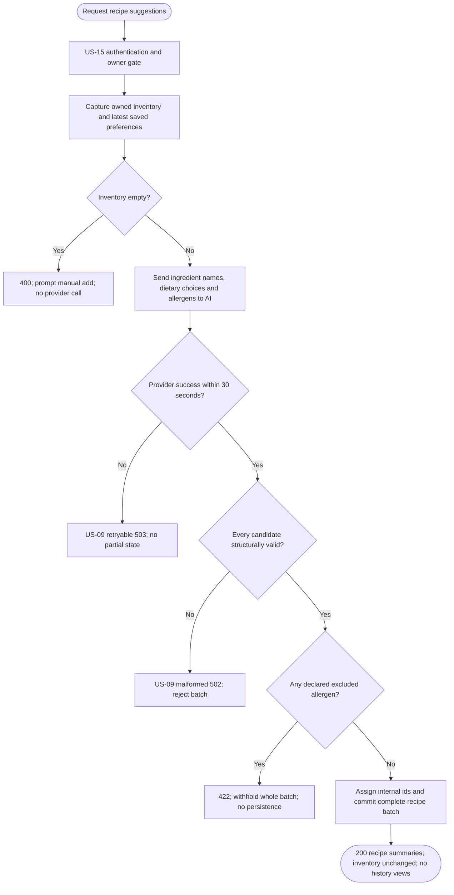

# US-07: Generate recipes

Requirement: [US-07](../../requirements/US-07.md). Covers AC-1, AC-2, AC-3, AC-4. Each numbered criterion in that file is AC-1, AC-2, etc.

Batch-wide 422 follows the approved acceptance contract and withholds every conflicting recipe. Structural validation checks all required strings, arrays, numbers and servings before any write. Provider failure is modeled in US-09; the detailed interaction is also in [the generation sequence](generation-sequence.md).

Notation: activity-style flowchart; diamonds are decisions, arrows are control flow and rounded terminals are start/end. The US-15 gate terminates immediately on denied access; the continuation edge means authorization succeeded. System/storage failures return an error and roll back any transaction; they are not shown as successful exits.

[Editable Mermaid source](US-07.mmd)

