# US-08 DFD: present recipe details

Use-case DFD view. Requirements: [US-08](../../requirements/US-08.md), [US-14](../../requirements/US-14.md). [Notation, store dictionary and hierarchy](README.md).

[Editable DFD data source](US-08.dfd.json). Rectangles are external entities, circles transform data, parallel lines are data stores and labeled arrows carry data. Arrows do not specify execution order or branch conditions. Numbering identifies the parent logical process; a per-story view may show a related process as a reference.

## Data exchanged

| Source | Data | Destination |
|---|---|---|
| Account holder | Recipe id and access token | 5.0 Present details and record view |
| D4 Accepted recipes and children | Owned complete recipe with ordered ingredients/steps | 5.0 Present details and record view |
| 5.0 Present details and record view | Owned recipe id and server view timestamp | D7 Recipe views |
| D7 Recipe views | Committed new or refreshed view record | 5.0 Present details and record view |
| 5.0 Present details and record view | 200 complete recipe details or access/not-found error | Account holder |

## Process constraints

1. This functional view combines detail presentation 5.1 and history maintenance 5.2 as aggregate process 5.0; US-14 shows their internal exchange.
2. All protected input is authenticated and owner-scoped under process 8.0 (US-15). Every referenced object ID, including recipeId in a request body, is checked against the verified account before a read/write. Client owner IDs are rejected or ignored.
3. Details include title, supplied ingredients, ordered steps, minutes, calories per serving and serving count. UI labels generated cooking time and calories as estimates.
4. Malformed provider output is rejected during generation in US-07/US-09, before any recipe can be read here.
5. A successful detail response includes the history upsert behavior specified by US-14.
6. No inventory write occurs: recipe, shopping, favorite and history actions never deduct or restock fridge ingredients.
