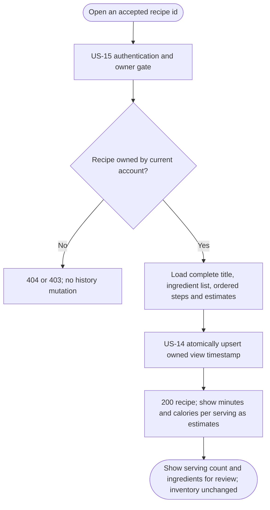

# US-08: Open recipe details

Requirement: [US-08](../../requirements/US-08.md). Covers AC-1, AC-2, AC-3. Each numbered criterion in that file is AC-1, AC-2, etc.

Malformed provider candidates never become accepted recipes (US-07). Details do not consume ingredients. The response succeeds only after the history update commits; UI estimate labels do not claim guaranteed allergen safety.

Notation: activity-style flowchart; diamonds are decisions, arrows are control flow and rounded terminals are start/end. The US-15 gate terminates immediately on denied access; the continuation edge means authorization succeeded. System/storage failures return an error and roll back any transaction; they are not shown as successful exits.

[Editable Mermaid source](US-08.mmd)

