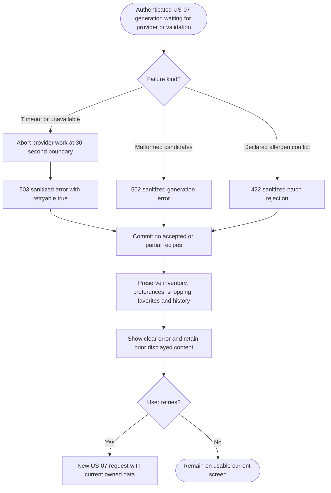

# US-09: Handle generation failures

Requirement: [US-09](../../requirements/US-09.md). Covers AC-1, AC-2, AC-3. Each numbered criterion in that file is AC-1, AC-2, etc.

A retry is a fresh user action, not an unbounded automatic retry loop. Provider diagnostics, keys and raw output never enter the public error or UI. Malformed/allergen rejection remains atomic even if earlier candidates in the batch were valid. This flow conditionally continues US-07 after its US-15 gate; it is not a separately accessible error endpoint. Retry re-enters US-07 and authenticates again.

Notation: activity-style flowchart; diamonds are decisions, arrows are control flow and rounded terminals are start/end. The US-15 gate terminates immediately on denied access; the continuation edge means authorization succeeded. System/storage failures return an error and roll back any transaction; they are not shown as successful exits.

[Editable Mermaid source](US-09.mmd)

