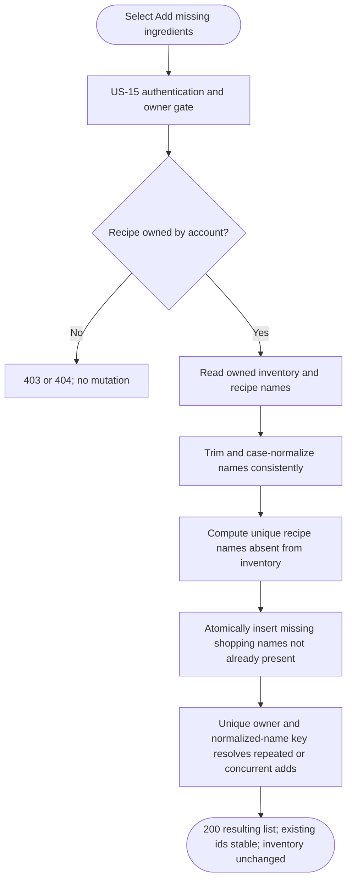

# US-10: Add missing recipe ingredients

Requirement: [US-10](../../requirements/US-10.md). Covers AC-1, AC-2, AC-3, AC-4. Each numbered criterion in that file is AC-1, AC-2, etc.

An empty missing set is a successful no-op. The logical uniqueness rule also applies to existing manually added shopping entries. See [the shopping sequence](shopping-sequence.md) for repeated and concurrent action semantics.

Notation: activity-style flowchart; diamonds are decisions, arrows are control flow and rounded terminals are start/end. The US-15 gate terminates immediately on denied access; the continuation edge means authorization succeeded. System/storage failures return an error and roll back any transaction; they are not shown as successful exits.

[Editable Mermaid source](US-10.mmd)

