# US-11 DFD: manage the shopping list

Use-case DFD view. Requirements: [US-11](../../requirements/US-11.md). [Notation, store dictionary and hierarchy](README.md).

[Editable DFD data source](US-11.dfd.json). Rectangles are external entities, circles transform data, parallel lines are data stores and labeled arrows carry data. Arrows do not specify execution order or branch conditions. Numbering identifies the parent logical process; a per-story view may show a related process as a reference.

## Data exchanged

| Source | Data | Destination |
|---|---|---|
| Account holder | List query, item name or deletion id and access token | 6.2 Read or edit shopping items |
| D5 Shopping entries | Owned shopping entries and existence data | 6.2 Read or edit shopping items |
| 6.2 Read or edit shopping items | Validated owned shopping-item changes | D5 Shopping entries |
| 6.2 Read or edit shopping items | Owned items; new-item 201; deletion 204; errors | Account holder |

## Process constraints

1. All protected input is authenticated and owner-scoped under process 8.0 (US-15). Every referenced object ID, including recipeId in a request body, is checked against the verified account before a read/write. Client owner IDs are rejected or ignored.
2. A blank name yields 400 without list changes. List reads return the owned items or empty array. New items return 201.
3. Owner/name uniqueness is the existing D-07 deduplication rule; repeated normalized names retain the existing entry. Missing deletion targets return 404 and foreign targets 403/404.
4. No inventory write occurs: recipe, shopping, favorite and history actions never deduct or restock fridge ingredients.
