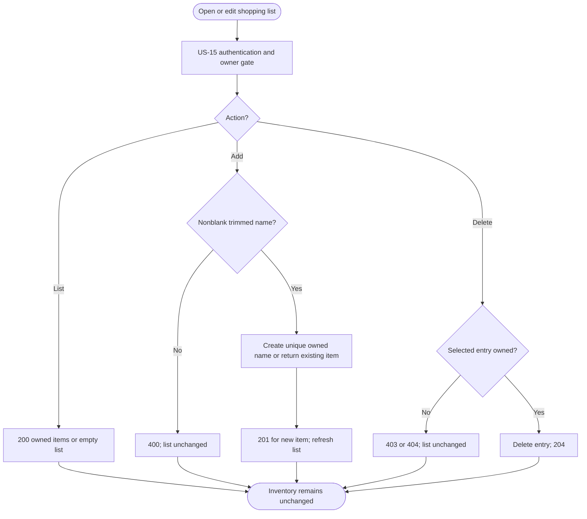

# US-11: Manage shopping items

Requirement: [US-11](../../requirements/US-11.md). Covers AC-1, AC-2, AC-3, AC-4. Each numbered criterion in that file is AC-1, AC-2, etc.

The 201 label applies to a new item only; an existing normalized name returns the existing row according to the draft dictionary. Deletion never checks off a purchase or adds food to the fridge. The baseline has add/list/delete, not a completion state.

Notation: activity-style flowchart; diamonds are decisions, arrows are control flow and rounded terminals are start/end. The US-15 gate terminates immediately on denied access; the continuation edge means authorization succeeded. System/storage failures return an error and roll back any transaction; they are not shown as successful exits.

[Editable Mermaid source](US-11.mmd)

