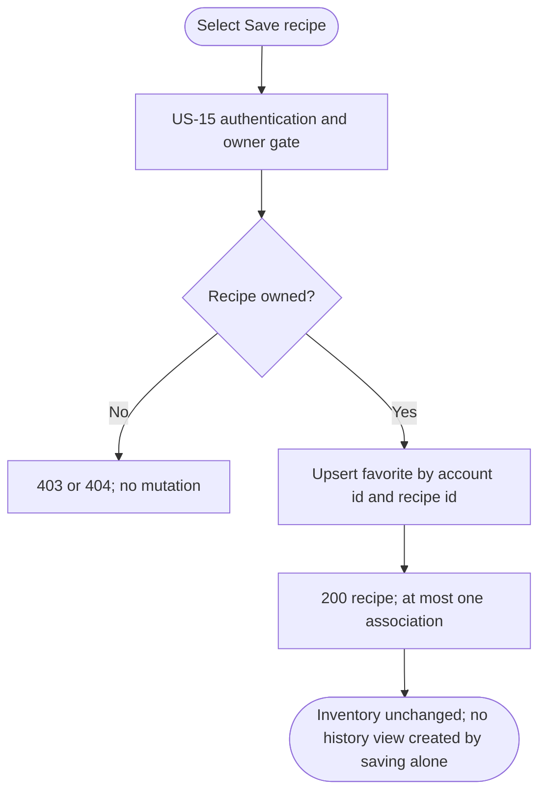

# US-12: Save a favorite

Requirement: [US-12](../../requirements/US-12.md). Covers AC-1, AC-2, AC-3. Each numbered criterion in that file is AC-1, AC-2, etc.

The unique association makes repeated and concurrent saves idempotent. If the user already opened details, a history record may already exist; favoriting alone does not add a new view.

Notation: activity-style flowchart; diamonds are decisions, arrows are control flow and rounded terminals are start/end. The US-15 gate terminates immediately on denied access; the continuation edge means authorization succeeded. System/storage failures return an error and roll back any transaction; they are not shown as successful exits.

[Editable Mermaid source](US-12.mmd)

