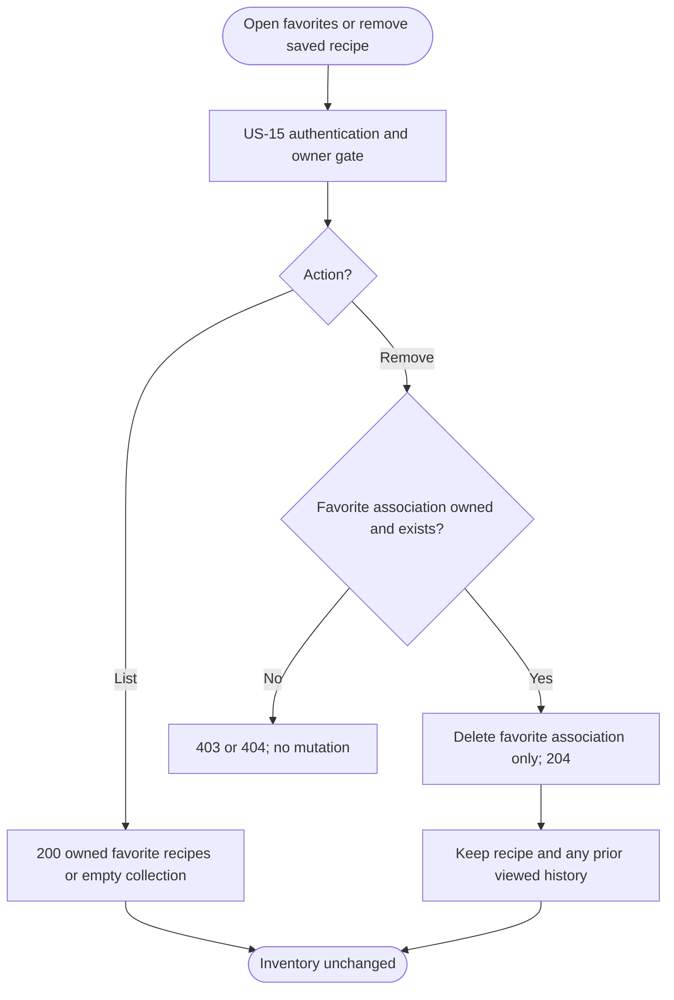

# US-13: List and remove favorites

Requirement: [US-13](../../requirements/US-13.md). Covers AC-1, AC-2, AC-3. Each numbered criterion in that file is AC-1, AC-2, etc.

The stored recipe remains available for a previously recorded history entry. Removing an association is not deleting the recipe object. A foreign recipe cannot be used to target another account's favorite.

Notation: activity-style flowchart; diamonds are decisions, arrows are control flow and rounded terminals are start/end. The US-15 gate terminates immediately on denied access; the continuation edge means authorization succeeded. System/storage failures return an error and roll back any transaction; they are not shown as successful exits.

[Editable Mermaid source](US-13.mmd)

