# US-13 DFD: list and remove favorites

Use-case DFD view. Requirements: [US-13](../../requirements/US-13.md). [Notation, store dictionary and hierarchy](README.md).

[Editable DFD data source](US-13.dfd.json). Rectangles are external entities, circles transform data, parallel lines are data stores and labeled arrows carry data. Arrows do not specify execution order or branch conditions. Numbering identifies the parent logical process; a per-story view may show a related process as a reference.

## Data exchanged

| Source | Data | Destination |
|---|---|---|
| Account holder | Favorite-list query or selected recipe id and token | 7.2 Read or remove favorite |
| D6 Favorite associations | Owned favorite associations | 7.2 Read or remove favorite |
| D4 Accepted recipes and children | Owned complete recipe records | 7.2 Read or remove favorite |
| 7.2 Read or remove favorite | Selected owned favorite-association deletion data | D6 Favorite associations |
| 7.2 Read or remove favorite | 200 recipe array/empty array; deletion 204; error | Account holder |

## Process constraints

1. All protected input is authenticated and owner-scoped under process 8.0 (US-15). Every referenced object ID, including recipeId in a request body, is checked against the verified account before a read/write. Client owner IDs are rejected or ignored.
2. Remove only the favorite association. The accepted recipe and any existing D7 viewed-history record remain available; no D4/D7 deletion flow exists.
3. No inventory write occurs: recipe, shopping, favorite and history actions never deduct or restock fridge ingredients.
