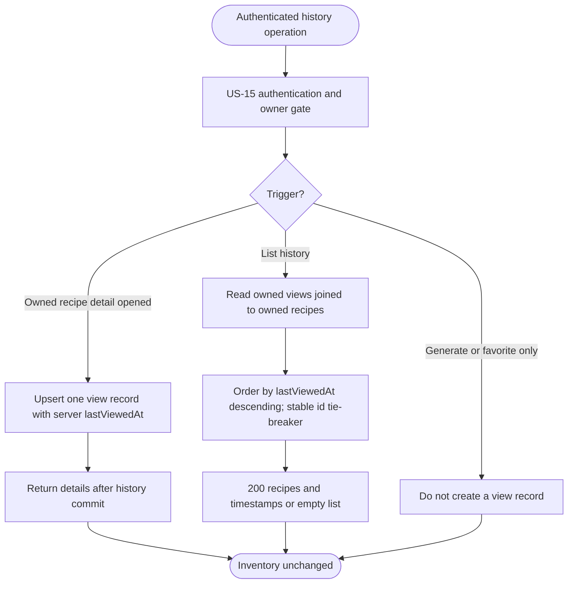

# US-14: Record and list recipe history

Requirement: [US-14](../../requirements/US-14.md). Covers AC-1, AC-2, AC-3, AC-4. Each numbered criterion in that file is AC-1, AC-2, etc.

Opening the same recipe updates the one view record and moves it to the newest position. Generation does not populate history. Stable sorting for equal timestamps is a draft analysis detail (A-04).

Notation: activity-style flowchart; diamonds are decisions, arrows are control flow and rounded terminals are start/end. The US-15 gate terminates immediately on denied access; the continuation edge means authorization succeeded. System/storage failures return an error and roll back any transaction; they are not shown as successful exits.

[Editable Mermaid source](US-14.mmd)

