# US-14 DFD: record and read viewed history

Use-case DFD view. Requirements: [US-14](../../requirements/US-14.md), [US-08](../../requirements/US-08.md). [Notation, store dictionary and hierarchy](README.md).

[Editable DFD data source](US-14.dfd.json). Rectangles are external entities, circles transform data, parallel lines are data stores and labeled arrows carry data. Arrows do not specify execution order or branch conditions. Numbering identifies the parent logical process; a per-story view may show a related process as a reference.

## Data exchanged

| Source | Data | Destination |
|---|---|---|
| Account holder | Detail query and access token | 5.1 Present recipe details (reference) |
| D4 Accepted recipes and children | Owned complete recipe | 5.1 Present recipe details (reference) |
| 5.1 Present recipe details (reference) | Opened owned recipe id and verified principal | 5.2 Maintain latest recipe views |
| 5.2 Maintain latest recipe views | Upserted owned view with server lastViewedAt | D7 Recipe views |
| D7 Recipe views | Owned most-recent view records | 5.2 Maintain latest recipe views |
| 5.2 Maintain latest recipe views | Committed view result | 5.1 Present recipe details (reference) |
| 5.1 Present recipe details (reference) | Complete recipe details or sanitized error | Account holder |
| Account holder | History query and access token | 5.2 Maintain latest recipe views |
| D4 Accepted recipes and children | Owned recipe records for history entries | 5.2 Maintain latest recipe views |
| 5.2 Maintain latest recipe views | Newest-first recipe/view-timestamp array or empty/error | Account holder |

## Process constraints

1. All protected input is authenticated and owner-scoped under process 8.0 (US-15). Every referenced object ID, including recipeId in a request body, is checked against the verified account before a read/write. Client owner IDs are rejected or ignored.
2. Only a successful detail-open event produces view data. Generation or favoriting alone sends no history write.
3. Use one account/recipe view record; reopening refreshes lastViewedAt, not an additional record. Order by most recent view; recipe-id tie breaking is an explicitly proposed deterministic detail.
4. No inventory write occurs: recipe, shopping, favorite and history actions never deduct or restock fridge ingredients.
