# US-15 DFD: authorize all personal references

Use-case DFD view. Requirements: [US-15](../../requirements/US-15.md). [Notation, store dictionary and hierarchy](README.md).

[Editable DFD data source](US-15.dfd.json). Rectangles are external entities, circles transform data, parallel lines are data stores and labeled arrows carry data. Arrows do not specify execution order or branch conditions. Numbering identifies the parent logical process; a per-story view may show a related process as a reference.

## Data exchanged

| Source | Data | Destination |
|---|---|---|
| Account holder | Personal request, JWT and referenced ids | 8.1 Verify token identity |
| D1 Accounts | Account identity data | 8.1 Verify token identity |
| 8.1 Verify token identity | Verified subject and operation/reference data | 8.2 Validate owner and references |
| 8.1 Verify token identity | 401 missing, invalid or expired token | Account holder |
| D0 Personal records (D2-D7) | Referenced object existence and owner data | 8.2 Validate owner and references |
| 8.2 Validate owner and references | Authorized request with derived account id | 8.3 Execute scoped operation |
| 8.2 Validate owner and references | Rejected owner or foreign-object 403/404 error | Account holder |
| D0 Personal records (D2-D7) | Only verified-account records | 8.3 Execute scoped operation |
| 8.3 Execute scoped operation | Validated owner-scoped feature mutations | D0 Personal records (D2-D7) |
| 8.3 Execute scoped operation | Feature data or sanitized error | Account holder |

## Process constraints

1. Validate token signature and expiry against server time, not merely JWT shape. Invalid/expired/missing token data produces 401 before feature access.
2. Derive the account from the verified subject. Client owner fields are ignored or rejected; they never select someone else's account.
3. Check every referenced object regardless of HTTP method or whether an id appears in a URL or request body. A collection mutation with recipeId is not exempt. A foreign object is denied with 403/404 and no write.
4. D0 is a compact view of D2-D7 for access analysis, not an extra table. Feature mutation flows expand into the feature DFDs and preserve their allowed-write restrictions. Registration/sign-in are the public exceptions.
