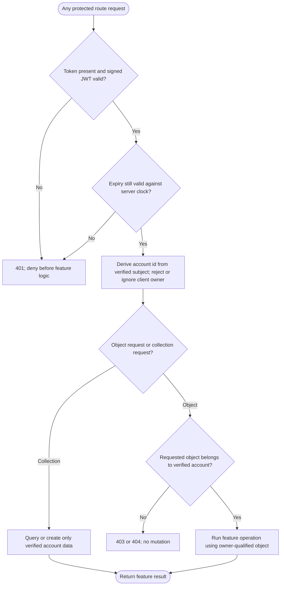

# US-15: Authorize personal data access

Requirement: [US-15](../../requirements/US-15.md). Covers AC-1, AC-2, AC-3. Each numbered criterion in that file is AC-1, AC-2, etc.

This gate is invoked before every US-03 through US-14 flow and every related read/write. Token validation includes signature and expiry, not only token shape. Registration/sign-in are public exceptions. Collection owner and object owner are both enforced; child recipe data inherits the owned parent. See [the authorization sequence](authorization-sequence.md).

Notation: activity-style flowchart; diamonds are decisions, arrows are control flow and rounded terminals are start/end. The US-15 gate terminates immediately on denied access; the continuation edge means authorization succeeded. System/storage failures return an error and roll back any transaction; they are not shown as successful exits.

[Editable Mermaid source](US-15.mmd)

