# Context DFD: Fridgely and its external data interfaces

System context DFD. Requirements: [US-01](../../requirements/US-01.md), [US-02](../../requirements/US-02.md), [US-03](../../requirements/US-03.md), [US-04](../../requirements/US-04.md), [US-05](../../requirements/US-05.md), [US-06](../../requirements/US-06.md), [US-07](../../requirements/US-07.md), [US-08](../../requirements/US-08.md), [US-09](../../requirements/US-09.md), [US-10](../../requirements/US-10.md), [US-11](../../requirements/US-11.md), [US-12](../../requirements/US-12.md), [US-13](../../requirements/US-13.md), [US-14](../../requirements/US-14.md), [US-15](../../requirements/US-15.md). [Notation, store dictionary and hierarchy](README.md).

[Editable DFD data source](context-dfd.dfd.json). Rectangles are external entities, circles transform data, parallel lines are data stores and labeled arrows carry data. Arrows do not specify execution order or branch conditions. Numbering identifies the parent logical process; a per-story view may show a related process as a reference.

## Data exchanged

| Source | Data | Destination |
|---|---|---|
| Visitor | Registration or sign-in credentials | 0 Fridgely |
| 0 Fridgely | Account or access result | Visitor |
| Account holder | Personal request and access token | 0 Fridgely |
| 0 Fridgely | Personal data or sanitized error | Account holder |
| 0 Fridgely | Ingredient names and preference lists | Recipe AI service |
| Recipe AI service | Recipe candidates or failure data | 0 Fridgely |

## Process constraints

1. The single process represents the whole Fridgely system. Persistent stores are internal and appear in lower-level diagrams.
2. AUTH includes registration/sign-in data and their results. PERSONAL includes preferences, inventory, recipes, shopping, favorites, history and errors.
3. AI input contains ingredient names and current saved dietary/allergen lists. AI output is candidate data or failure information, never automatically accepted stored recipes.
