# Level 1 DFD: logical processes and persistent data

First-level decomposition of context process 0. Requirements: [US-01](../../requirements/US-01.md), [US-02](../../requirements/US-02.md), [US-03](../../requirements/US-03.md), [US-04](../../requirements/US-04.md), [US-05](../../requirements/US-05.md), [US-06](../../requirements/US-06.md), [US-07](../../requirements/US-07.md), [US-08](../../requirements/US-08.md), [US-09](../../requirements/US-09.md), [US-10](../../requirements/US-10.md), [US-11](../../requirements/US-11.md), [US-12](../../requirements/US-12.md), [US-13](../../requirements/US-13.md), [US-14](../../requirements/US-14.md), [US-15](../../requirements/US-15.md). [Notation, store dictionary and hierarchy](README.md).

[Editable DFD data source](level-1-dfd.dfd.json). Rectangles are external entities, circles transform data, parallel lines are data stores and labeled arrows carry data. Arrows do not specify execution order or branch conditions. Numbering identifies the parent logical process; a per-story view may show a related process as a reference.

## Data exchanged

| Source | Data | Destination |
|---|---|---|
| Visitor | Credentials | 1.0 Manage identity |
| 1.0 Manage identity | Account or token result | Visitor |
| 1.0 Manage identity | New account data | D1 Accounts |
| D1 Accounts | Credential records | 1.0 Manage identity |
| Account holder | Request and token | 8.0 Authorize access |
| D1 Accounts | Identity data | 8.0 Authorize access |
| 8.0 Authorize access | Access error | Account holder |
| 8.0 Authorize access | Principal + preference request | 2.0 Store preferences |
| 2.0 Store preferences | Preference result/error | Account holder |
| 8.0 Authorize access | Principal + fridge request | 3.0 Maintain fridge |
| 3.0 Maintain fridge | Fridge result/error | Account holder |
| 8.0 Authorize access | Principal + generation request | 4.0 Generate recipes |
| 4.0 Generate recipes | Generation result/error | Account holder |
| 8.0 Authorize access | Principal + detail or history request | 5.0 Details and history |
| 5.0 Details and history | Detail or history result/error | Account holder |
| 8.0 Authorize access | Principal + shopping request | 6.0 Maintain shopping |
| 6.0 Maintain shopping | Shopping result/error | Account holder |
| 8.0 Authorize access | Principal + favorite request | 7.0 Maintain favorites |
| 7.0 Maintain favorites | Favorite result/error | Account holder |
| D2 Preferences | Saved lists | 2.0 Store preferences |
| 2.0 Store preferences | Replacement lists | D2 Preferences |
| D3 Inventory | Inventory records | 3.0 Maintain fridge |
| 3.0 Maintain fridge | Manual changes | D3 Inventory |
| D4 Recipes | Committed recipes | 4.0 Generate recipes |
| 4.0 Generate recipes | Valid recipe batch | D4 Recipes |
| D7 Views | View records | 5.0 Details and history |
| 5.0 Details and history | View timestamps | D7 Views |
| D5 Shopping | Shopping records | 6.0 Maintain shopping |
| 6.0 Maintain shopping | Unique item changes | D5 Shopping |
| D6 Favorites | Favorite records | 7.0 Maintain favorites |
| 7.0 Maintain favorites | Association changes | D6 Favorites |
| D2 Preferences | Preference lists | 4.0 Generate recipes |
| D3 Inventory | Inventory names | 4.0 Generate recipes |
| 4.0 Generate recipes | Ingredients and preferences | Recipe AI service |
| Recipe AI service | Candidates or failure | 4.0 Generate recipes |
| D4 Recipes | Complete recipes | 5.0 Details and history |
| D4 Recipes | Recipe names | 6.0 Maintain shopping |
| D3 Inventory | Inventory names | 6.0 Maintain shopping |
| D4 Recipes | Complete recipes | 7.0 Maintain favorites |
| D3 Inventory | Reference owners | 8.0 Authorize access |
| D4 Recipes | Reference owners | 8.0 Authorize access |
| D5 Shopping | Reference owners | 8.0 Authorize access |
| D6 Favorites | Reference owners | 8.0 Authorize access |
| D7 Views | Reference owners | 8.0 Authorize access |

## Process constraints

1. This decomposes process 0. Parent external interface groups balance with the context DFD; PERSONAL_OUT is refined into access errors and feature-specific data/error results.
2. Eight logical processes are responsibilities, not a selected service or deployment architecture. The per-story diagrams detail the data transformations and allowed writes.
3. D2 maps to both preference relations; D4 maps to recipe, ingredient and step relations. D1 and D3-D7 map to their corresponding E-R entities.
4. All protected input is authenticated and owner-scoped under process 8.0 (US-15). Every referenced object ID, including recipeId in a request body, is checked against the verified account before a read/write. Client owner IDs are rejected or ignored.
5. Process 8.0 and each feature enforce owner-qualified access. Referenced IDs in path and body are both covered. The stores supply existence/ownership data, not client-chosen ownership.
