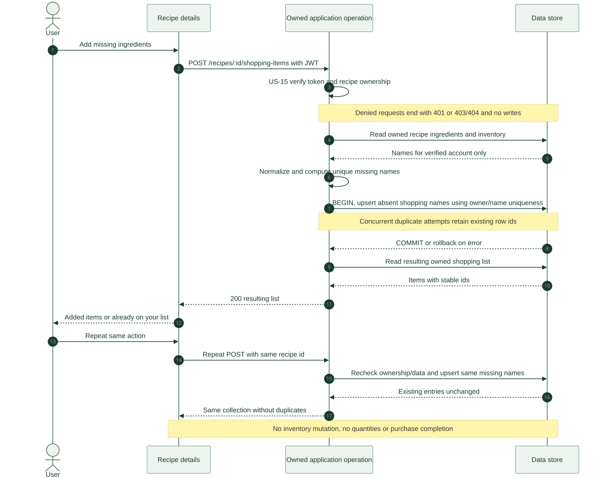
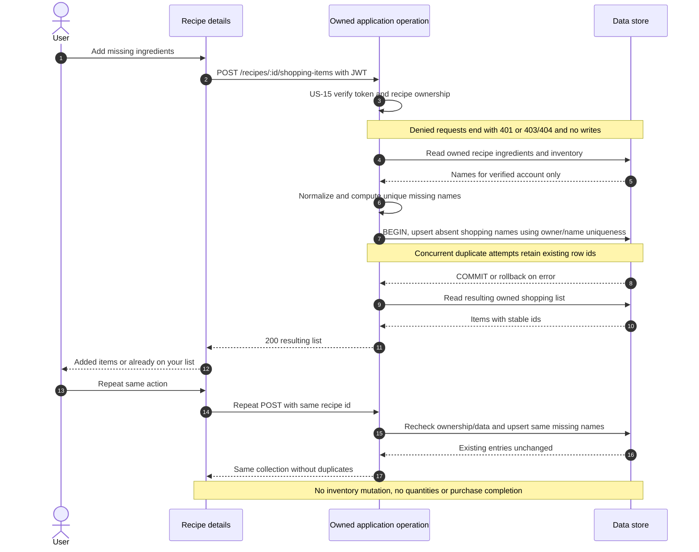

# Add missing names without duplicates

Expands US-10 and its interaction with US-11. Every repeat reauthenticates and recomputes from current owned data. Failed writes roll back and return an error, not a partial success.

[Editable Mermaid source](shopping-sequence.mmd)

