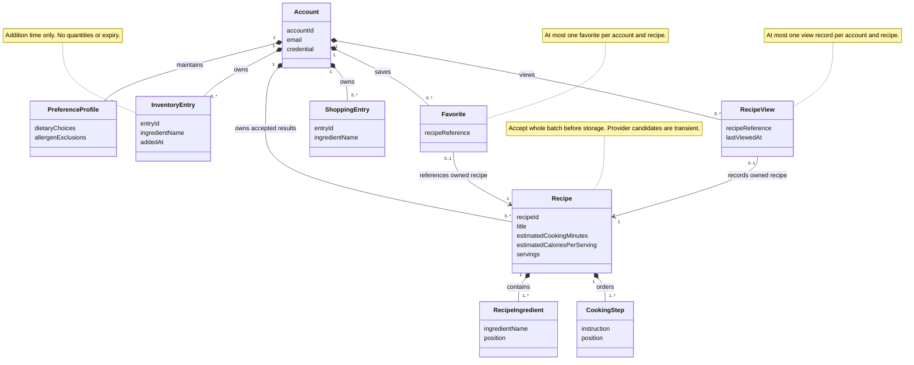

# Conceptual domain model

Baseline: [approved user stories](../../requirements/README.md) and [decisions D-02 to D-09](../../requirements/decisions.md). This conceptual model describes business concepts, not ORM classes or a selected database. Multiplicities next to each end apply to one instance at the other end.

An account owns exactly one logical preference profile; both lists initially are empty, even if no preference rows exist. Inventory and shopping entries represent names only. An accepted recipe belongs to exactly one account and has at least one ingredient and ordered cooking step. A recipe has zero or one favorite and zero or one most-recent view record because it has one owner. Foreign accounts cannot reference it. Generation alone creates no RecipeView; opening details creates or updates it. Removing a favorite removes that association only.

Credentials are a domain concern; persistence stores only a salted password hash. The recipe provider, browser and JWT are boundary collaborators, not owned business entities. Recipe estimates and supplied ingredients require visible labels and user review. See [invariants and persistence choices](data-dictionary.md) for precise constraints.

[Editable Mermaid source](domain-model.mmd)

