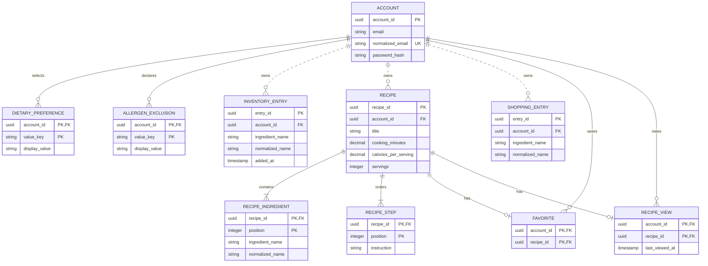

# Draft logical E-R model

This preliminary relational view remains required and useful if MongoDB is selected. It does not select PostgreSQL or require an ORM. UUID denotes an opaque application-assigned identifier; its physical representation is a design decision. PK, FK and UK label primary, foreign and unique keys. See [the data dictionary](data-dictionary.md) for composite uniqueness and owner constraints that the diagram alone cannot express.

Solid relationships are identifying: the child primary key includes the parent key. Dashed relationships are non-identifying: inventory, recipe and shopping entries have independent identifiers. Line style does not specify database cascade policy. Every child has exactly one parent; each recipe must have one or more ingredient and step rows after a successful transaction. No row represents an expiry date, ingredient quantity, persistent JWT session or provider secret. PreferenceProfile in the domain maps to the two optional preference collections below.

[Editable Mermaid source](er-model.mmd)

