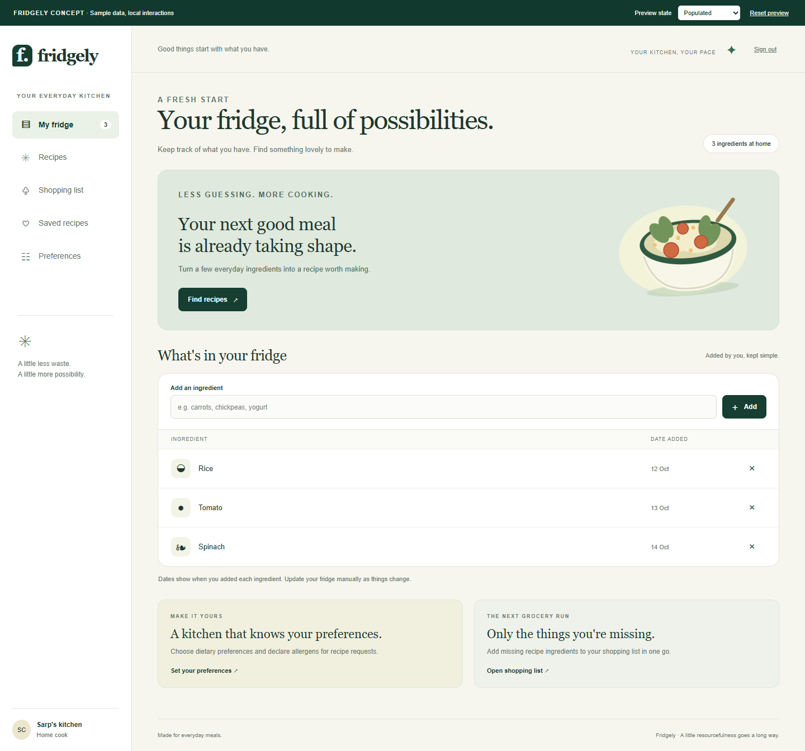
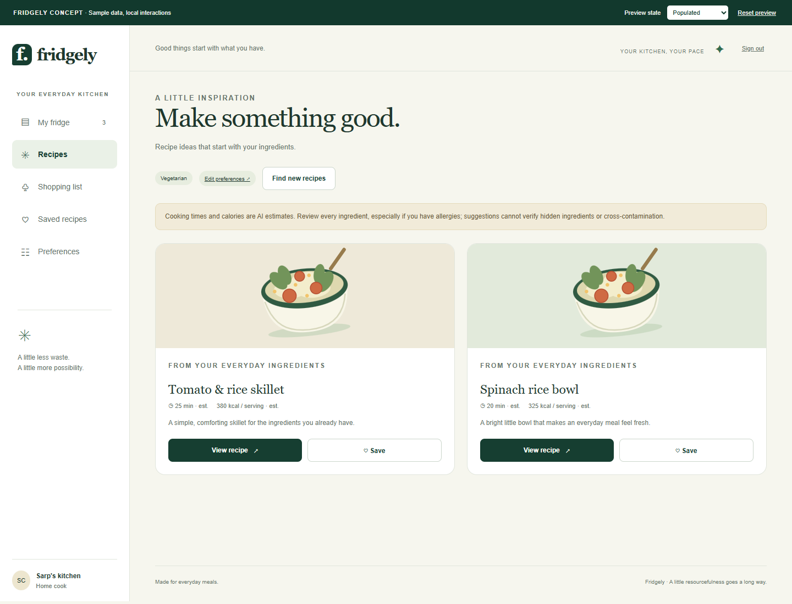
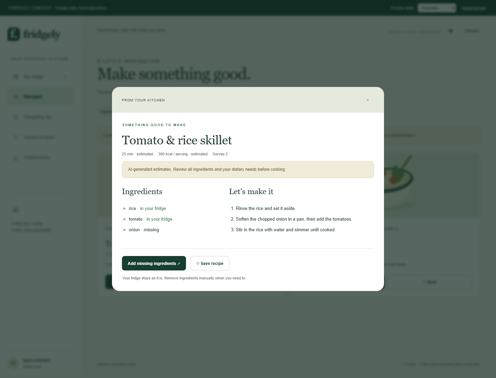
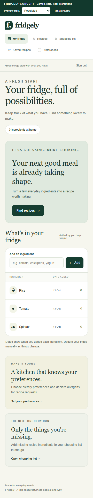

# Preliminary frontend mockups

Open [the interactive concept](index.html) locally. It is self-contained HTML, CSS and JavaScript with local sample data, original inline SVG food illustration and system fonts. No installation, CDN, backend or AI credentials are required. GitHub shows the source file; download the folder or use a local checkout to interact with it.

The first design pass establishes a quiet kitchen-oriented interface with forest green, warm neutrals, readable recipe instructions and explicit addition dates. Desktop navigation becomes a wrapping navigation row on narrow screens. The same content model supports the three target widths from NFR-05. These are reviewable mockups, not a selected production frontend framework.

## Screen and state coverage

| Screen | Interactions represented | Requirements |
|---|---|---|
| Sign in / create account | Labeled email/password fields, blank/invalid input, navigation to the sample kitchen, expired-session message | US-01, US-02, US-15 presentation |
| My fridge | Add/delete names, immutable displayed addition dates, populated and empty states, recipe entry point | US-04, US-05, US-06 |
| Preferences | Dietary/allergen selections, clear selections then save, guidance about reviewing ingredients | US-03, US-07, US-08 |
| Recipes | Sample suggestions, loading, empty-inventory block, service error and retry; prior results retained | US-07, US-08, US-09 |
| Recipe details | Ingredients, ordered steps, estimated minutes, estimated calories per serving, serving count; add missing, save | US-08, US-10, US-12 |
| Shopping list | Name add/list/remove, duplicate prevention and empty state; no purchase-completion state | US-10, US-11 |
| Saved recipes | Favorites and recently viewed tabs, remove favorite without losing viewed history, empty collections | US-12, US-13, US-14 |

## Review instructions

Start with the sample fridge. Find recipes, open a recipe, add missing ingredients twice and save it. The shopping list should have no duplicates; deleting shopping items does not change the fridge. Remove the favorite and switch to Recently viewed: the viewed recipe remains. Opening a recipe updates its most recent view. Saving a card without opening it does not create a view.

Use the separate preview toolbar to inspect empty, loading, service-error and expired-session states, then Reset preview to restore sample data. A service retry uses the current sample fridge; an empty fridge remains blocked. Use Preferences to clear all choices and save empty lists. All sample state resets on reload. No password is stored or sent; only enter dummy values.

## Boundaries and unfinished work

The preview toolbar is a reviewer aid, not a proposed customer feature. Sample recipe suggestions are fixed fixtures and do not implement AI filtering, calorie estimation, the HTTP acceptance contract, authentication, multi-user isolation or persistence. Sign-in/create-account buttons only demonstrate navigation after basic field validation; they cannot verify credentials, prevent real duplicate accounts or issue JWTs. Session expiry is a selectable display state. Real tokens and owner checks belong to the reviewed backend models.

The preference option list is illustrative and does not settle D-11's allergen vocabulary or imply an exhaustive clinical taxonomy. No safety or medical guarantee is implied. Adding/removing sample names is local only. The UI's simulated delay is not a measurement of the 30-second provider limit. Dialog history and shopping logic illustrate the intended interaction, not proof of the production implementation.

Before production design is accepted: confirm wording/visual direction with the team; select the final preference taxonomy; design duplicate-account, wrong-password, denied-object, malformed-output and allergen-conflict feedback; define real loading cancellation; connect the chosen frontend to the backend; and run a full accessibility audit. Keyboard, viewport and local interaction checks here establish a starting point only.

See [the design brief](design-brief.md), [validation record](../validation.md) and [criterion traceability](../traceability.md).
