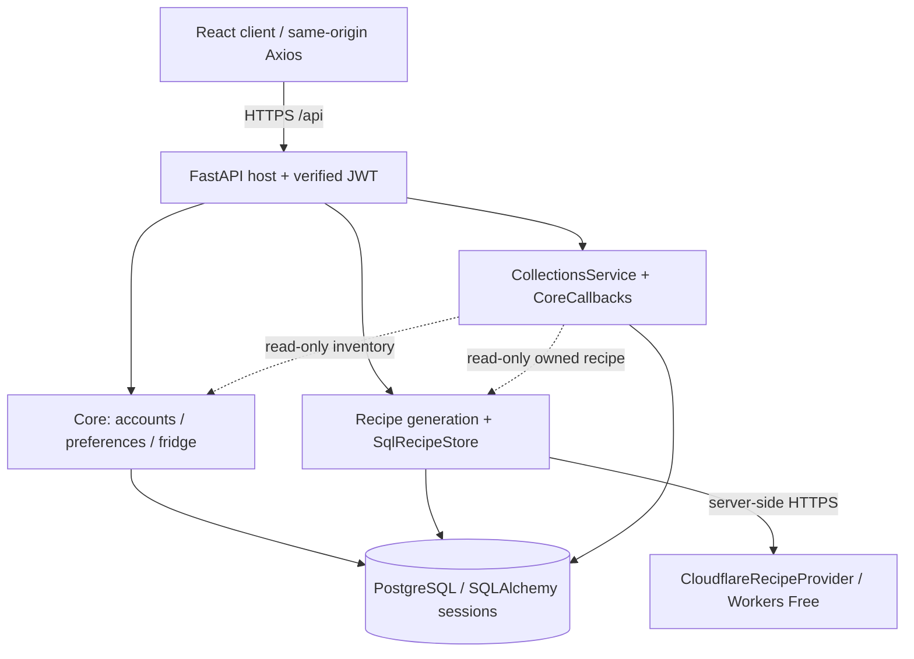

# Fridgely design and implementation alignment

Inspected source: `c67165407e71ee584a8fcfdf2d0a925fd42a2a42`.
Historical design: `02a7d3b6cbf1a97c0392df77481ab2b19bb3f0cf`.

## 1. Design and implementation alignment

Fridgely / CMPE 331 / Berfin Gökgöz / 25 November 2026

This addendum describes the implementation inspected at c67165407e71ee584a8fcfdf2d0a925fd42a2a42. It accompanies the 14 November design report and its 13 UML models. The original PDF and model files remain historical design evidence; they are not a statement that Express or the 501 acceptance stub is deployed.

The implemented product keeps the approved scope: accounts, saved dietary/allergen lists, manual fridge entries, recipe generation and detail, shopping, favorites and viewed history. Generation and shopping do not consume fridge inventory. The original report's 15-story mapping remains the design traceability baseline.

This is a documentation follow-up in the existing design_work branch. It preserves the current main application and teammates' module interfaces. It does not choose a replacement course submission, update the approved a59556e ZIP/PDF pair, apply a migration or change a live service.

| 14 November proposal | Implementation at the inspected source |
| --- | --- |
| Express HTTP application | Python 3.12 FastAPI host composes core, recipe and collection routers; one Docker runtime serves the compiled React client. |
| React / Tailwind / Axios | React/Vite and Axios are retained; frontend/src/styles.css supplies the delivered styling. The browser calls same-origin /api. |
| OpenAI as the initial provider | The deployed configuration selects Cloudflare Workers Free through the server-side provider adapter. OpenAI support exists but is not activated for this deployment. |
| Node-only verification / 501 baseline | Node acceptance tests drive the real FastAPI host. Python, browser, PostgreSQL, container, security, load, coverage and Sonar evidence are recorded by integrated CI. |
| In-memory token, proposed 30-minute lifetime | The delivered client uses sessionStorage; the host's default token lifetime is 3,600 seconds. These are explicit implementation deviations from the proposal. |

Source links below are pinned to the inspected application revision. A successful design render is not runtime verification.

## 2. Composition and teammate interfaces

The host constructs one SQLAlchemy session factory and Authentication dependency. The recipe router receives verified identity plus the core inventory and preference readers. The collections router receives CoreCallbacks, which exposes only owned persisted recipes and fridge names in the caller's session.

Production serves frontend/dist and API documentation assets from the same origin. The approved root API remains available; the React client uses its /api alias. There is no separately deployed frontend API gateway or Express server.



| Boundary / implementation | Responsibility |
| --- | --- |
| fridgely_app/host.py and core.py | Compose routers, static assets and errors; register/sign in; read/replace preferences; manually add/list/delete inventory; database health. |
| fridgely_recipes/api.py and service.py | Inject RecipeProvider and SQL store; read an owned input snapshot, bound generation, validate the entire batch and commit persisted results. |
| fridgely_collections/ports.py | AccountPrincipal is produced by verified JWT authentication. OwnedRecipe and CoreData/CoreCallbacks preserve Sarp and Ayşe's integration contracts. |
| fridgely_collections/service.py | Resolve owned detail/history/favorites and missing shopping ingredients using the shared session; return success after transaction commit. |
| frontend/src/api.js and useKitchen.js | One Axios API client and authenticated state connect screens to the host; provider secrets and account identity are never supplied by a browser owner field. |

The original UML interface names are conceptual design contracts. They should not be mistaken for one-to-one Python class declarations.

## 3. Persistence, identity and transactions

Production uses the existing managed PostgreSQL database. SQLite is supported for isolated local work. Alembic revisions 0001_owned_schema and 0002_ordered_preferences define ordered schema evolution. scripts/cloud/start.sh explicitly runs migration setup before starting one Uvicorn worker; importing the application does not create the production schema.

FastAPI/Pydantic validates request shape and constraints at the HTTP boundary. Shared ingredient/identifier helpers and feature services validate domain values; the recipe service validates provider output. This is the implemented allocation, whereas the historical UML revision places request validation uniformly in conceptual services.

| Data / security rule | Current implementation and evidence target |
| --- | --- |
| Accounts and JWT ownership | Argon2 password hashes; HS256 token verification checks signature, issuer, audience, finite expiry and an existing subject account. Repositories scope personal queries to that verified subject. |
| Preferences and manual inventory | Two ordered relational child lists preserve original strings, repeats and positions. Preference reads use one statement; PostgreSQL generation reads use REPEATABLE READ. Inventory stores server UTC addition time and is changed only through manual routes. |
| Recipes, children and collections | A validated batch is inserted atomically with ordered ingredients/steps. Deployed migration constraints protect owned recipe associations; shopping uniqueness is per owner and normalized ingredient. |
| Commit before HTTP success | Core write contexts exit before returning. SqlRecipeStore.insert_batch commits before generate returns. CollectionsService._transaction commits before returning and retries bounded serialization/deadlock/locking failures. |
| Secrets and browser state | Database URL, JWT key and provider credentials stay in Render environment settings. The session token is in browser sessionStorage, so it survives reload in that tab; this differs from the original in-memory proposal. |

Inspect: backend/src/fridgely_app/{models,security,database,core}.py; backend/src/fridgely_app/migrations/versions; backend/src/fridgely_recipes/storage.py; backend/src/fridgely_collections/{models,repository,service}.py.

## 4. Generation, detail and shopping flow

The browser sends POST /api/recipes/generate without a client-chosen owner or ingredient snapshot. The server resolves the authenticated owner's fridge names and both saved preference lists, closes the input session, then calls the configured provider. No database transaction remains open during model inference.

RecipeProvider.generate accepts GenerationInput. The Cloudflare adapter sends only recipe inputs and server-side authorization to a fixed model. The generation service has a maximum provider timeout of 28 seconds and maps unavailable/timeout failures to a sanitized retryable 503. Missing provider configuration selects UnavailableProvider rather than a production fixture.

```mermaid
sequenceDiagram
  participant UI as React client
  participant API as FastAPI + verified JWT
  participant Gen as RecipeGenerationService
  participant Store as SQL input / recipe store
  participant AI as CloudflareRecipeProvider
  UI->>API: POST /api/recipes/generate
  API->>Gen: generate(verified owner)
  Gen->>Store: Read fridge and preferences snapshot
  Store-->>Gen: GenerationInput; input session closed
  Gen->>AI: generate(input), max 28 seconds
  AI-->>Gen: Untrusted candidates
  Gen->>Gen: Validate complete batch and declared exclusions
  Gen->>Store: insert_batch(owner, recipes)
  Store-->>Gen: Transaction committed
  Gen-->>API: Persisted recipes
  API-->>UI: HTTP 200
  Note over Gen,Store: No inventory deduction
```

| Step / outcome | Persisted behavior |
| --- | --- |
| Validate before save | Empty fridge: 400. Malformed provider batch: 502. A declared ingredient matching a saved exclusion: 422. A valid complete batch is stored before HTTP 200. |
| Open recipe detail | Owned lookup produces the persisted recipe and records a view in the collection transaction. History orders recorded views; merely generating a recipe does not record a view. |
| Add missing ingredients | Read the owned recipe and current fridge; normalize names; add distinct missing names to shopping under the owner/name unique key. Repeating the action creates no duplicate rows. |
| Inventory remains manual | Generation, opening detail, favorites and shopping do not delete or decrement inventory. The deployed-source acceptance check compared inventory before and after the flow. |
| Limits of validation | Declared ingredient names are checked; the implementation does not implement a comprehensive allergen synonym taxonomy. Cooking time and calories remain estimates. A successful live request is not a load or reliability guarantee. |

Inspect: backend/src/fridgely_recipes/{api,service,provider,storage}.py and backend/src/fridgely_collections/{service,repository}.py.

## 5. Review response and verification provenance

Yeşim's 14 November changes-requested review remains an actual review decision. The existing follow-up commits address its four technical points in the historical design models. This addendum does not mark that review approved or dismissed. A new independent review is required on the updated PR head.

| Review finding | Existing correction retained in PR #6 |
| --- | --- |
| Provided / required interfaces | dd6ed230: component providers use dashed realization triangles; required interfaces use explicit use dependencies. 02a7d3b6 synchronizes the report's notation explanation. |
| Validation layer inconsistency | 5262eb00: historical sequences consistently delegate request value validation to conceptual services. Page 3 of this addendum separately records FastAPI/Pydantic's actual boundary. |
| Undefined types / SQL adapters | 2b0bb0b0: class models define DTO/result contracts, primitive aliases in legends and SQL adapter realizations; viewed detail and created/deleted outcomes carry sequence requirements. |
| Repository lifelines / transaction order | 5262eb00: separate participant lifelines represent repositories/services; explicit commit completes before HTTP success. Historical PlantUML and rendered figures are retained byte-for-byte. |

Application CI: run 45545808271 on c671654 completed all seven jobs successfully. Those CI checks include controlled-provider, PostgreSQL, browser and container verification; they must not be described as real Cloudflare inference.

Deployed-source evidence: dep-dc3682c9v7es73fm9mg0 served c671654. On 25 November 2026, 07:30:49-07:31:02 Europe/Istanbul, 33 HTTP/behavior checks passed with one real Workers Free generation request (HTTP 200, 5.716 seconds), persisted recipe detail/history, exactly three missing shopping items, repeat idempotence and unchanged inventory.

The live run did not add a browser, load or two-account test. Its sanitized JSON is included here with SHA-256 8777c0cb7b0847a6d1b374a94fa5fbc456a2a1a64c7d69d0512d21f86a4c4595. It was collected before this addendum; no new model request is claimed.

Remaining external decisions: independent design re-review and reviewed integration; Sarp's main protection/version release; the product owner's final course source/artifact choice and actual Learn receipt. The approved a59556e course pair remains separate.

[Application source](https://github.com/SarpCizer/CMPE331-Project/tree/c67165407e71ee584a8fcfdf2d0a925fd42a2a42)

[Application CI](https://github.com/SarpCizer/CMPE331-Project/actions/runs/45545808271)

[Original review](https://github.com/SarpCizer/CMPE331-Project/pull/6#pullrequestreview-5902760198)

[Cloud completion proof](https://github.com/SarpCizer/CMPE331-Project/issues/40#issuecomment-7152962475)

[Course delivery tracking](https://github.com/SarpCizer/CMPE331-Project/issues/48)

## Reproduction

From the repository root, install the existing `scripts/tests/requirements-report.txt` dependencies and run `python scripts/design/export_alignment.py`.
The editable Mermaid diagrams accompany the simplified PDF diagrams. Both exports read `docs/design/current/alignment.json`.
See `source-manifest.json` for the original model blob identities and the inspected application file identities. No model request is made during export.
