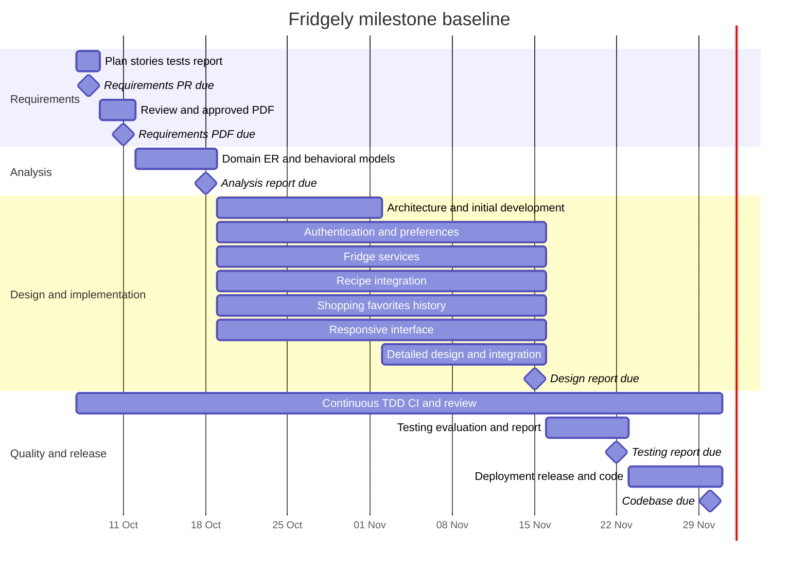

# Gantt schedule

Dates are an inclusive calendar baseline in Europe/Istanbul. The chart uses duration notation so two days starting 7 October cover 7–8 October. The charter milestone on 2 October precedes this plan. Presentation remains TBA.

| Phase | Start | Finish | Milestone |
|---|---|---|---|
| Requirements package | 2026-10-07 | 2026-10-08 | 8 Oct PR |
| Review and PDF | 2026-10-09 | 2026-10-11 | 11 Oct requirements PDF |
| Requirements analysis | 2026-10-12 | 2026-10-18 | 18 Oct analysis report |
| Architecture and initial development | 2026-10-19 | 2026-11-01 | Internal architecture baseline |
| Detailed design and integration | 2026-11-02 | 2026-11-15 | 15 Nov design report |
| Testing evaluation | 2026-11-16 | 2026-11-22 | 22 Nov testing report |
| Release and code submission | 2026-11-23 | 2026-11-30 | 30 Nov codebase |

Risks: reviewer availability; undecided backend/database/provider; provider quota or malformed output; unclear allergen vocabulary; integration delays. Mitigations: submit the PR by 8 October, resolve decisions with the product owner, use deterministic provider fixtures, normalize ingredient names consistently, and run tests throughout development. Cloud service selection and any paid account setup require a separate team decision.
