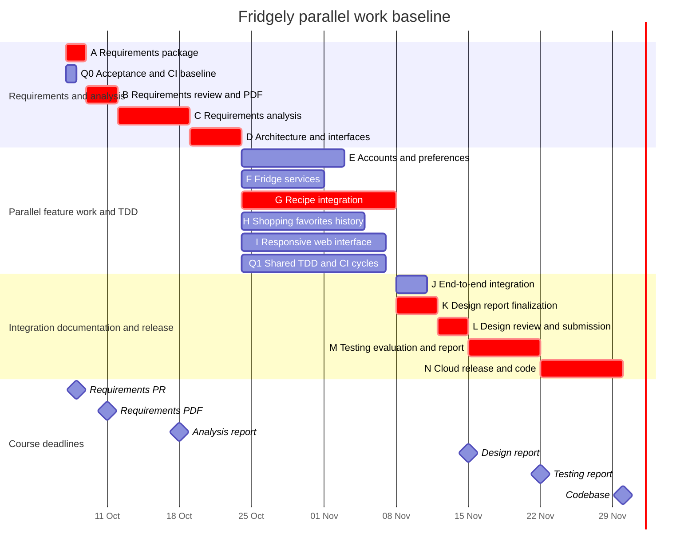
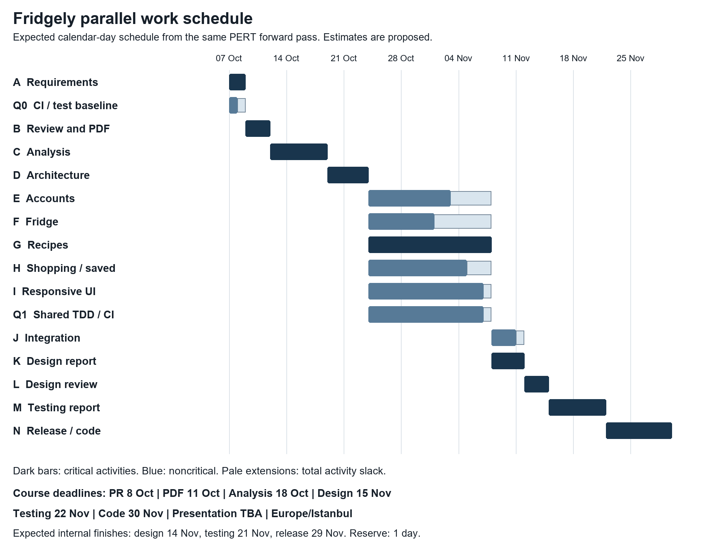

# Gantt schedule

This schedule uses the expected-duration forward pass from the [PERT network](pert.md). Start/finish dates below are inclusive calendar dates in Europe/Istanbul. Day 0 is 7 October 2026. Internal finish dates can precede the fixed course deadlines; estimates are not actual progress records. The charter's 2 October milestone precedes this baseline, and presentation remains TBA.

| ID | Activity | Start | Finish | Owner |
|---|---|---|---|---|
| A | Requirements package | 2026-10-07 | 2026-10-08 | İrem + all members |
| Q0 | Acceptance and CI baseline | 2026-10-07 | 2026-10-07 | Kerem + story owners |
| B | Requirements review and PDF | 2026-10-09 | 2026-10-11 | Team contact + all members |
| C | Requirements analysis | 2026-10-12 | 2026-10-18 | Berfin + İrem + all members |
| D | Architecture and interfaces | 2026-10-19 | 2026-10-23 | Berfin + Ayşe + Kerem |
| E | Accounts and preferences | 2026-10-24 | 2026-11-02 | Berfin |
| F | Fridge services | 2026-10-24 | 2026-10-31 | İrem |
| G | Recipe integration | 2026-10-24 | 2026-11-07 | Ayşe |
| H | Shopping favorites history | 2026-10-24 | 2026-11-04 | Sarp |
| I | Responsive web interface | 2026-10-24 | 2026-11-06 | Mustafa |
| Q1 | Shared TDD and CI cycles | 2026-10-24 | 2026-11-06 | Kerem + feature owners |
| J | End-to-end integration | 2026-11-08 | 2026-11-10 | Kerem + all members |
| K | Design report finalization | 2026-11-08 | 2026-11-11 | All members |
| L | Design review and submission | 2026-11-12 | 2026-11-14 | All members |
| M | Testing evaluation and report | 2026-11-15 | 2026-11-21 | Kerem + all members |
| N | Cloud release and code | 2026-11-22 | 2026-11-29 | Kerem + all members |

Parallel streams E-I and Q1 all start after architecture D. Integration J and design-report finalization K join the feature streams and run in parallel, before design review L. The critical recipe stream has no activity slack; delayed recipe integration delays the project unless other estimates or dependencies change. Q0, Q1 and J explicitly represent shared TDD/integration support; developer tests and regression remain part of every implementation, evaluation and release task.

Fixed course dates: requirements PR 8 October; PDF 11 October; analysis 18 October; design 15 November; testing 22 November; code 30 November. Expected internal design completion is 14 November, testing 21 November, release 29 November. The one-day finish reserve is not counted as an activity's slack. Risks remain reviewer availability, technology/provider decisions, malformed AI output and integration delays.
