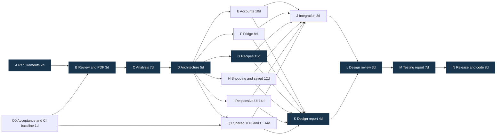
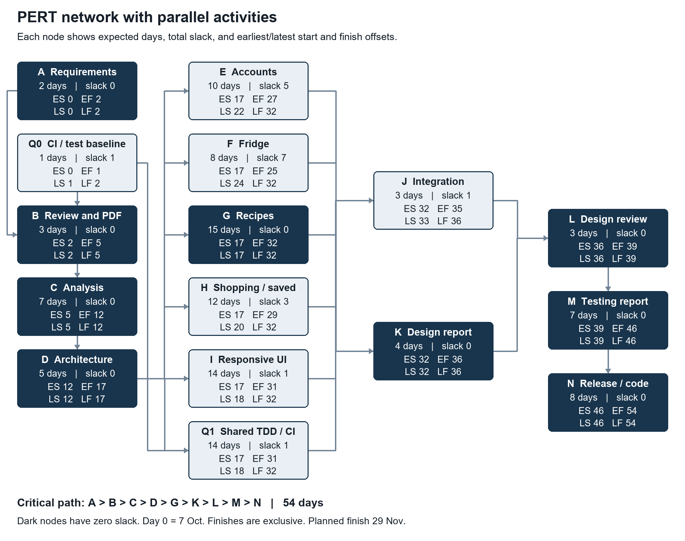

# PERT and critical path plan

This proposed baseline begins 7 October 2026. Expected durations use `(O + 4M + P) / 6`; variance is `((P - O) / 6)^2`. O, M and P are optimistic, most likely and pessimistic calendar-day estimates, not person-days. These remain team estimates, not actual completion records.

The network now separates parallel feature work (WBS 3.2-3.6), shared TDD/CI work (4.1), integration and design-report preparation (3.7). An arrow is a finish-to-start readiness dependency. UI and service teams work against the agreed interfaces in parallel; end-to-end integration joins their completed outputs. Design-report finalization also waits for feature evidence and proceeds alongside integration, before a final design review joins both outputs.

## Activities and estimates

| ID | Activity | WBS | Predecessors | O | M | P | Expected | Variance |
|---|---|---|---|---:|---:|---:|---:|---:|
| A | Requirements package | 1.1 / 1.2 | Start | 1 | 2 | 3 | 2 | 0.11 |
| Q0 | Acceptance and CI baseline | 4.1a | Start | 1 | 1 | 1 | 1 | 0.00 |
| B | Requirements review and PDF | 1.3 | A, Q0 | 1 | 3 | 5 | 3 | 0.44 |
| C | Requirements analysis | 2.1 / 2.2 | B | 5 | 7 | 9 | 7 | 0.44 |
| D | Architecture and interfaces | 3.1 | C | 3 | 5 | 7 | 5 | 0.44 |
| E | Accounts and preferences | 3.2 | D | 8 | 10 | 12 | 10 | 0.44 |
| F | Fridge services | 3.3 | D | 6 | 8 | 10 | 8 | 0.44 |
| G | Recipe integration | 3.4 | D | 12 | 15 | 18 | 15 | 1.00 |
| H | Shopping favorites history | 3.5 | D | 10 | 12 | 14 | 12 | 0.44 |
| I | Responsive web interface | 3.6 | D | 12 | 14 | 16 | 14 | 0.44 |
| Q1 | Shared TDD and CI cycles | 4.1b | D, Q0 | 12 | 14 | 16 | 14 | 0.44 |
| J | End-to-end integration | 4.1c | E, F, G, H, I, Q1 | 2 | 3 | 4 | 3 | 0.11 |
| K | Design report finalization | 3.7a | E, F, G, H, I, Q1 | 3 | 4 | 5 | 4 | 0.11 |
| L | Design review and submission | 3.7b | J, K | 2 | 3 | 4 | 3 | 0.11 |
| M | Testing evaluation and report | 4.2 | L | 5 | 7 | 9 | 7 | 0.44 |
| N | Cloud release and code | 5.1 | M | 6 | 8 | 10 | 8 | 0.44 |

## Dependency network

## Forward and backward pass

Use day 0 at the beginning of 7 October. ES/LS are start offsets; EF/LF are exclusive finish offsets. Thus an activity with ES 0 and EF 2 occupies 7-8 October. The forward pass uses `ES = max(predecessor EF)` and `EF = ES + duration`. The backward pass is anchored at the earliest project finish, day 54: `LF = min(successor LS)` and `LS = LF - duration`. Total slack is `LS - ES`, equal to `LF - EF`.

| ID | Days | ES | EF | LS | LF | Slack |
|---|---:|---:|---:|---:|---:|---:|
| A | 2 | 0 | 2 | 0 | 2 | 0 |
| Q0 | 1 | 0 | 1 | 1 | 2 | 1 |
| B | 3 | 2 | 5 | 2 | 5 | 0 |
| C | 7 | 5 | 12 | 5 | 12 | 0 |
| D | 5 | 12 | 17 | 12 | 17 | 0 |
| E | 10 | 17 | 27 | 22 | 32 | 5 |
| F | 8 | 17 | 25 | 24 | 32 | 7 |
| G | 15 | 17 | 32 | 17 | 32 | 0 |
| H | 12 | 17 | 29 | 20 | 32 | 3 |
| I | 14 | 17 | 31 | 18 | 32 | 1 |
| Q1 | 14 | 17 | 31 | 18 | 32 | 1 |
| J | 3 | 32 | 35 | 33 | 36 | 1 |
| K | 4 | 32 | 36 | 32 | 36 | 0 |
| L | 3 | 36 | 39 | 36 | 39 | 0 |
| M | 7 | 39 | 46 | 39 | 46 | 0 |
| N | 8 | 46 | 54 | 46 | 54 | 0 |

The critical path is **A -> B -> C -> D -> G -> K -> L -> M -> N**, with expected duration **54 calendar days**. Zero-slack activities lie on that path. Accounts E have 5 days of slack, fridge F 7 days, shopping/saved H 3 days, UI I and shared TDD Q1 each 1 day, integration J 1 day and initial test baseline Q0 1 day. For example, E finishes at day 27 and can finish as late as day 32 without delaying the feature join. The path sum is `2 + 3 + 7 + 5 + 15 + 4 + 3 + 7 + 8 = 54`.

This finishes on **29 November**, one day before the **30 November** code deadline. That one-day course-deadline reserve is separate from the activity slack above. Design is internally ready on 14 November (course deadline 15 November); testing on 21 November (course deadline 22 November). The [Gantt](gantt.md) uses these same ES/EF dates and shows course deadlines separately.

## TDD, ownership and constraints

Q0 establishes the red acceptance baseline and CI configuration. Q1 is the shared daily test/CI support stream during parallel feature development. Each feature activity E-I includes its own developer TDD and review within its estimate; Q1 is additional shared QA work, not a gate that stops developers from testing after its final scheduled day. J covers cross-feature regression/integration. TDD and regression also continue within M and N. WBS 4.1 is therefore decomposed into concrete activities rather than represented as a 55-day task that would dominate every path by definition.

Owners and calendar windows are in the [WBS](wbs.md). The network assumes the six charter team roles can work concurrently; it is not a resource-leveled or person-day plan. The design document may be drafted earlier, but K estimates its finalization using completed feature evidence. Presentation is excluded from the dated network because its date is TBA. Review B is an external dependency; its three-day allowance must be updated if feedback or approval arrives later. No approval date, completion probability or actual progress is asserted by this baseline.

The [activity data](activities.json) is shared by the diagrams and [CPM calculator](../../scripts/project_plan.py). Run `python scripts/project_plan.py` to reproduce the table and critical path.
