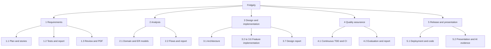

# Work breakdown structure

Work packages are grouped by deliverable. Owners are proposed from the charter, not new role assignments.

| ID | Work package | Planned window | Owner | Exit artifact |
|---|---|---|---|---|
| 1.1 | Requirements plan and definitions | 7–8 Oct | İrem + all members | WBS, PERT, Gantt, user stories, traceability |
| 1.2 | Requirements tests and report | 7–8 Oct | Kerem + story owners | Failing functional tests, NFR cases, Markdown report |
| 1.3 | Requirements review and PDF | 9–11 Oct | Team contact + all members | Reviewer responses, approved report and PDF |
| 2.1 | Domain and data models | 12–18 Oct | Berfin + İrem | Domain model and ER diagram |
| 2.2 | Behavioral models and analysis report | 12–18 Oct | Sarp + Ayşe + Mustafa | Meaningful flows, analysis report |
| 3.1 | Architecture and interfaces | 19-23 Oct | Berfin + Ayşe + Kerem | Architecture, API contracts, deployment design |
| 3.2 | Authentication and preferences | 24 Oct-2 Nov | Berfin | US-01–03 and US-15 implementation |
| 3.3 | Fridge services | 24-31 Oct | İrem | US-04–06 implementation |
| 3.4 | Recipe integration | 24 Oct-7 Nov | Ayşe | US-07–09, deterministic provider tests |
| 3.5 | Shopping, favorites and history | 24 Oct-4 Nov | Sarp | US-10–14 implementation |
| 3.6 | Responsive web interface | 24 Oct-6 Nov | Mustafa | All user flows, responsive UI |
| 3.7 | Design models and report | 8-14 Nov | All members | Class/sequence models, design decisions and report |
| 4.1 | Continuous TDD and integration | 7 Oct–30 Nov | Kerem + all members | Tests, CI/CD, traceability, reviewed PRs |
| 4.2 | Testing evaluation and report | 15-21 Nov | Kerem + all members | Unit coverage, performance/security results, SonarQube and penetration findings |
| 5.1 | Cloud deployment and release | 22-29 Nov | Kerem + all members | Release validation, deployment scripts, source-only code archive |
| 5.2 | Presentation and AI workflow evidence | Throughout; presentation TBA | All members | Use-case walkthrough, AI workflow, human-caught AI errors |

## Schedule cross-reference

WBS 4.1 includes Q0 (7 October, acceptance/CI baseline), Q1 (24 October-6 November, shared feature TDD/CI cycles), and J (8-10 November, end-to-end integration). Developer TDD and regression also continue inside feature, testing and release activities. WBS 3.7 is split into K (8-11 November, report finalization) and L (12-14 November, final design review). These are planning estimates. See [PERT](pert.md) for dependencies and slack and [Gantt](gantt.md) for all dates.
