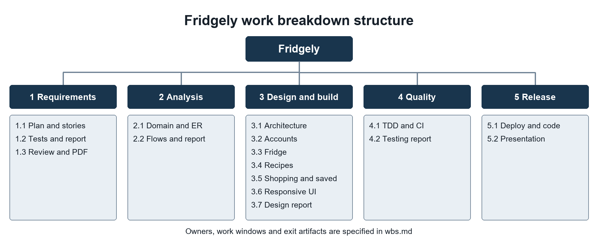
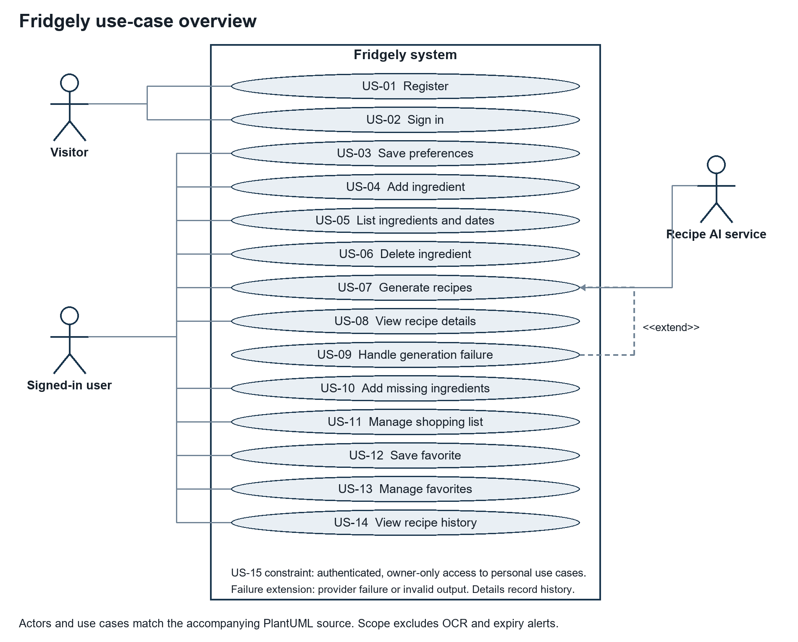

# Fridgely requirements specification

CMPE 331 Software Engineering Concepts | Requirements definition | Revised 11 October 2026

Fridgely is a responsive web assistant for managing food ingredients at home and finding AI-generated recipes. This report defines the initial release, its user stories, acceptance tests and project plan. The baseline contains 15 functional stories and nine non-functional requirements. Detailed behavior and quality targets are proposed for review; implementation has not begun in the repository.

Repository: [SarpCizer/CMPE331-Project](https://github.com/SarpCizer/CMPE331-Project). Requirements branch: `requirements_work`.

## 1 Sources and submission

The [project charter](CHARTER.MD) defines the purpose, scope, roles, alternatives and milestones. The supplied detailed syllabus requires WBS, PERT and Gantt plans; requirements definitions; at least one functional test per specification; non-functional test cases; and this report. The course announcement requires a requirements PR with Yeşim as reviewer by 8 October 2026, followed by an approved PDF on learn.bilgi by 11 October 2026. The charter specifies 23:59 for the PDF milestone. All dates use Europe/Istanbul. The PDF must embed diagrams rather than relying only on image links.

## 2 Users and scope

Primary users are university students, busy young professionals and people with dietary restrictions who want to manage ingredients and discover practical meals. The product owner is İrem Demircan. The six-member team is Berfin Gökgöz (full-stack/database), İrem Demircan (fridge backend), Sarp Çizer (shopping/favorites/history backend), Ayşe Döne (AI integration), Mustafa Safa Bayrak (frontend), and Kerem Sönmez (DevOps/QA). A designated project manager/team contact still needs to be identified.

The initial release includes email/password registration and sign-in without email verification, saved dietary/allergen preferences, manual ingredient addition/deletion/listing with addition dates, recipe generation and details, missing-ingredient shopping lists, favorites and previously viewed recipe history. Receipt OCR, expiration tracking or spoilage alerts, automatic ingredient deduction and native mobile applications are outside this release. Responsive web access remains in scope.

## 3 Project plan

The [WBS](plans/wbs.md) groups the work into requirements, analysis, design/implementation, quality assurance and release/presentation. Development ownership follows the charter roles. Continuous TDD, integration and review accompany feature development; formal testing evaluation is scheduled before the testing report.

The [PERT plan](plans/pert.md) separates accounts E, fridge F, recipes G, shopping/saved H, responsive UI I and shared TDD Q1 into parallel activities after architecture D. Integration J and design-report finalization K join those streams and run in parallel before final design review L. Q0 establishes the acceptance/CI baseline; Q1 and J represent shared TDD and integration work, while developer TDD and regression also remain within each feature, testing and release estimate. [Activity estimates and dependencies](plans/activities.json) are shared with the diagram exporter and [CPM calculator](../scripts/project_plan.py).

Expected duration is `(O + 4M + P) / 6`. The computed critical path is **A -> B -> C -> D -> G -> K -> L -> M -> N**, totaling **54 calendar days**, with planned completion on **29 November**, one day before the code deadline. Noncritical work has positive slack, including five days for accounts E and seven days for fridge F. Estimates and dates are proposed, not actual progress records.

Offsets below use day 0 at the start of 7 October; finish offsets are exclusive. Forward pass: ES is the maximum predecessor EF; EF is ES plus duration. Backward pass is anchored at expected project finish 54: LF is the minimum successor LS; LS is LF minus duration. Slack is LS minus ES. The separate one-day deadline reserve is not included in these activity slack values.

| ID | Days | ES | EF | LS | LF | Slack |
|---|---:|---:|---:|---:|---:|---:|
| A | 2 | 0 | 2 | 0 | 2 | 0 |
| Q0 | 1 | 0 | 1 | 1 | 2 | 1 |
| B | 3 | 2 | 5 | 2 | 5 | 0 |
| C | 7 | 5 | 12 | 5 | 12 | 0 |
| D | 5 | 12 | 17 | 12 | 17 | 0 |
| E | 10 | 17 | 27 | 22 | 32 | 5 |
| F | 8 | 17 | 25 | 24 | 32 | 7 |
| G | 15 | 17 | 32 | 17 | 32 | 0 |
| H | 12 | 17 | 29 | 20 | 32 | 3 |
| I | 14 | 17 | 31 | 18 | 32 | 1 |
| Q1 | 14 | 17 | 31 | 18 | 32 | 1 |
| J | 3 | 32 | 35 | 33 | 36 | 1 |
| K | 4 | 32 | 36 | 32 | 36 | 0 |
| L | 3 | 36 | 39 | 36 | 39 | 0 |
| M | 7 | 39 | 46 | 39 | 46 | 0 |
| N | 8 | 46 | 54 | 46 | 54 | 0 |

The [Gantt schedule](plans/gantt.md) aligns work with the charter milestones. Requirements work is due as a PR on 8 October; review/PDF occupies 9–11 October. Analysis is due 18 October; design 15 November; testing 22 November; code 30 November. Internal expected finishes are 14 November for design, 21 November for testing and 29 November for code. Presentation is TBA. Milestones are fixed course dates; internal windows and ownership are proposed.

## 4 Functional requirements

The [use-case overview](requirements/use-case-diagram.md) identifies the visitor, signed-in user and external AI service and maps the scope to the story IDs. US-09 is a conditional generation-failure extension; US-15 is the owner-only access constraint on personal use cases. [PlantUML source](requirements/use-cases.puml) is included.

User stories and acceptance criteria follow. Every criterion uses explicit Given/When/Then wording. Every story is Must have for this baseline. The proposed behavior adds validation and edge cases needed for testing without claiming that the charter already specifies those details.

### US-01 Register an account

As a new user, I want to register with email and password so that I can keep a personal fridge and recipe collection.

Owner: Berfin Gökgöz. [Dedicated definition](requirements/US-01.md).

1. Given an unused valid email and an acceptable password, When I register, Then an account is created without an email verification step.
2. Given an existing email, When I attempt another registration, Then the system rejects it and does not create a duplicate account.
3. Given a malformed email or a password below the proposed eight-character minimum, When I register, Then validation fails without saving an account.

### US-02 Sign in

As a registered user, I want to sign in with my email and password so that I can access my personal data.

Owner: Berfin Gökgöz. [Dedicated definition](requirements/US-02.md).

1. Given a registered account, When I submit correct credentials, Then the system issues a JWT and grants access to protected features.
2. Given incorrect credentials, When I sign in, Then access is denied and no access token is returned.

### US-03 Save dietary and allergen preferences

As a user, I want to save dietary and allergen preferences so that recipe requests reflect my choices.

Owner: Berfin Gökgöz. [Dedicated definition](requirements/US-03.md).

1. Given an authenticated account, When I save dietary and allergen lists, Then reading my profile returns those lists.
2. Given saved preferences, When I replace them with empty lists, Then the old preferences are cleared.
3. Given saved dietary and allergen preferences, When I request recipes, Then the latest saved preferences are supplied to the recipe provider.

### US-04 Add fridge ingredients manually

As a user, I want to add an ingredient manually so that Fridgely knows which food I have at home.

Owner: İrem Demircan. [Dedicated definition](requirements/US-04.md).

1. Given an authenticated account, When I add a nonblank ingredient name, Then the system stores a new ingredient with an ID and server-generated added-at timestamp.
2. Given a blank ingredient name, When I submit it, Then validation fails and the inventory is unchanged.
3. Given an ingredient is being added, When the server records its added-at timestamp, Then that value represents the addition time and is not treated as an expiry date.

### US-05 List ingredients and their addition dates

As a user, I want to list my fridge ingredients and see their addition dates so that I can review what I have.

Owner: İrem Demircan. [Dedicated definition](requirements/US-05.md).

1. Given stored ingredients, When I open my fridge, Then every stored ingredient appears with its name and addition date.
2. Given an empty fridge, When I open it, Then an empty list and a clear empty state are shown.
3. Given a stored ingredient and its original addition timestamp, When I list my fridge repeatedly, Then the original timestamp remains unchanged.

### US-06 Delete fridge ingredients manually

As a user, I want to remove an ingredient manually so that my fridge reflects what remains at home.

Owner: İrem Demircan. [Dedicated definition](requirements/US-06.md).

1. Given an ingredient belonging to me, When I delete it, Then it no longer appears in my fridge.
2. Given a nonexistent ingredient, When I attempt deletion, Then a not-found response is returned and other ingredients remain unchanged.
3. Given ingredients in my fridge, When I open a recipe or save it as a favorite, Then no ingredient is deducted from my inventory.

### US-07 Generate recipes using the fridge and preferences

As a user, I want recipe suggestions based on my ingredients and saved preferences so that I can find a suitable meal.

Owner: Ayşe Döne. [Dedicated definition](requirements/US-07.md).

1. Given a nonempty fridge and saved preferences, When I request recipes, Then the provider receives my ingredient names, dietary choices, and allergen exclusions.
2. Given a provider response containing a declared excluded allergen, When results are processed, Then that recipe is withheld.
3. Given an empty fridge, When I request recipes, Then the system prompts me to add ingredients and does not call the provider.
4. Given ingredients in my fridge, When I generate recipes, Then the inventory remains unchanged.

### US-08 View recipe details

As a user, I want ingredients, ordered cooking steps, cooking time, and calorie information so that I can decide whether to prepare a recipe.

Owner: Ayşe Döne and Mustafa Safa Bayrak. [Dedicated definition](requirements/US-08.md).

1. Given an accepted recipe, When I open its details, Then I see its title, ingredients, ordered steps, cooking time in minutes, and estimated calories per serving with the serving count.
2. Given malformed provider output with missing steps, invalid time, or missing calories, When results are processed, Then it is rejected rather than shown as a complete recipe.
3. Given a recipe with AI-generated cooking times and calories, When I view its details, Then those values are labeled as estimates and the supplied ingredient list is displayed for review.

### US-09 Handle recipe service failures

As a user, I want a clear message When recipe generation fails so that I can retry without losing my data.

Owner: Ayşe Döne. [Dedicated definition](requirements/US-09.md).

1. Given a provider timeout or service error, When I request recipes, Then the system displays a retryable error and does not store partial results.
2. Given existing inventory, preferences, shopping items, favorites and history, When recipe generation fails, Then all five collections remain unchanged.
3. Given invalid provider output, When the system processes the result, Then it reports a generation error without exposing provider credentials or raw diagnostics.

### US-10 Add missing recipe ingredients in one action

As a user, I want to add a recipe’s missing ingredients to my shopping list in one action so that I know what to buy.

Owner: Sarp Çizer. [Dedicated definition](requirements/US-10.md).

1. Given a recipe and my fridge, When I select Add missing ingredients, Then ingredients absent from my fridge are added to my shopping list.
2. Given fridge or shopping-item names that differ only by case or surrounding whitespace, When I add missing recipe ingredients, Then names are matched after trimming and case normalization and existing shopping items are not duplicated.
3. Given missing ingredients from a recipe have already been added, When I repeat the action for that recipe, Then the shopping list contains the same entries without duplicates.
4. Given a recipe and ingredients in my fridge, When I add its missing ingredients to shopping, Then my fridge remains unchanged.

### US-11 Manage the shopping list

As a user, I want to list, manually add, and remove shopping items so that I can keep my shopping list current.

Owner: Sarp Çizer. [Dedicated definition](requirements/US-11.md).

1. Given an authenticated account, When I add a nonblank item and list shopping items, Then it appears in my list.
2. Given an existing shopping item, When I remove it, Then it no longer appears.
3. Given a blank item name, When I submit it, Then validation fails without changing the list.
4. Given an item in my shopping list, When I remove it, Then it is not automatically added to my fridge.

### US-12 Save a favorite recipe

As a user, I want to save a recipe as a favorite so that I can find it again.

Owner: Sarp Çizer. [Dedicated definition](requirements/US-12.md).

1. Given an existing recipe, When I save it as a favorite, Then it appears in my favorites with its details available.
2. Given a recipe is already in my favorites, When I save it again, Then there is only one favorite for that recipe.
3. Given ingredients in my fridge, When I save a recipe as a favorite, Then the fridge inventory remains unchanged.

### US-13 List and remove favorite recipes

As a user, I want to browse and remove favorites so that my saved collection stays useful.

Owner: Sarp Çizer. [Dedicated definition](requirements/US-13.md).

1. Given saved favorites, When I open favorites, Then the system returns those recipes.
2. Given a favorite, When I remove it, Then it no longer appears in favorites but remains available in my viewed history if previously viewed.
3. Given no favorites, When I open favorites, Then an empty collection is returned.

### US-14 Keep previously viewed recipes

As a user, I want to see recipes I previously opened so that I can revisit them.

Owner: Sarp Çizer. [Dedicated definition](requirements/US-14.md).

1. Given a generated recipe, When I open its details, Then it is recorded in my history with a last-viewed timestamp.
2. Given a generated recipe has not been opened, When I list my history, Then that recipe does not appear in history.
3. Given a recipe already has a history entry, When I reopen it, Then its last-viewed timestamp is updated without creating a duplicate and history is ordered by most recent view.
4. Given ingredients in my fridge, When I view a recipe, Then the inventory remains unchanged.

### US-15 Protect personal data

As a user, I want my fridge, preferences, shopping list, favorites, and history to be accessible only to me so that other users cannot read or modify them.

Owner: Berfin Gökgöz. [Dedicated definition](requirements/US-15.md).

1. Given no token or an invalid/expired token, When a protected endpoint is requested, Then access is denied.
2. Given two accounts, When one account attempts to read or change an object owned by the other, Then access is denied or the object is reported not found.
3. Given an authenticated account, When it requests a personal list or recipe generation and supplies another user ID, Then only the authenticated account’s data is used and the supplied owner ID is ignored or rejected.

## 5 Non-functional requirements

The following criteria have dedicated [definitions](requirements/non-functional.md) and [test cases](../tests/non-functional/cases.md). They are proposed targets, not measured results.

### NFR-01 Authorization

All personal resource routes require a valid JWT; cross-user read/write attempts return 403 or 404 and leave data unchanged.

Verification: Automated US-15 cases; later expand to every method and resource.

### NFR-02 Credential and secret handling

Passwords are stored as salted password hashes; tokens, passwords and provider keys are absent from client-visible errors and logs.

Verification: Inspect account storage and captured logs after sign-in and provider failures; search for seeded secrets.

### NFR-03 Response time

For 50 concurrent signed-in users and 100 inventory entries each, non-AI API requests have p95 response time ≤ 500 ms and error rate < 1% over five minutes in the agreed deployment environment.

Verification: Run load scenarios for fridge, profile, shopping and favorites; record environment, p95 and error rate. Proposed target.

### NFR-04 AI timeout handling

AI generation times out within 30 seconds and returns a retryable error without partial state changes.

Verification: Use a controllable stalled provider and measure elapsed time; verify unchanged collections. Proposed target.

### NFR-05 Responsive usability

At viewport widths 360, 768 and 1440 px, all core actions remain visible and operable without horizontal page scrolling.

Verification: Browser checks on sign-in, fridge, recipes, shopping, favorites and history, including empty/error states.

### NFR-06 Accessible core controls

Core flows work with keyboard-only input; form controls have labels, focus is visible, and validation errors are associated with fields.

Verification: Manual keyboard walkthrough plus an accessibility audit; preserve evidence of corrections.

### NFR-07 Persistence

Committed accounts, preferences, inventory, shopping items, favorites and history survive an application restart and remain isolated by user.

Verification: Create data for two users, restart app against the same database, sign in again, compare all resources.

### NFR-08 AI output integrity

Accepted recipes include ingredients, ordered steps, positive cooking minutes, nonnegative estimated calories per serving and a positive serving count; declared allergen conflicts are rejected.

Verification: Controlled fixture tests for missing fields, invalid numbers and declared excluded allergens; manual review of displayed estimate labels.

### NFR-09 Deployment and reproducibility

The web app and backend run on a cloud service; CI runs acceptance tests and later deployment checks; secrets are supplied outside source control.

Verification: Deploy to agreed staging service, run core smoke flows over HTTPS, inspect pipeline and repository for credentials.

## 6 Test strategy and traceability

The [functional suite](../tests/functional/requirements.test.mjs) uses deterministic recipe fixtures, an injected clock and fresh application contexts. Setup requests and state reads now assert their response status; snapshots are detached to avoid aliasing. Recipe routes use application-assigned IDs. Malformed AI outputs violate one field at a time, and an expiry case advances the injected clock past a real issued token’s expiry. Database verification of rejected batches remains an integration task once persistence exists. It checks registration, preferences, addition dates, recipe provider inputs, rejected AI output, shopping deduplication, favorites, viewed history and user isolation. It does not call a live AI service or require credentials.

The [application scaffold](../src/acceptance-app.mjs) currently returns 501 for every request. Tests assert real expected behavior and are deliberately red. Feature-dependent cases initially fail at registration until prerequisite functionality is implemented. The in-process boundary must later connect to the actual application's routing/business layer or HTTP server; implementing a parallel fake application just to pass tests is not acceptable. Browser presentation, storage restarts, deployment and performance require the additional quality cases.

Run `npm test` or `node --test tests/functional/requirements.test.mjs` with Node 20 or newer. The initial verification result is recorded in [test status](../tests/STATUS.md). Node is a test-tooling choice; Express/FastAPI and database choices remain open.

| Story | Executable test IDs |
|---|---|
| [US-01](requirements/US-01.md) | US-01-T01, US-01-T02 |
| [US-02](requirements/US-02.md) | US-02-T01 |
| [US-03](requirements/US-03.md) | US-03-T01 |
| [US-04](requirements/US-04.md) | US-04-T01, US-04-T02 |
| [US-05](requirements/US-05.md) | US-05-T01 |
| [US-06](requirements/US-06.md) | US-06-T01 |
| [US-07](requirements/US-07.md) | US-07-T01, US-07-T02, US-07-T03 |
| [US-08](requirements/US-08.md) | US-08-T01, US-08-T02, US-08-T03, US-08-T04, US-08-T05, US-08-T06, US-08-T07 |
| [US-09](requirements/US-09.md) | US-09-T01 |
| [US-10](requirements/US-10.md) | US-10-T01 |
| [US-11](requirements/US-11.md) | US-11-T01 |
| [US-12](requirements/US-12.md) | US-12-T01 |
| [US-13](requirements/US-13.md) | US-13-T01 |
| [US-14](requirements/US-14.md) | US-14-T01 |
| [US-15](requirements/US-15.md) | US-15-T01, US-15-T02, US-15-T03 |

Each of the 15 stories maps to at least one of the 27 executable functional cases. [Full traceability](requirements/traceability.md) also identifies manual UI verification. Mapping proves test coverage exists; it does not claim that every acceptance criterion is automated or that any feature is complete.

## 7 Assumptions and decisions

The [decision register](requirements/decisions.md) identifies proposed password policy, timestamps, normalization, calorie units, AI failure rules, shopping deduplication, history semantics and numeric quality targets. The [HTTP contract](requirements/api-contract.md) makes the tests reproducible but requires team/reviewer agreement before production implementation.

The backend, database, frontend framework, runtime AI provider, cloud host and allergen/diet taxonomy are not finalized by the charter. Development assistant examples in the charter are not mandatory vendor commitments. AI output is validated for required fields and declared ingredient conflicts; the product cannot establish hidden ingredients or cross-contamination. The interface must label time and calorie values as estimates and allow users to review ingredients.

## 8 Risks and review completion

Reviewer availability may threaten the 11 October PDF submission because approval must precede submission. Undecided technology choices can delay integration. Provider failures and inconsistent ingredient naming can produce unreliable suggestions or shopping lists. Mitigations are early PR submission, explicit decisions with the product owner, deterministic provider tests, consistent normalization and continuous TDD.

Review readiness means plans, stories, executable red tests, non-functional cases and this Markdown report are committed on the requirements branch. Submission readiness additionally requires Yeşim's review, resolution of comments, PR approval and regeneration of the PDF from the final approved report with all images embedded. Upload the final PDF to learn.bilgi only after approval. This draft PDF is a review copy and is not evidence of approval or submission.
