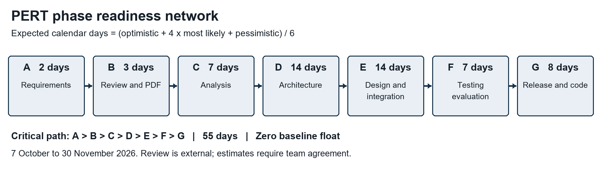
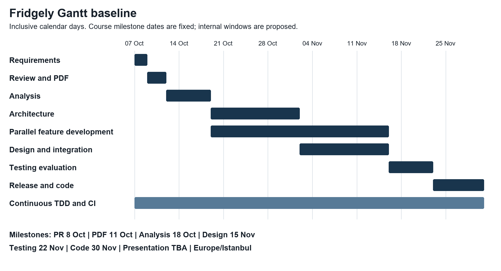

# Fridgely requirements specification

CMPE 331 Software Engineering Concepts | Requirements definition | 7 October 2026

Fridgely is a responsive web assistant for managing food ingredients at home and finding AI-generated recipes. This report defines the initial release, its user stories, acceptance tests and project plan. The baseline contains 15 functional stories and nine non-functional requirements. Detailed behavior and quality targets are proposed for review; implementation has not begun in the repository.

Repository: [SarpCizer/CMPE331-Project](https://github.com/SarpCizer/CMPE331-Project). Requirements branch: `requirements_work`.

## 1 Sources and submission

The [project charter](CHARTER.MD) defines the purpose, scope, roles, alternatives and milestones. The supplied detailed syllabus requires WBS, PERT and Gantt plans; requirements definitions; at least one functional test per specification; non-functional test cases; and this report. The course announcement requires a requirements PR with Yeşim as reviewer by 8 October 2026, followed by an approved PDF on learn.bilgi by 11 October 2026. The charter specifies 23:59 for the PDF milestone. All dates use Europe/Istanbul. The PDF must embed diagrams rather than relying only on image links.

## 2 Users and scope

Primary users are university students, busy young professionals and people with dietary restrictions who want to manage ingredients and discover practical meals. The product owner is İrem Demircan. The six-member team is Berfin Gökgöz (full-stack/database), İrem Demircan (fridge backend), Sarp Çizer (shopping/favorites/history backend), Ayşe Döne (AI integration), Mustafa Safa Bayrak (frontend), and Kerem Sönmez (DevOps/QA). A designated project manager/team contact still needs to be identified.

The initial release includes email/password registration and sign-in without email verification, saved dietary/allergen preferences, manual ingredient addition/deletion/listing with addition dates, recipe generation and details, missing-ingredient shopping lists, favorites and previously viewed recipe history. Receipt OCR, expiration tracking or spoilage alerts, automatic ingredient deduction and native mobile applications are outside this release. Responsive web access remains in scope.

## 3 Project plan

The [WBS](plans/wbs.md) groups the work into requirements, analysis, design/implementation, quality assurance and release/presentation. Development ownership follows the charter roles. Continuous TDD, integration and review accompany feature development; formal testing evaluation is scheduled before the testing report.

The [PERT plan](plans/pert.md) uses proposed optimistic, most likely and pessimistic calendar-day estimates. Expected duration is `(O + 4M + P) / 6`. The phase readiness network has critical path A–B–C–D–E–F–G, totaling 55 calendar days from 7 October through 30 November, with zero phase-level float. Review is an external dependency. The network does not prevent overlapping implementation within phases.

The [Gantt schedule](plans/gantt.md) aligns work with the charter milestones. Requirements work is due as a PR on 8 October; review/PDF occupies 9–11 October. Analysis is due 18 October; design 15 November; testing 22 November; code 30 November. Presentation is TBA. Milestones are fixed course dates; internal windows and ownership are proposed.

## 4 Functional requirements

User stories and acceptance criteria follow. Every story is Must have for this baseline. The proposed behavior adds validation and edge cases needed for testing without claiming that the charter already specifies those details.

### US-01 Register an account

As a new user, I want to register with email and password so that I can keep a personal fridge and recipe collection.

Owner: Berfin Gökgöz. [Dedicated definition](requirements/US-01.md).

1. Given an unused valid email and an acceptable password, when I register, then an account is created without an email verification step.
2. Given an existing email, when I attempt another registration, then the system rejects it and does not create a duplicate account.
3. Given a malformed email or a password below the proposed eight-character minimum, when I register, then validation fails without saving an account.

### US-02 Sign in

As a registered user, I want to sign in with my email and password so that I can access my personal data.

Owner: Berfin Gökgöz. [Dedicated definition](requirements/US-02.md).

1. Given a registered account, when I submit correct credentials, then the system issues a JWT and grants access to protected features.
2. Given incorrect credentials, when I sign in, then access is denied and no access token is returned.

### US-03 Save dietary and allergen preferences

As a user, I want to save dietary and allergen preferences so that recipe requests reflect my choices.

Owner: Berfin Gökgöz. [Dedicated definition](requirements/US-03.md).

1. Given an authenticated account, when I save dietary and allergen lists, then reading my profile returns those lists.
2. Given saved preferences, when I replace them with empty lists, then the old preferences are cleared.
3. Given a recipe request, then the latest saved preferences are supplied to the recipe provider.

### US-04 Add fridge ingredients manually

As a user, I want to add an ingredient manually so that Fridgely knows which food I have at home.

Owner: İrem Demircan. [Dedicated definition](requirements/US-04.md).

1. Given an authenticated account, when I add a nonblank ingredient name, then the system stores a new ingredient with an ID and server-generated added-at timestamp.
2. Given a blank ingredient name, when I submit it, then validation fails and the inventory is unchanged.
3. The added-at timestamp records addition time; it does not represent an expiry date.

### US-05 List ingredients and their addition dates

As a user, I want to list my fridge ingredients and see their addition dates so that I can review what I have.

Owner: İrem Demircan. [Dedicated definition](requirements/US-05.md).

1. Given stored ingredients, when I open my fridge, then every stored ingredient appears with its name and addition date.
2. Given an empty fridge, when I open it, then an empty list and a clear empty state are shown.
3. Repeated reads preserve the original addition timestamp.

### US-06 Delete fridge ingredients manually

As a user, I want to remove an ingredient manually so that my fridge reflects what remains at home.

Owner: İrem Demircan. [Dedicated definition](requirements/US-06.md).

1. Given an ingredient belonging to me, when I delete it, then it no longer appears in my fridge.
2. Given a nonexistent ingredient, when I attempt deletion, then a not-found response is returned and other ingredients remain unchanged.
3. Opening or saving a recipe does not deduct inventory.

### US-07 Generate recipes using the fridge and preferences

As a user, I want recipe suggestions based on my ingredients and saved preferences so that I can find a suitable meal.

Owner: Ayşe Döne. [Dedicated definition](requirements/US-07.md).

1. Given a nonempty fridge and saved preferences, when I request recipes, then the provider receives my ingredient names, dietary choices, and allergen exclusions.
2. Given a provider response containing a declared excluded allergen, when results are processed, then that recipe is withheld.
3. Given an empty fridge, when I request recipes, then the system prompts me to add ingredients and does not call the provider.
4. Recipe generation leaves inventory unchanged.

### US-08 View recipe details

As a user, I want ingredients, ordered cooking steps, cooking time, and calorie information so that I can decide whether to prepare a recipe.

Owner: Ayşe Döne and Mustafa Safa Bayrak. [Dedicated definition](requirements/US-08.md).

1. Given an accepted recipe, when I open its details, then I see its title, ingredients, ordered steps, cooking time in minutes, and estimated calories per serving with the serving count.
2. Given malformed provider output with missing steps, invalid time, or missing calories, when results are processed, then it is rejected rather than shown as a complete recipe.
3. The interface labels AI-generated cooking times and calories as estimates and displays the supplied ingredient list for user review.

### US-09 Handle recipe service failures

As a user, I want a clear message when recipe generation fails so that I can retry without losing my data.

Owner: Ayşe Döne. [Dedicated definition](requirements/US-09.md).

1. Given a provider timeout or service error, when I request recipes, then the system displays a retryable error and does not store partial results.
2. After a failed generation request, inventory, preferences, favorites, and history remain unchanged.
3. Given invalid provider output, then the system reports a generation error without exposing provider credentials or raw diagnostics.

### US-10 Add missing recipe ingredients in one action

As a user, I want to add a recipe’s missing ingredients to my shopping list in one action so that I know what to buy.

Owner: Sarp Çizer. [Dedicated definition](requirements/US-10.md).

1. Given a recipe and my fridge, when I select Add missing ingredients, then ingredients absent from my fridge are added to my shopping list.
2. Ingredient name comparison trims whitespace and ignores case; existing shopping items are not duplicated.
3. When I repeat the action for the same recipe, then the shopping list contains the same entries.
4. The action does not change my fridge.

### US-11 Manage the shopping list

As a user, I want to list, manually add, and remove shopping items so that I can keep my shopping list current.

Owner: Sarp Çizer. [Dedicated definition](requirements/US-11.md).

1. Given an authenticated account, when I add a nonblank item and list shopping items, then it appears in my list.
2. Given an existing shopping item, when I remove it, then it no longer appears.
3. Given a blank item name, when I submit it, then validation fails without changing the list.
4. Removing a shopping item does not automatically add it to the fridge.

### US-12 Save a favorite recipe

As a user, I want to save a recipe as a favorite so that I can find it again.

Owner: Sarp Çizer. [Dedicated definition](requirements/US-12.md).

1. Given an existing recipe, when I save it as a favorite, then it appears in my favorites with its details available.
2. When I save the same recipe again, then there is only one favorite for it.
3. Saving a favorite does not change fridge inventory.

### US-13 List and remove favorite recipes

As a user, I want to browse and remove favorites so that my saved collection stays useful.

Owner: Sarp Çizer. [Dedicated definition](requirements/US-13.md).

1. Given saved favorites, when I open favorites, then the system returns those recipes.
2. Given a favorite, when I remove it, then it no longer appears in favorites but remains available in my viewed history if previously viewed.
3. Given no favorites, when I open favorites, then an empty collection is returned.

### US-14 Keep previously viewed recipes

As a user, I want to see recipes I previously opened so that I can revisit them.

Owner: Sarp Çizer. [Dedicated definition](requirements/US-14.md).

1. Given a generated recipe, when I open its details, then it is recorded in my history with a last-viewed timestamp.
2. Generated recipes do not enter history until opened.
3. When I reopen a recipe, then its existing history entry is updated rather than duplicated, and history is ordered by most recent view.
4. Viewing a recipe does not change inventory.

### US-15 Protect personal data

As a user, I want my fridge, preferences, shopping list, favorites, and history to be accessible only to me so that other users cannot read or modify them.

Owner: Berfin Gökgöz. [Dedicated definition](requirements/US-15.md).

1. Given no token or an invalid/expired token, when a protected endpoint is requested, then access is denied.
2. Given two accounts, when one account attempts to read or change an object owned by the other, then access is denied or the object is reported not found.
3. Lists and recipe requests use only the authenticated account’s data; the client cannot select another owner by supplying a user ID.

## 5 Non-functional requirements

The following criteria have dedicated [definitions](requirements/non-functional.md) and [test cases](../tests/non-functional/cases.md). They are proposed targets, not measured results.

### NFR-01 Authorization

All personal resource routes require a valid JWT; cross-user read/write attempts return 403 or 404 and leave data unchanged.

Verification: Automated US-15 cases; later expand to every method and resource.

### NFR-02 Credential and secret handling

Passwords are stored as salted password hashes; tokens, passwords and provider keys are absent from client-visible errors and logs.

Verification: Inspect account storage and captured logs after sign-in and provider failures; search for seeded secrets.

### NFR-03 Response time

For 50 concurrent signed-in users and 100 inventory entries each, non-AI API requests have p95 response time ≤ 500 ms and error rate < 1% over five minutes in the agreed deployment environment.

Verification: Run load scenarios for fridge, profile, shopping and favorites; record environment, p95 and error rate. Proposed target.

### NFR-04 AI timeout handling

AI generation times out within 30 seconds and returns a retryable error without partial state changes.

Verification: Use a controllable stalled provider and measure elapsed time; verify unchanged collections. Proposed target.

### NFR-05 Responsive usability

At viewport widths 360, 768 and 1440 px, all core actions remain visible and operable without horizontal page scrolling.

Verification: Browser checks on sign-in, fridge, recipes, shopping, favorites and history, including empty/error states.

### NFR-06 Accessible core controls

Core flows work with keyboard-only input; form controls have labels, focus is visible, and validation errors are associated with fields.

Verification: Manual keyboard walkthrough plus an accessibility audit; preserve evidence of corrections.

### NFR-07 Persistence

Committed accounts, preferences, inventory, shopping items, favorites and history survive an application restart and remain isolated by user.

Verification: Create data for two users, restart app against the same database, sign in again, compare all resources.

### NFR-08 AI output integrity

Accepted recipes include ingredients, ordered steps, positive cooking minutes, nonnegative estimated calories per serving and a positive serving count; declared allergen conflicts are rejected.

Verification: Controlled fixture tests for missing fields, invalid numbers and declared excluded allergens; manual review of displayed estimate labels.

### NFR-09 Deployment and reproducibility

The web app and backend run on a cloud service; CI runs acceptance tests and later deployment checks; secrets are supplied outside source control.

Verification: Deploy to agreed staging service, run core smoke flows over HTTPS, inspect pipeline and repository for credentials.

## 6 Test strategy and traceability

The [functional suite](../tests/functional/requirements.test.mjs) uses deterministic recipe fixtures, an injected clock and fresh application contexts. It checks registration, preferences, addition dates, recipe provider inputs, rejected AI output, shopping deduplication, favorites, viewed history and user isolation. It does not call a live AI service or require credentials.

The [application scaffold](../src/acceptance-app.mjs) currently returns 501 for every request. Tests assert real expected behavior and are deliberately red. Feature-dependent cases initially fail at registration until prerequisite functionality is implemented. The in-process boundary must later connect to the actual application's routing/business layer or HTTP server; implementing a parallel fake application just to pass tests is not acceptable. Browser presentation, storage restarts, deployment and performance require the additional quality cases.

Run `npm test` or `node --test tests/functional/requirements.test.mjs` with Node 20 or newer. The initial verification result is recorded in [test status](../tests/STATUS.md). Node is a test-tooling choice; Express/FastAPI and database choices remain open.

| Story | Executable test IDs |
|---|---|
| [US-01](requirements/US-01.md) | US-01-T01, US-01-T02 |
| [US-02](requirements/US-02.md) | US-02-T01 |
| [US-03](requirements/US-03.md) | US-03-T01 |
| [US-04](requirements/US-04.md) | US-04-T01, US-04-T02 |
| [US-05](requirements/US-05.md) | US-05-T01 |
| [US-06](requirements/US-06.md) | US-06-T01 |
| [US-07](requirements/US-07.md) | US-07-T01, US-07-T02, US-07-T03 |
| [US-08](requirements/US-08.md) | US-08-T01, US-08-T02 |
| [US-09](requirements/US-09.md) | US-09-T01 |
| [US-10](requirements/US-10.md) | US-10-T01 |
| [US-11](requirements/US-11.md) | US-11-T01 |
| [US-12](requirements/US-12.md) | US-12-T01 |
| [US-13](requirements/US-13.md) | US-13-T01 |
| [US-14](requirements/US-14.md) | US-14-T01 |
| [US-15](requirements/US-15.md) | US-15-T01, US-15-T02 |

Each of the 15 stories maps to at least one of the 21 executable functional cases. [Full traceability](requirements/traceability.md) also identifies manual UI verification. Mapping proves test coverage exists; it does not claim that every acceptance criterion is automated or that any feature is complete.

## 7 Assumptions and decisions

The [decision register](requirements/decisions.md) identifies proposed password policy, timestamps, normalization, calorie units, AI failure rules, shopping deduplication, history semantics and numeric quality targets. The [HTTP contract](requirements/api-contract.md) makes the tests reproducible but requires team/reviewer agreement before production implementation.

The backend, database, frontend framework, runtime AI provider, cloud host and allergen/diet taxonomy are not finalized by the charter. Development assistant examples in the charter are not mandatory vendor commitments. AI output is validated for required fields and declared ingredient conflicts; the product cannot establish hidden ingredients or cross-contamination. The interface must label time and calorie values as estimates and allow users to review ingredients.

## 8 Risks and review completion

Reviewer availability may threaten the 11 October PDF submission because approval must precede submission. Undecided technology choices can delay integration. Provider failures and inconsistent ingredient naming can produce unreliable suggestions or shopping lists. Mitigations are early PR submission, explicit decisions with the product owner, deterministic provider tests, consistent normalization and continuous TDD.

Review readiness means plans, stories, executable red tests, non-functional cases and this Markdown report are committed on the requirements branch. Submission readiness additionally requires Yeşim's review, resolution of comments, PR approval and regeneration of the PDF from the final approved report with all images embedded. Upload the final PDF to learn.bilgi only after approval. This draft PDF is a review copy and is not evidence of approval or submission.
