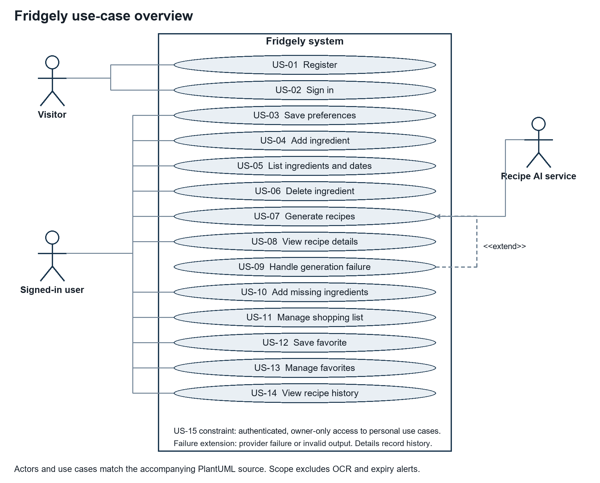

# Fridgely use-case diagram

The system boundary is Fridgely. Visitor uses registration and sign-in. Signed-in user performs the personal fridge, preference, recipe, shopping, favorite and history use cases. Recipe AI service is an external supporting actor for recipe generation. Handling generation failure (US-09) extends generation only when the provider fails or returns invalid output. US-15 is an authorization constraint on all personal use cases, not a separate user action.

This is a system overview; the [15 user stories](README.md) remain the detailed requirements. [PlantUML source](use-cases.puml) is provided alongside the embedded image. The PDF exporter draws an equivalent UML view from these same actor/use-case mappings so images can be embedded without sending the private project to an external renderer.
