# Fridgely Software Design Report

CMPE 331 Software Engineering Concepts · Fall 2026–2027

14 November 2026 · Design review revision

**Project team:** Berfin Gökgöz, İrem Demircan, Sarp Çizer, Ayşe Döne, Mustafa Safa Bayrak, Kerem Sönmez

## 1. Scope and design baseline

Fridgely is a responsive web application for keeping a manual fridge inventory, generating recipes from ingredients and saved preferences, adding missing ingredients to a shopping list, and returning to favorite or previously opened recipes. The design uses a React browser client and a modular Express application backed by PostgreSQL. The application owns authorization, data integrity and provider error handling. It delegates recipe candidate generation to an external provider.

The [project charter](CHARTER.MD) defines the product scope. The [approved requirements revision](https://github.com/SarpCizer/CMPE331-Project/tree/4839cdfdf7f53f226373380f41c307886d08906a) and [requirements PR #4](https://github.com/SarpCizer/CMPE331-Project/pull/4#pullrequestreview-5483856402) supply 15 stories, 48 functional acceptance criteria, nine quality requirements and the [acceptance API](requirements/api-contract.md). The [analysis report](https://github.com/SarpCizer/CMPE331-Project/blob/3a42edf46817f0399eb0adf31f1a88c88fb5ff76/docs/analysis-report.md), [E-R model](https://github.com/SarpCizer/CMPE331-Project/blob/3a42edf46817f0399eb0adf31f1a88c88fb5ff76/docs/analysis/data/er-model.md), [data dictionary](https://github.com/SarpCizer/CMPE331-Project/blob/3a42edf46817f0399eb0adf31f1a88c88fb5ff76/docs/analysis/data/data-dictionary.md) and [front-end concept](https://github.com/SarpCizer/CMPE331-Project/blob/3a42edf46817f0399eb0adf31f1a88c88fb5ff76/docs/analysis/frontend/design-brief.md) are referenced at revision `3a42edf`. Analysis PR #5 remains a separate review. This design carries forward its domain and process findings as proposals wherever they go beyond the approved requirements.

The first release supports account registration without verification email, sign-in, preference editing, manually added ingredient names and dates, recipe estimates, shopping, favorites and viewed history. The release excludes receipt scanning, expiry tracking, quantity arithmetic, automatic ingredient deduction and native mobile apps. All behavior below describes the target implementation.

## 2. Architecture and interfaces

**A1** shows which components provide and require the interfaces defined in C1–C3. A dashed realization with a hollow triangle identifies the provider. A dashed usage dependency identifies the consumer. **A2** shows the proposed cloud deployment and trust boundaries. The application is one deployable with feature modules for identity, preferences, inventory, recipes and collections. This keeps owner checks and transaction management consistent across modules. Separate services would add network calls and distributed transaction complexity to a small application. The recipe provider and storage sit behind interfaces so feature tests can substitute an injected provider and clock.

| Interface | Inputs and outputs | Responsibility |
| --- | --- | --- |
| Browser to HTTP routes | Same-origin HTTPS, JSON, `Authorization: Bearer <token>` for personal routes | React, Tailwind CSS and Axios present form, list and recipe states. Express maps HTTP inputs and domain results to the approved contract. |
| Routes to JWT guard and services | Verified `AccountId` and extracted arguments; service result or typed error | Public routes are `POST /accounts` and `POST /sessions`. Every other feature route uses the guard. The HTTP adapter delegates input validation to feature services and maps results to HTTP without exposing internal fields. |
| Services to persistence | Owner-qualified repository methods and a transaction-scoped unit of work | Parameterized PostgreSQL queries, constraints and transactions enforce ownership and atomic writes. Services coordinate operations across repositories. |
| Recipe service to provider adapter | `generate({ingredients,dietary,allergens}, signal)` returns untrusted candidates | Outbound HTTPS, server-only provider credential, cancellation budget and normalized error mapping. The outbound body contains ingredient names and both saved lists. |
| Release pipeline to staging | Reviewed revision, versioned migrations, health and smoke checks | GitHub Actions builds and tests a pinned Node environment. Render hosts the same-origin app and managed PostgreSQL in the same region. |

The production plan serves compiled front-end assets from Express on the Render web service. The browser can reach only public HTTPS routes. The database uses an internal Render connection with TLS and restricted ingress. A runtime database role handles application data. A separate release role applies reviewed migrations. Environment secrets hold the database URL, signing key and provider credential. The provider adapter is configured at deploy time, with OpenAI as the proposed initial provider. Provider and model selection can change through the adapter as long as the API and validation contract remain intact.

The API contract remains the implementation boundary. Routes decode HTTP and extract fields. Feature services validate all request field values, including credentials, preference arrays, names and identifiers, before a write. JWT verification remains the guard’s responsibility. The recipe service checks that the fridge has ingredients and delegates provider output validation to `CandidateValidator`. Input validation errors return `400`, missing or invalid authentication returns `401`, and an owner-qualified lookup without a match returns `404`. This chooses one of the approved foreign-object outcomes and avoids disclosing object existence. Errors use `{error: string}`. Provider unavailability or timeout adds `retryable: true` to a sanitized `503`. Response bodies return the resources specified by the contract without a wrapper.

## 3. Static design and persistence

**C1** covers identity, the logical preference profile and manual inventory. **C2** covers the generation service, provider port, validator and persisted recipe aggregate. **C3** covers shopping, favorites and viewed history. The class diagrams define the types used by the method contracts and show each PostgreSQL adapter realizing its interface. `ShoppingAddResult` contains the saved entry and its creation flag, `ViewedRecipe` pairs the complete recipe with its latest view time, and delete methods return a boolean. `AccountDTO` contains only the account ID and email. The routes map these results to the approved HTTP body and status.

| Logical records | Storage rule | Transaction and access pattern |
| --- | --- | --- |
| Account and preference lists | Unique normalized email; salted password hash. Separate ordered dietary and allergen rows keyed by account and position. | Insert account under uniqueness. Replace both lists in one transaction. Return original strings in order, including repeats. Zero rows represent an empty list. |
| Inventory entry | Opaque ID, account FK, name, normalized name and immutable UTC addition time. Duplicate names are allowed. | Query by owner. Insert and delete only through manual inventory routes. Empty reads return an array. An owner-qualified delete affects at most one row. |
| Recipe with ingredients and steps | Owned immutable snapshot with ordered child rows. Nonblank title and names, positive minutes, nonnegative calories per serving and positive integer servings. | Validate the full provider batch and child collections first. Assign internal IDs and write the entire batch in one short transaction. Return full recipe DTOs. |
| Shopping entry | Unique account and normalized name. Preserve existing row IDs and display names. | Read owned recipe and inventory, subtract normalized names, insert distinct missing entries with conflict handling and return the resulting list. Manual add uses the same key. |
| Favorite and recipe view | Each association has one row per account and recipe. A composite FK references the same owned recipe. | Favorite save uses an idempotent insert. Detail-open commits a view upsert before replying. Favorite removal affects only its association. |

Index the account keys used by owned list and detail queries. Keep a unique key on `recipe(account_id, recipe_id)` for ownership-constrained foreign keys and an index on `recipe_view(account_id, last_viewed_at DESC, recipe_id)` for stable history pagination or ordering. The first release returns the existing contract's arrays. Ingredient and step position reconstructs original order. The application creates opaque IDs and uses UTC server time; the UI renders addition dates in local time.

Repository adapters share the unit of work's connection. The service commits before returning success and rolls back before reporting a transaction failure. Single-statement writes complete under autocommit.

Generation closes its fridge and preference snapshot before calling the provider. Shopping reads an owned snapshot and uses a unique key to prevent concurrent duplicates. A serialization failure retries the entire shopping transaction before replying. Detail uses a monotonic upsert so older requests cannot overwrite newer views. History orders by latest timestamp, with recipe ID as a tiebreaker. Only detail opening records a view.

## 4. Dynamic design and traceability

Eight sequence models explicitly cover **15 of 15 approved user stories (100%)**. The denominator is the 15 stories in the approved requirements. Each story is counted once in the table. For this baseline, 30% requires at least five stories. S8 is the shared guard interaction referenced by S2–S7. S1 documents the two public routes. Each repository and service has its own lifeline. Explicit transaction groups end before the route sends an HTTP response.

| Approved story | Analysis DFD | Design figures | Existing test IDs |
| --- | --- | --- | --- |
| [US-01](requirements/US-01.md) Register | [1.1](https://github.com/SarpCizer/CMPE331-Project/blob/3a42edf46817f0399eb0adf31f1a88c88fb5ff76/docs/analysis/behavior/US-01.md) | S1, C1 | US-01-T01–T02 |
| [US-02](requirements/US-02.md) Sign in | [1.2](https://github.com/SarpCizer/CMPE331-Project/blob/3a42edf46817f0399eb0adf31f1a88c88fb5ff76/docs/analysis/behavior/US-02.md) | S1, C1 | US-02-T01 |
| [US-03](requirements/US-03.md) Preferences | [US-03 DFD](https://github.com/SarpCizer/CMPE331-Project/blob/3a42edf46817f0399eb0adf31f1a88c88fb5ff76/docs/analysis/behavior/US-03.md) | S2, C1, S4 | US-03-T01 |
| [US-04](requirements/US-04.md) Add inventory | [US-04 DFD](https://github.com/SarpCizer/CMPE331-Project/blob/3a42edf46817f0399eb0adf31f1a88c88fb5ff76/docs/analysis/behavior/US-04.md) | S3, C1 | US-04-T01–T02 |
| [US-05](requirements/US-05.md) List inventory | [US-05 DFD](https://github.com/SarpCizer/CMPE331-Project/blob/3a42edf46817f0399eb0adf31f1a88c88fb5ff76/docs/analysis/behavior/US-05.md) | S3, C1 | US-05-T01 |
| [US-06](requirements/US-06.md) Delete inventory | [US-06 DFD](https://github.com/SarpCizer/CMPE331-Project/blob/3a42edf46817f0399eb0adf31f1a88c88fb5ff76/docs/analysis/behavior/US-06.md) | S3, C1, S5, S7 | US-06-T01 |
| [US-07](requirements/US-07.md) Generate recipes | [US-07 DFD](https://github.com/SarpCizer/CMPE331-Project/blob/3a42edf46817f0399eb0adf31f1a88c88fb5ff76/docs/analysis/behavior/US-07.md) | S4, C2 | US-07-T01–T03 |
| [US-08](requirements/US-08.md) Recipe details | [US-08 DFD](https://github.com/SarpCizer/CMPE331-Project/blob/3a42edf46817f0399eb0adf31f1a88c88fb5ff76/docs/analysis/behavior/US-08.md) | S5, C2, C3, S4 | US-08-T01–T07 |
| [US-09](requirements/US-09.md) Recipe failures | [US-09 DFD](https://github.com/SarpCizer/CMPE331-Project/blob/3a42edf46817f0399eb0adf31f1a88c88fb5ff76/docs/analysis/behavior/US-09.md) | S4, C2 | US-09-T01 |
| [US-10](requirements/US-10.md) Add missing ingredients | [US-10 DFD](https://github.com/SarpCizer/CMPE331-Project/blob/3a42edf46817f0399eb0adf31f1a88c88fb5ff76/docs/analysis/behavior/US-10.md) | S6, C3 | US-10-T01 |
| [US-11](requirements/US-11.md) Manage shopping list | [US-11 DFD](https://github.com/SarpCizer/CMPE331-Project/blob/3a42edf46817f0399eb0adf31f1a88c88fb5ff76/docs/analysis/behavior/US-11.md) | S6, C3 | US-11-T01 |
| [US-12](requirements/US-12.md) Save favorite | [US-12 DFD](https://github.com/SarpCizer/CMPE331-Project/blob/3a42edf46817f0399eb0adf31f1a88c88fb5ff76/docs/analysis/behavior/US-12.md) | S7, C3 | US-12-T01 |
| [US-13](requirements/US-13.md) List/remove favorites | [US-13 DFD](https://github.com/SarpCizer/CMPE331-Project/blob/3a42edf46817f0399eb0adf31f1a88c88fb5ff76/docs/analysis/behavior/US-13.md) | S7, C3 | US-13-T01 |
| [US-14](requirements/US-14.md) Viewed history | [US-14 DFD](https://github.com/SarpCizer/CMPE331-Project/blob/3a42edf46817f0399eb0adf31f1a88c88fb5ff76/docs/analysis/behavior/US-14.md) | S5, C3 | US-14-T01 |
| [US-15](requirements/US-15.md) Protect personal data | [US-15 DFD](https://github.com/SarpCizer/CMPE331-Project/blob/3a42edf46817f0399eb0adf31f1a88c88fb5ff76/docs/analysis/behavior/US-15.md) | S8, A1, C1 | US-15-T01–T03 |

The [requirements traceability table](requirements/traceability.md) and [functional suite](../tests/functional/requirements.test.mjs) define the referenced cases. The dynamic models also capture behavior requiring browser checks, including estimates, retry feedback and empty-state presentation. For manual shopping add, the design proposes `200` with the existing item on a duplicate normalized name; `201` applies only to a new row. For recipe generation, a retry after a known provider failure uses current input. The UI suppresses parallel submissions while a request is pending. A lost response after a successful commit is a distinct case; the API has no request idempotency contract for generation.

## 5. Quality requirements and verification plan

The following decisions apply the [nine NFRs](requirements/non-functional.md) to components and tests. Thresholds come from the requirements baseline. The tools in this table are planned for implementation and staging. A passing model render does not establish runtime quality.

| Requirement | Design decision | Tool, evidence and acceptance |
| --- | --- | --- |
| NFR-01 Authorization | JWT guard verifies the configured algorithm, signature, issuer, audience and finite expiry; owner comes from verified subject. Owner-qualified queries and composite recipe FKs guard URL and body references. | Node acceptance suite and PostgreSQL integration cases with two isolated accounts. Check all protected methods, invalid/expired credentials, foreign references and unchanged state after denial. |
| NFR-02 Credentials and secrets | Argon2id salted hashes; JWT lifetime proposed at 30 min, kept in browser memory. Re-sign-in after expiry or reload. Provider key and signing key remain server-side. Structured logs allow only safe fields such as request ID, outcome and duration. | Inspect test account storage and captured auth/provider error logs for seeded secret values. CI secret scanning and a review of logs and HTTP responses provide evidence that credentials are absent. |
| NFR-03 Response time | Use pooled PostgreSQL connections, owner indexes and bounded queries. Non-AI paths never await provider calls. | k6 against agreed staging with 50 signed-in concurrent users and 100 entries each for five minutes. For fridge, profile, shopping and favorites capture route and aggregate p95 ≤ 500 ms, error rate < 1%, environment and revision. Use `EXPLAIN` on slow queries. |
| NFR-04 AI timeout | Set a request deadline of 30 s and a shorter provider budget (proposed 28 s maximum). Abort a stalled call and leave time for validation, transaction or error mapping. Persist only a validated batch; disable automatic retries. | Inject a stalled or unavailable provider through the port. Measure the end-to-end `503` within 30 s with retry flag. Compare before/after stores, including accepted recipes, and test the next user retry. |
| NFR-05 Responsive usability | Tailwind layout adapts fridge, sign-in, recipes, shopping, favorites and history to narrow widths. UI keeps controls available through empty, busy and error states. | Playwright checks at 360, 768 and 1440 px. Verify control visibility/operation and absence of horizontal page scroll. Capture failure screenshots. |
| NFR-06 Accessible controls | Use semantic forms, labels, visible focus, associated errors and live status announcements. Manage dialog focus and keyboard dismissal. | Playwright with axe-core plus a manual keyboard walkthrough. Save audit results and confirm core tasks, focus order, announcements and visible focus. |
| NFR-07 Persistence | Durable PostgreSQL with versioned migrations and transactional aggregate writes. Unique keys prevent shopping, favorite and history duplicates. | Integration run creates both accounts and their data, restarts the app against the same database, signs in again and compares each persisted collection and isolation. Inject rollback cases and concurrent duplicate requests. |
| NFR-08 AI output integrity | Treat provider output as untrusted. Validate required strings, nonempty ingredient/step arrays, finite numeric bounds, integer servings and declared exclusions across the entire batch. Use trim/case-normalized declared ingredient names. | Node fixture cases check malformed, excluded and accepted batches; verify `502` vs `422`, no partial commit and visible estimate labels. The design does not infer hidden ingredients or guarantee allergen safety. |
| NFR-09 Reproducible deployment | GitHub Actions runs builds and tests; reviewed revisions deploy with migrations and secret injection to Render. Readiness checks database connectivity without provider calls. | Store CI output, migration version, staged deployment ID and HTTPS smoke results. Exercise sign-in, inventory and recipe flow with a controlled provider in CI and run a separately configured live smoke on staging. |

The generation service validates the response schema before checking declared conflicts. The first release rejects a malformed batch with `502` and a structurally valid batch with a declared exclusion with `422`. Use a provider input allowlist and keep raw provider payloads, account identity and credentials out of error logs. A broader allergen synonym taxonomy requires a reviewed vocabulary. Generated cooking time and calories per serving are presented as estimates.

Three implementation choices merit review. A modular monolith is easier to deploy and share a transaction across than independently deployed services. PostgreSQL makes owner-qualified references and uniqueness enforceable at the database boundary, at the cost of joins for ordered lists and recipe children. Bounded synchronous recipe generation keeps the existing HTTP contract; the latency budget and provider cost should be checked on staging before changing the contract to an asynchronous job.

Tool documentation: [Render private network](https://render.com/docs/private-network), [Grafana k6 thresholds](https://grafana.com/docs/k6/latest/using-k6/thresholds/) and [Playwright accessibility testing](https://playwright.dev/docs/accessibility-testing).

## 6. Implementation and design verification

1. Implement account and access foundations first. Start with US-01, US-02 and US-15 acceptance cases, then cover PostgreSQL ownership constraints and sign-in through the real HTTP adapter.
2. Implement inventory and preferences with an injected clock. Verify ordered preference fidelity, manual inventory mutations and stable date display before wiring generation.
3. Connect the recipe port to fixture and live adapters. Drive validation, failure handling, batch atomicity and history with the approved cases. Implement shopping and favorites with owned queries and uniqueness.
4. Wire the responsive screens to the API. Run browser checks and database integration in CI. Deploy a reviewed revision, then collect NFR evidence on staging for the testing report.

The [current source boundary](../src/acceptance-app.mjs) is an unimplemented adapter. Baseline execution on 11 November 2026 with Node v24.22.1 ran 27 acceptance cases: 0 passed, 27 failed, 0 skipped. The scaffold returns `501`; dependent tests generally stop at registration. These results agree with the [recorded baseline](../tests/STATUS.md). Runtime implementation, cloud deployment, load and accessibility verification remain testing work.

The design package provides 13 editable PlantUML models and their rendered figures. The sources compile with PlantUML 1.2025.4 using UTF-8 and the Smetana layout for architecture and class views. Regenerate from the repository root with `plantuml -charset UTF-8 -tpng docs/design/*/*.puml`. The PDF includes all 13 figures on dedicated sheets with source links. The Markdown, models and PDF are reviewed together in the design PR.

## Appendix. Design figures

### A1. Component architecture

Logical components with the provided and required interfaces defined in C1–C3. The route layer delegates personal actions only after JWT verification.

[Editable PlantUML source](design/arch/component.puml)

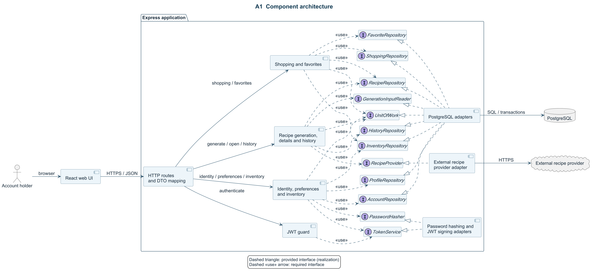

### A2. Deployment and trust boundaries

Proposed topology for HTTPS, private database traffic, server-side secrets and CI/CD.

[Editable PlantUML source](design/arch/deployment.puml)

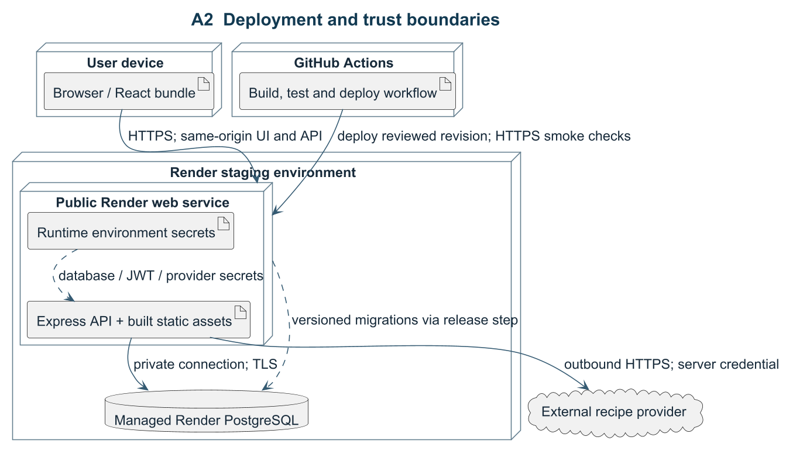

### C1. Identity, preferences and inventory

Account and inventory ownership, typed security and persistence contracts, and their PostgreSQL adapters.

[Editable PlantUML source](design/class/identity-inventory.puml)

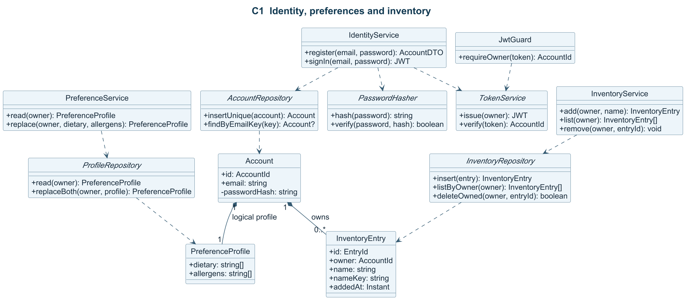

### C2. Recipe generation and persistence

Typed provider and validation contracts, PostgreSQL adapters, unit of work and the owned recipe aggregate with ordered children.

[Editable PlantUML source](design/class/recipe-pipeline.puml)

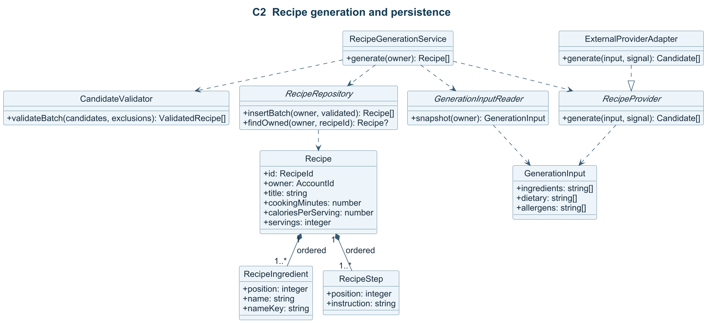

### C3. Shopping, favorites and viewed history

Owner-qualified repositories and SQL adapters. Shopping creation and history return the data needed by S5–S7.

[Editable PlantUML source](design/class/personal-collections.puml)

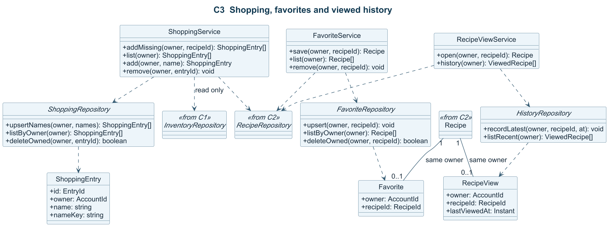

### S1. Register and sign in

US-01 and US-02. Validation and uniqueness protect registration. Sign-in verifies the password before issuing a JWT.

[Editable PlantUML source](design/sequence/accounts.puml)

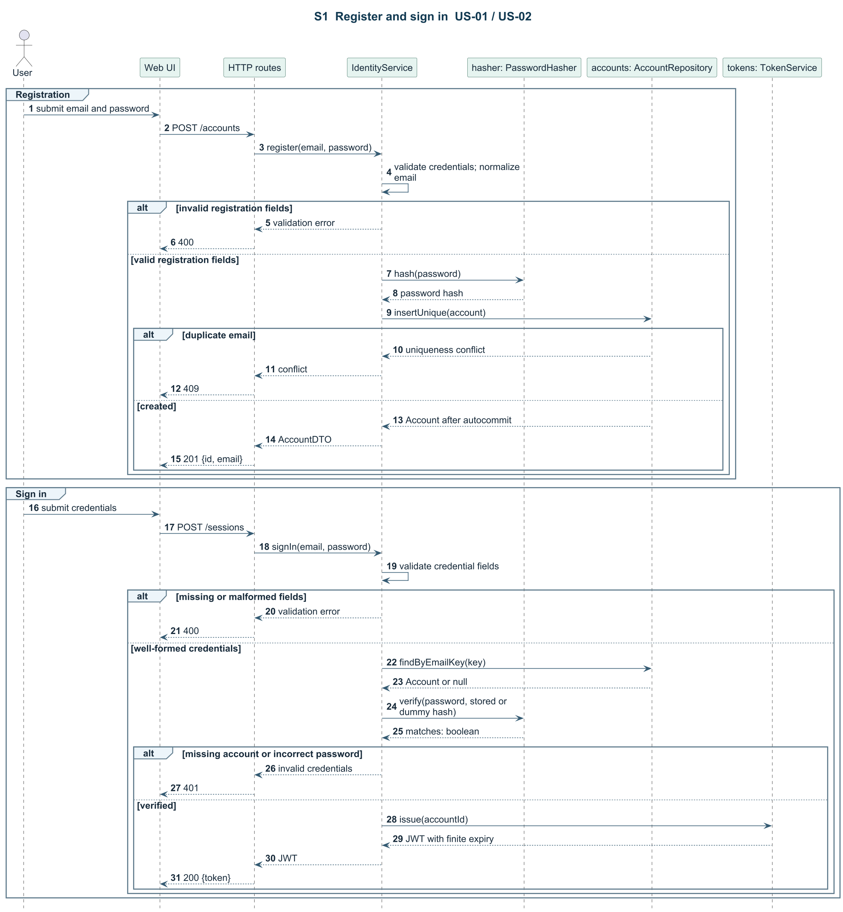

### S2. Read, replace and clear preferences

US-03. Update both lists together and preserve exact saved order and repeated values.

[Editable PlantUML source](design/sequence/preferences.puml)

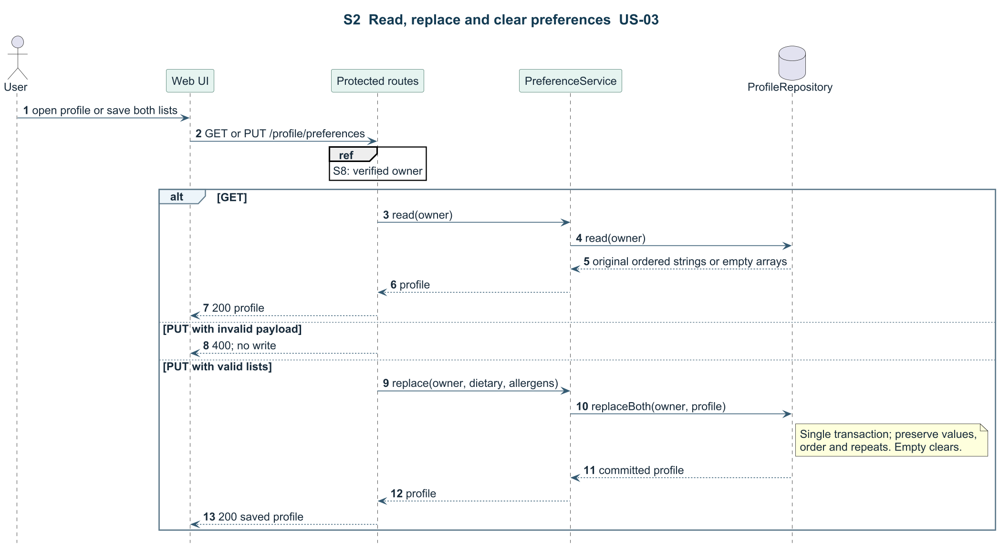

### S3. Manage fridge and addition dates

US-04, US-05 and US-06. Manual add/delete own the inventory writes. Listing uses stored addition dates.

[Editable PlantUML source](design/sequence/inventory.puml)

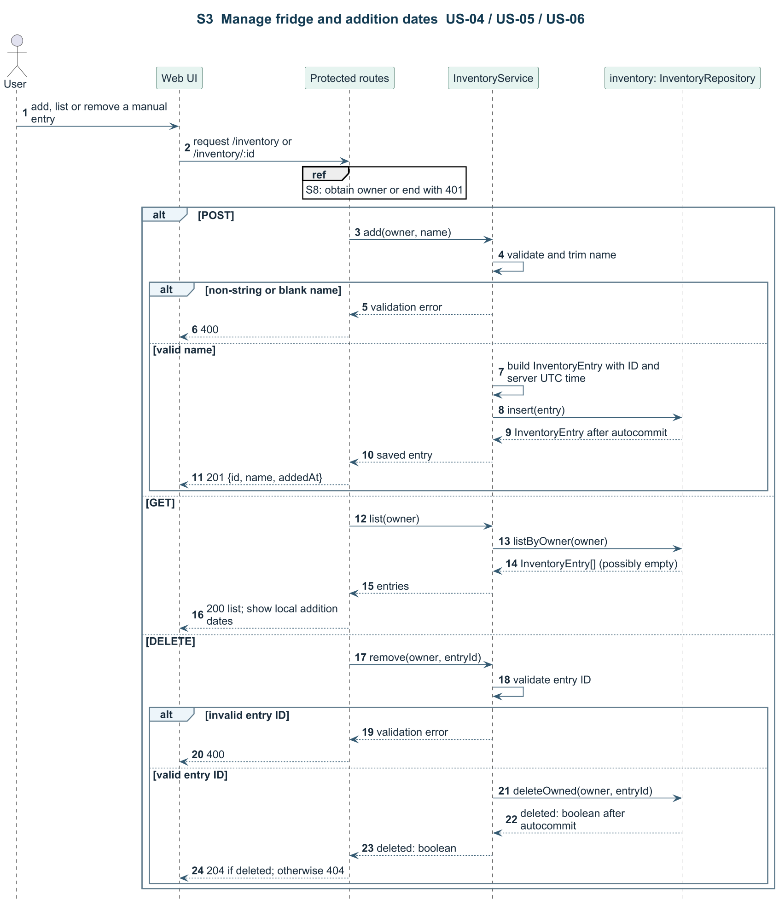

### S4. Generate recipes and handle failures

US-07 and US-09. Snapshot inputs, stop on empty fridge, bound provider work and validate the entire batch before saving.

[Editable PlantUML source](design/sequence/generation.puml)

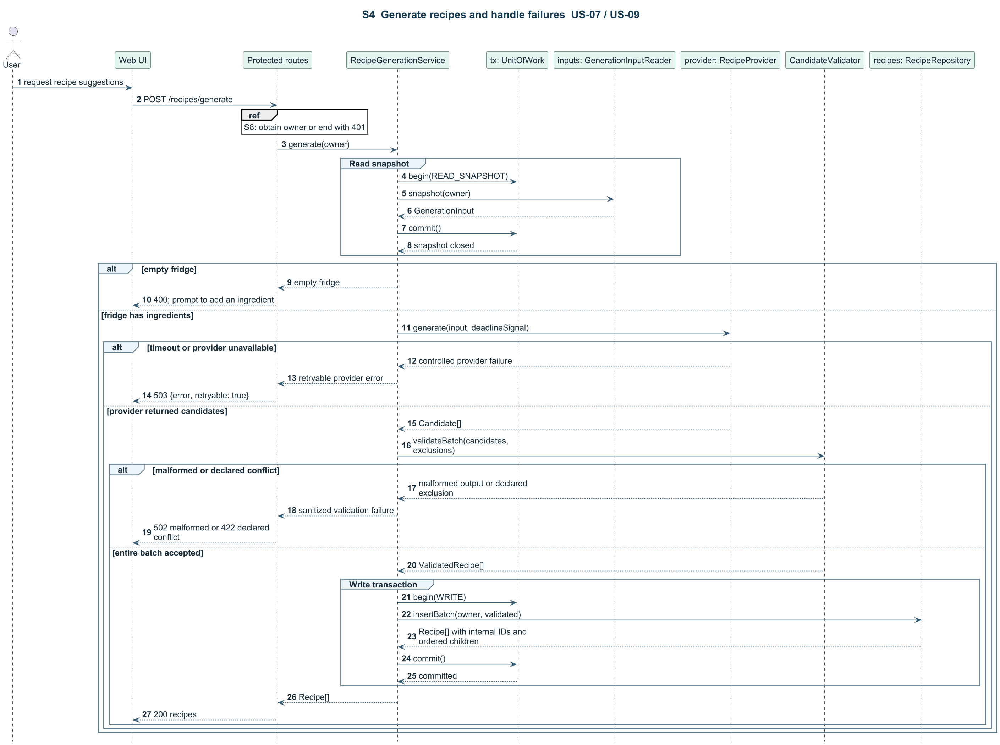

### S5. Open recipe details and read history

US-08 and US-14. Return full recipe details after the view commits. History lists owned viewed recipes newest first.

[Editable PlantUML source](design/sequence/details-history.puml)

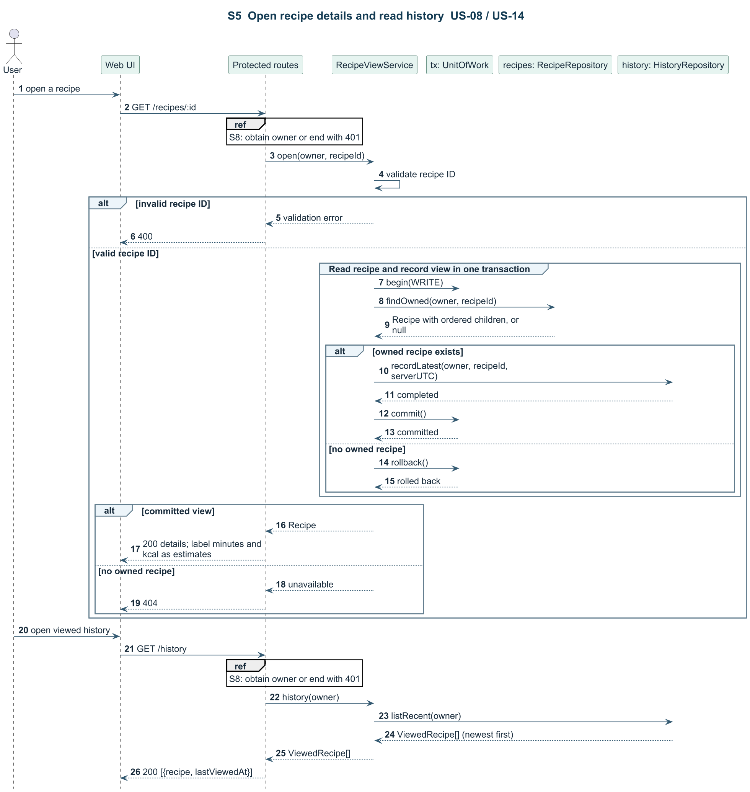

### S6. Add missing ingredients and manage shopping

US-10 and US-11. Subtract normalized fridge names and upsert missing shopping items. Manual operations affect only shopping.

[Editable PlantUML source](design/sequence/shopping.puml)

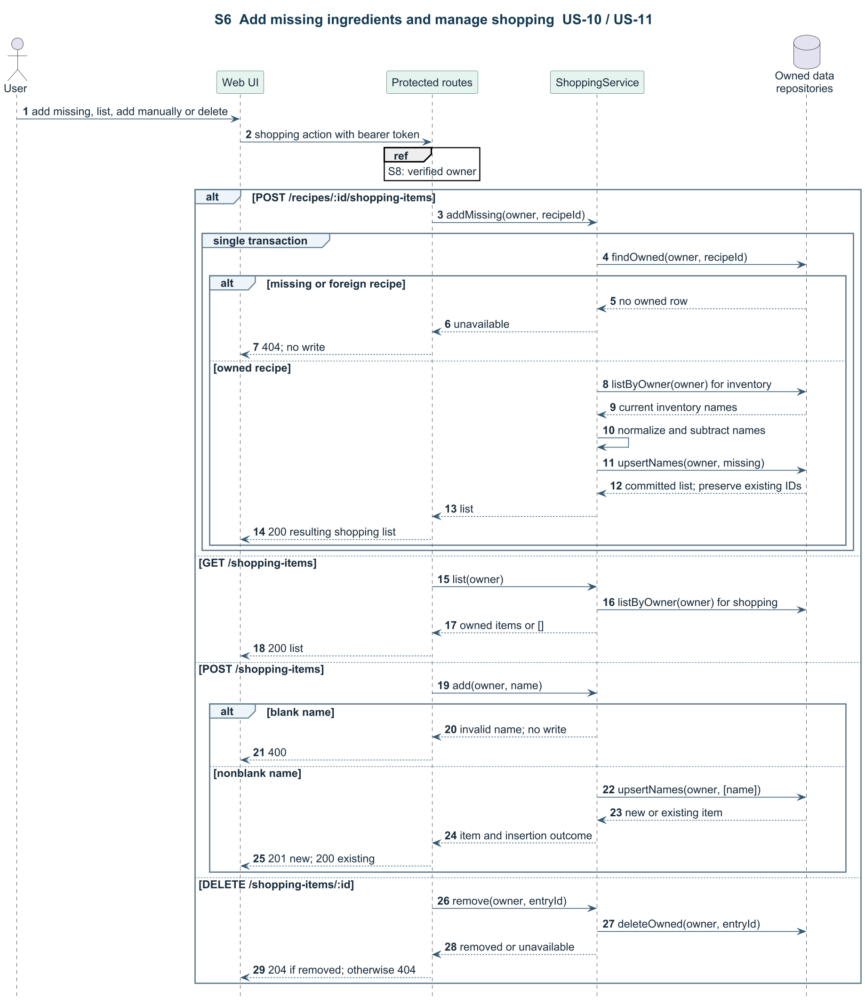

### S7. Save, list and remove favorites

US-12 and US-13. The service validates the recipe ID, commits an idempotent association before reporting success, and preserves view history on removal.

[Editable PlantUML source](design/sequence/favorites.puml)

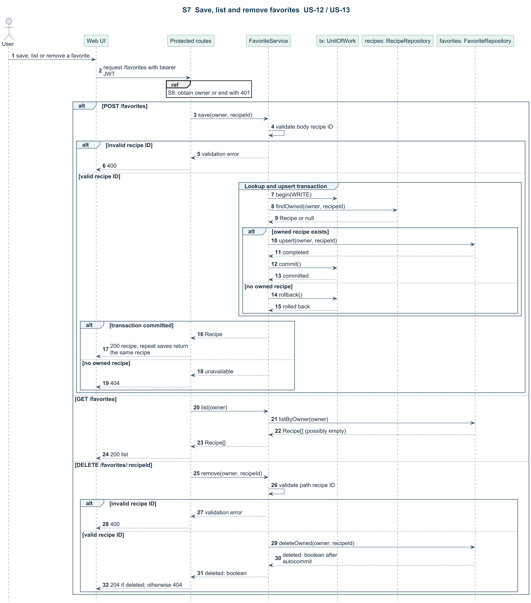

### S8. Authorize each personal request

US-15. Derive the owner from verified claims before invoking any personal operation. Check referenced objects against that owner.

[Editable PlantUML source](design/sequence/authorization.puml)

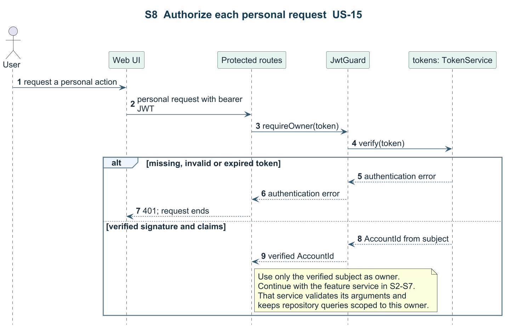
