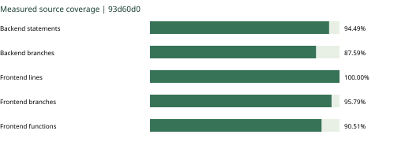
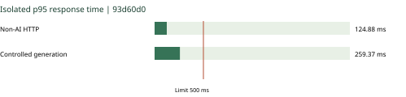
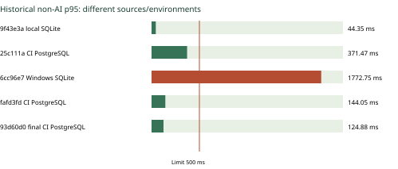
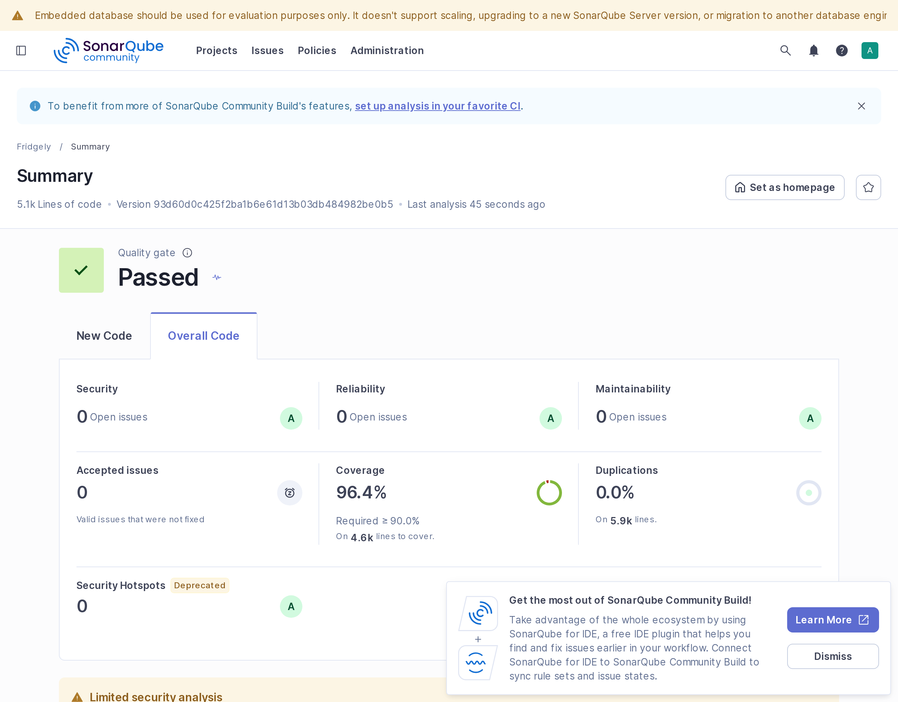

# Fridgely
Software Testing Report

Final verification edition | 28 November 2026 | CMPE331

Prepared by Sarp Çizer with Codex assistance, continuing the reviewed team work through Berfin Gökgöz's PR #102. Earlier measurements and unsuccessful attempts retain their original identities. No instructor acceptance or course-platform upload is inferred.

Measured application and test source: 93d60d0c425f2ba1b6e61d13b03db484982be0b5

[Nine-job CI 46157083697](https://github.com/SarpCizer/CMPE331-Project/actions/runs/46157083697) | [Measured source 93d60d0](https://github.com/SarpCizer/CMPE331-Project/commit/93d60d0c425f2ba1b6e61d13b03db484982be0b5) | [Finalization PR #103](https://github.com/SarpCizer/CMPE331-Project/pull/103)

Release candidate: isolated verification has passed. Protected-main review, merge and exact-source production verification remain pending. This edition does not claim that the candidate is live.

| Verification layer | Observed result |
| --- | --- |
| Backend / PostgreSQL | 1096 passed, 3 SQLite-only cases skipped; zero failures/errors |
| Complementary SQLite run | 5 passed; 5 PostgreSQL variants intentionally skipped locally |
| Production-build browser | 55 passed; zero failures or skips |
| Acceptance / HTTP isolation | 32 / 12 passed; 28 unique US test IDs, repeated per-engine executions distinguished |
| Static analysis / security | Five evaluated Sonar conditions passed; ZAP 0 high/medium/low; four targeted probes passed |
| Coverage / performance | All five coverage floors and both isolated load scenarios passed |
| Mutation / reproducibility | 27/27 seeded mutations killed; archive, secret detector canary and container restart passed |

## Scope and exit criteria

Exercise the real FastAPI host, SQL persistence and built React interface. Controlled provider fixtures isolate deterministic contracts and failure paths; bounded live model checks are a separate release gate. Completion requires green required checks, legitimate peer approval, the merged source observed on Render, and a visually verified report. A test pass is evidence for its scenario, not a guarantee that all future generated meals are safe or correct.

# 1. Strategy and requirements

The syllabus asks for unit-module traceability, explained coverage metrics, performance and security experiments, SonarQube and penetration findings with their treatment. The instructor's PR #67 review adds criterion-level assertions, honest version labels, load/concurrency and brute-force tests, evaluated quality conditions, and report figures. This edition addresses each using retained results.

| Layer / environment | What the result establishes |
| --- | --- |
| Python 3.12, Linux CI, PostgreSQL 17 | Real transactions, migrations, ownership, restart persistence, recipe validation and interleavings; engine-specific SQLite cases are covered separately. |
| Windows local, Python 3.12, SQLite | Five targeted planner/sign-in interleavings on measured source 93d60d0. PostgreSQL skips are disclosed; no local full-suite pass is inferred. |
| Node + Playwright Chromium, built React | Actual host/browser flows with controllable provider, DOM assertions, keyboard navigation, error/empty states, accessibility and 360/768/1440 px layouts. |
| Disposable Docker/Sonar/ZAP hosts | Production Docker image and PostgreSQL restart; static quality gate; authenticated active API scan. No attack or load scan targets production. |
| Load host / one worker / PostgreSQL | Five-minute 50-user non-AI scenario and separate 10-user controlled-generation experiment. Runner characteristics come from each raw JSON. |

## Assertion-level traceability

The matrix contains all 48 acceptance criteria from US-01 through US-15 plus nine NFR criteria. Every row gives the exact requirement text, concrete assertion, why it verifies the criterion, case name and immutable source-line link. One test may cover several criteria; the criterion keys remain unique.

There are 28 unique physical US-xx-Txx identifiers. The acceptance runner reports 32 executions because some scenarios execute for both database engines. These are executions, not extra requirements or duplicate identifiers. Supplemental product tests cover quantities, purchase/cooking, moods, weekly planning, wheel behavior and password changes beyond the original 15 stories.

[Full criterion matrix](https://github.com/SarpCizer/CMPE331-Project/blob/f7cce4daa812e7d4a4fd226604df9b2f0e629c1e/docs/tests/final-release/traceability/traceability.md) is committed under docs/tests/final-release/traceability/ as Markdown, CSV and JSON. Assertion links target 93d60d0; the evidence publication commit is distinct. Historical scope notes in the generator remain historical, while current metrics and deployment status are evaluated in this report.

# 2. Module-to-requirement evidence

The [complete module map](https://github.com/SarpCizer/CMPE331-Project/blob/f7cce4daa812e7d4a4fd226604df9b2f0e629c1e/docs/tests/final-release/module-map.csv) is generated from actual JUnit test cases, not collected-file estimates. The following groups summarize it; each module remains individually identified in the companion files.

| Module family / requirements | Executed evidence and purpose |
| --- | --- |
| Accounts and security
US-01/02/15; NFR-01/02 | 5 modules; 612 passed, 0 skipped. Hashes, JWT/version revocation, ownership, throttling and password rotation/rehash races. |
| Host, collections and persistence
US-08/10-15; NFR-01/07/09 | 6 modules; 70 passed, 0 skipped. Integrated ports, detail/favorites/history, transactions, two-user process restart and OpenAPI behavior. |
| Recipe/provider contracts
US-07/08/09/15; NFR-04/08 | 11 modules; 185 passed, 0 skipped. Provider input/output validation, declared exclusions, wire variants, concurrency, bounded parsing and content curation. |
| Provider deadline
US-09; NFR-04 | 1 module; 1 passed, 0 skipped. Actual default timeout/cancellation and unchanged five collections. |
| Weekly planning
US-07/08/09/15 extensions; NFR-07/08 | 5 modules; 72 passed, 3 skipped. Owned flexible slots, exact requested dishes, state fidelity, retries and SQLite/PostgreSQL races. |
| Stock and consumption
US-04/05/06 extensions; NFR-07/08 | 3 modules; 41 passed, 0 skipped. Quantity boundaries, legacy upgrades, explicit confirmed cooking and no unintended deductions. |
| Preferences and migration
US-03/07/15; NFR-07 | 2 modules; 5 passed, 0 skipped. Ordered preferences/allergens, normalization, atomic snapshots and schema upgrades. |
| Moods and surprise wheel
US-07/08 extensions; NFR-08 | 2 modules; 26 passed, 0 skipped. Preference-constrained moods and wheel selection from the displayed recipe batch without new inference or stock writes. |
| Shopping and purchases
US-10/11/15 extensions; NFR-07/08 | 3 modules; 82 passed, 0 skipped. Missing quantities, unit conversion, atomic purchase, retry/overlap idempotence and stock isolation. |
| Deployment identity
NFR-09 | 1 module; 2 passed, 0 skipped. Validated public revision header across success/error responses; request spoofing rejected. |

Acceptance tests assert real HTTP DTOs/statuses and collection snapshots. Browser tests assert rendered behavior against the built frontend. Unit/adapter tests provide fault injection and fine-grained validation; integration, restart and concurrency tests complement them. No single aggregate is described as purely unit testing.

# 3. Functional and browser results

| Browser source file at 93d60d0 | Cases |
| --- | --- |
| [completion.spec.js](https://github.com/SarpCizer/CMPE331-Project/blob/93d60d0c425f2ba1b6e61d13b03db484982be0b5/frontend/tests/completion.spec.js) | 10 |
| [cooking.spec.js](https://github.com/SarpCizer/CMPE331-Project/blob/93d60d0c425f2ba1b6e61d13b03db484982be0b5/frontend/tests/cooking.spec.js) | 6 |
| [entry-units.spec.js](https://github.com/SarpCizer/CMPE331-Project/blob/93d60d0c425f2ba1b6e61d13b03db484982be0b5/frontend/tests/entry-units.spec.js) | 2 |
| [kitchen.spec.js](https://github.com/SarpCizer/CMPE331-Project/blob/93d60d0c425f2ba1b6e61d13b03db484982be0b5/frontend/tests/kitchen.spec.js) | 8 |
| [moods.spec.js](https://github.com/SarpCizer/CMPE331-Project/blob/93d60d0c425f2ba1b6e61d13b03db484982be0b5/frontend/tests/moods.spec.js) | 3 |
| [password.spec.js](https://github.com/SarpCizer/CMPE331-Project/blob/93d60d0c425f2ba1b6e61d13b03db484982be0b5/frontend/tests/password.spec.js) | 2 |
| [preferences-fidelity.spec.js](https://github.com/SarpCizer/CMPE331-Project/blob/93d60d0c425f2ba1b6e61d13b03db484982be0b5/frontend/tests/preferences-fidelity.spec.js) | 2 |
| [quantities.spec.js](https://github.com/SarpCizer/CMPE331-Project/blob/93d60d0c425f2ba1b6e61d13b03db484982be0b5/frontend/tests/quantities.spec.js) | 2 |
| [shopping-quantity.spec.js](https://github.com/SarpCizer/CMPE331-Project/blob/93d60d0c425f2ba1b6e61d13b03db484982be0b5/frontend/tests/shopping-quantity.spec.js) | 7 |
| [shortage.spec.js](https://github.com/SarpCizer/CMPE331-Project/blob/93d60d0c425f2ba1b6e61d13b03db484982be0b5/frontend/tests/shortage.spec.js) | 1 |
| [surprise.spec.js](https://github.com/SarpCizer/CMPE331-Project/blob/93d60d0c425f2ba1b6e61d13b03db484982be0b5/frontend/tests/surprise.spec.js) | 3 |
| [text-format.spec.js](https://github.com/SarpCizer/CMPE331-Project/blob/93d60d0c425f2ba1b6e61d13b03db484982be0b5/frontend/tests/text-format.spec.js) | 2 |
| [weekly-plan.spec.js](https://github.com/SarpCizer/CMPE331-Project/blob/93d60d0c425f2ba1b6e61d13b03db484982be0b5/frontend/tests/weekly-plan.spec.js) | 7 |

The inventory above comes from this run's browser JUnit and verified Git blobs. completion.spec.js exists at this exact source; historical snapshots with fewer files are kept separate. fixtures.js and global-setup.js support execution and are not counted as test suites.

## Important invariants

Generation, viewing, history, favorites, missing-ingredient shopping and wheel selection preserve fridge stock. Normal Remove only removes a shopping row. Bought - add to fridge and confirmed cooking are explicit transactions; retries are idempotent. Cross-user methods deny access and preserve all owned snapshots. Legacy unit/quantity and migration cases remain covered.

New provider regressions cover bounded input parsing, transport variants and confirmed truncated-prefix recovery, batch atomicity for hard failures, honest usable-candidate curation, undosed/unlisted ingredient rejection and bounded poultry/fish temperature guidance. These fixtures establish rejection and normalization rules; they cannot certify arbitrary inference, estimated nutrition or undeclared allergens.

# 4. Coverage and mutation analysis

| Metric | Actual numerator / denominator | Required floor |
| --- | --- | --- |
| Backend statements | 1974 / 2089 = 94.49% | 90% |
| Backend branches | 466 / 532 = 87.59% | 70% |
| Frontend lines | 2520 / 2520 = 100.00% | 90% |
| Frontend branches | 638 / 666 = 95.79% | 85% |
| Frontend functions | 124 / 137 = 90.51% | 85% |

Statement coverage counts executed source statements; branch coverage counts taken exits. Executing a validation line once does not exercise both its success and rejection paths. The earlier 91.83% statement / 73.91% branch snapshot therefore did not imply its missed exits were tested. Current denominators above are taken from coverage.py; frontend source maps and per-file denominators are retained.

| Current remaining branch gaps | Missed exits / example arcs |
| --- | --- |
| fridgely_recipes/provider.py | 12 / 127->129, 174->177, 199->200 |
| fridgely_recipes/wire.py | 6 / 50->51, 60->61, 82->83 |
| fridgely_app/availability.py | 5 / 28->29, 131->132, 131->135 |
| fridgely_app/migrations/versions/0002_ordered_preferences.py | 5 / 24->22, 39->40, 39->46 |

Arcs are exact source line-to-line exits (negative numbers denote function exit), not invented failure cases. These gaps remain visible; thresholds were not lowered to hide them. The coverage canary proves a synthetic regression fails. All 27 targeted seeded source mutants were killed by real failing assertions; none survived, timed out or failed to compile. This is a deliberately selected campaign, not whole-project mutation coverage.

# 5. Performance and concurrency

The 500 ms marker applies only to NFR-03 non-AI routes. Controlled generation has a separate 2000 ms experimental threshold and a 200 ms fixture provider; its timing is not real external model latency.

| Experiment | Observed result / interpretation |
| --- | --- |
| Non-AI, 50 users, 100 fridge rows each, 300 s | 52256 requests, 0 errors; p95 124.88 ms. Margin to 500 ms: 375.12 ms. Each route is also checked independently. |
| Generation, 10 users, 60 s, 1 s think time | 493 requests, 0 errors; p95 259.37 ms. No external inference; actual HTTP/DB persistence and zero malformed accepted results. |
| Five simultaneous stalled providers | 5 cancellations; each retryable 503 within 30 s, configured 28 s budget. No partial recipes, stock or other collection changes. |

| Non-AI route | Requests | Errors | p95 ms |
| --- | --- | --- | --- |
| inventory | 13064 | 0 | 132.74 |
| profile | 13064 | 0 | 124.12 |
| shopping | 13064 | 0 | 127.93 |
| favorites | 13064 | 0 | 115.59 |

Runner: {"system": "Linux", "architecture": "x86_64", "python": "3.12.16", "cpu_count": 4}. GitHub-Actions-Ubuntu-PostgreSQL17-one-worker. The client and one-worker host share the runner; these measurements include local HTTP, serialization and database work, not public Render network latency.

# 6. Historical timing interpretation

The original 371.47 ms CI p95 is 8.38 times the 44.35 ms local p95, leaving 128.53 ms below the 500 ms limit. The local source is 9f43e3af07f08d070251e371fb6112c989db330e (macOS ARM64, SQLite, eight reported CPUs); the CI source is 25c111aa5a8d678b60c17745289675821b62f91d (Linux, PostgreSQL, two reported CPUs). Code, database, hardware and scheduler differ. The data cannot establish one causal explanation.

The later Windows SQLite benchmark at 6cc96e729eaf07d739bcedefee22fbb7ce4c45f9 failed the 500 ms requirement at 1772.75 ms despite zero HTTP errors. It is retained as FAIL, not dropped. Its measured source-scope equality with fafd3fdbfa0d8ccd2ff7679282687142615e0aed is retained in the earlier follow-up evidence. That CI run passed at 144.05 ms. This controlled comparison still does not establish equivalence of machine performance.

The latest result is a new measurement at 93d60d0c425f2ba1b6e61d13b03db484982be0b5. No older local run is relabelled as this version, and no isolated load result is presented as production capacity. Historical raw JSON and full revision labels remain linked in the earlier corrected report and evidence index.

# 7. Security and defect treatment

| Technique / actual scope | Observed result and disposition |
| --- | --- |
| OWASP ZAP 2.17.0 authenticated OpenAPI active scan | 4370 observed requests; 514 successful authenticated requests. 0 high, 0 medium, 0 low; 3 informational rule categories retained. Disposable host, bounded scan; no production attack. |
| Four targeted automated probes | SQL injection, mass assignment, source/config traversal and stored XSS (actual browser before/after reload). All passed; complements rather than replaces the standard scanner. |
| Brute-force / credential handling | Sign-in throttle and account-isolation assertions, Argon2 salted hashes, signed JWT/expiry/auth_version checks, seeded credential leakage checks and sanitized provider errors. No claim about third-party platform logs. |
| Dependency / secret checks | Python and frontend dependency audits each reported zero known vulnerabilities at scan time. Reachable-history Gitleaks reported zero findings; its synthetic credential canary was detected and rejected. |
| Earlier findings / current treatment | Historical missing CORP header fixed; scanner-host preferences collision isolated. Twelve S2970 findings were assertion-helper recognition false positives, not twelve security vulnerabilities. The later regex issue was replaced with a bounded linear parser; actual current Sonar results are shown next. |

The three retained ZAP informational categories are client-error responses to invalid/unauthorized probes, identification of the authentication request, and non-storable responses. They document observed API/authentication/cache behavior; no scanner rule is suppressed to obtain the pass. Recheck if the contract or cache policy changes.

## Password rotation race: genuine test-first fix

A stale sign-in rehash could overwrite a concurrently changed password. A deterministic real-route regression first failed against abdca3f: 1 failed / 1 passed / 2 PostgreSQL variants skipped locally (test commit 03d0f3d). The fix c3558ba compares both the previously verified hash and auth_version before updating. On a conflict it reloads and verifies current credentials; a stale old password is rejected, while two legitimate concurrent rehashes can both complete.

The final CI executes both engines' password-race cases. A complementary SQLite run has five passes across planner and password interleavings; local PostgreSQL variants are explicitly skipped. Mutant M27 removes the compare-and-set guard and is killed by the race assertion. No database schema, account data or auth-version migration was rewritten.

# 8. Evaluated SonarQube quality gate

| Server-evaluated condition | Threshold | Actual | Status |
| --- | --- | --- | --- |
| coverage | LT 90 | 96.4 | OK |
| blocker_violations | GT 0 | 0 | OK |
| bugs | GT 0 | 0 | OK |
| critical_violations | GT 0 | 0 | OK |
| vulnerabilities | GT 0 | 0 | OK |

The server returned five actual evaluated conditions. A historical green status with an empty conditions array was insufficient; current validation rejects missing, altered or non-passing conditions. The independent policy also requires zero security hotspots; zero does not imply a manual review of nonexistent hotspots. Sonar analysis and imported test coverage both identify 93d60d0 with no reused test artifacts.

Sonar reports combined-source coverage 96.4%, line coverage 97.5% and condition/branch coverage 92.2%; these use its imported multi-language line/condition aggregation. They are not the backend-only coverage.py statement/exit percentages on page 5. Current exported bugs, vulnerabilities, code smells, blocker/critical issues and hotspots are all zero.

Actual browser capture of the ephemeral SonarQube dashboard from this run, scaled with its aspect ratio preserved. The original PNG, capture revision, configured gate, evaluated response, metrics, issue list and hotspot export are retained. This image is embedded in the PDF.

# 9. Reproducibility and delivery

Raw evidence index: 45 retained files. Each member has an original byte length and SHA-256. Downloaded artifact ZIP digests were checked against GitHub metadata before safe, selected extraction. Git attributes preserve evidence bytes on Windows. The report fails before publication if an indexed file changes, source/run identities differ, JUnit inventory changes, a gate is incomplete or a mandatory result fails.

[Retained evidence index](https://github.com/SarpCizer/CMPE331-Project/blob/f7cce4daa812e7d4a4fd226604df9b2f0e629c1e/docs/tests/evidence/final93d60d0/evidence-index.json) | [Backend JUnit](https://github.com/SarpCizer/CMPE331-Project/blob/f7cce4daa812e7d4a4fd226604df9b2f0e629c1e/docs/tests/evidence/final93d60d0/integrated/backend-junit.xml) | [Browser JUnit](https://github.com/SarpCizer/CMPE331-Project/blob/f7cce4daa812e7d4a4fd226604df9b2f0e629c1e/docs/tests/evidence/final93d60d0/integrated/browser-junit.xml)

| Action | Rebuild / interpretation |
| --- | --- |
| Install report-only dependencies | python -m pip install -r scripts/tests/requirements-report.txt |
| Export from a full repository checkout | python scripts/tests/export_final_report.py --output build/final-report
Creates absent parent folders; writes PDF, UTF-8 Markdown and SVG figures; performs no network/provider calls. |
| Verify report safeguards | python -B -m unittest discover -s scripts/tests -p test_*.py -v
Includes missing-folder rebuild, tampered evidence, source mismatch and browser inventory regressions. |
| Package reviewed source | python scripts/release/package_source.py --revision FULL_SHA --output build/release/Fridgely-final-source.zip
Uses immutable Git blobs; repeated exports are byte-identical. No dependencies, secrets, scanner dumps or embedded PDF binary in the source ZIP. |
| Exact live-source observation | GET /api/health and X-Fridgely-Revision. The production host only publishes a valid 40-character Render commit ID; a request header cannot spoof it. Source-tree comparison links publication/merge commits to the measured application. |

The earlier a59556e course ZIP/PDF, delivery branch and v0.1.0 tag are preserved. This final verification edition does not silently replace their source labels. The new PDF is a companion to the exact selected source ZIP. Report regeneration requires the full checkout with retained evidence; the deliberately source-only ZIP is not a scanner-evidence mirror.

## Production verification status

Pending legitimate peer review and normal protected-main merge. After CI-triggered Render deployment, observe the new revision header and verify real normal/Quick recipes, details/history, favorites, missing-shopping and unchanged stock using a disposable test account. Isolated controlled-provider tests above are complete; these outstanding live checks are not marked passed.

# 10. Instructor checklist and limits

| Instructor request | Evidence in this edition |
| --- | --- |
| Rebuild without build/; accurate file inventory | Clean nested-directory export regression; JUnit/Git-blob browser inventory on pages 4 and companion JSON. |
| Local versus CI versions | Full source labels, environments and retained failed Windows benchmark; historical comparison on page 7. |
| Interpret p95 and branch gaps | Measured denominators, missed arcs and unchanged floors; 8.38x historical comparison and 128.53 ms historical margin; current route-level p95 and margins. |
| Granular AC / NFR assertions; duplicated IDs | 57 unique criterion rows, concrete immutable assertion links; 28 physical IDs distinguished from 32 executions. |
| Standard penetration / brute force / generation load | Authenticated ZAP, four custom probes, sign-in throttle; 10-user generation load and five simultaneous cancelled deadlines. |
| Real Sonar gate and false-positive interpretation | Five evaluated conditions plus zero-hotspot policy; retained issue exports and actual dashboard. S2970 helper false positives identified accurately. |
| Graphs and embedded report images | Coverage, current/historical performance plots and actual Sonar dashboard embedded directly in PDF. |
| Review discipline | Work isolated in PR #103; review and merge status are explicit. Peer review does not imply instructor approval. |

Known limits: isolated performance is not a Render capacity promise; ZAP/probes are bounded automated assessment, not exhaustive independent penetration testing; estimated nutrition and arbitrary generated food safety are not certified. Automated keyboard/axe coverage complements, but does not replace, human usability review. Remaining branch exits are disclosed rather than presented as executed.

Course submission and team presentation require actual human completion. No Learn receipt, instructor acceptance, teammate review, future reliability or grade is invented. Final production completion is reported only after exact-source deployment and bounded live evidence exist.

[Instructor review](https://github.com/SarpCizer/CMPE331-Project/pull/67#issuecomment-7198211995) | [Requirements](https://github.com/SarpCizer/CMPE331-Project/tree/93d60d0c425f2ba1b6e61d13b03db484982be0b5/docs/requirements) | [Historical corrected report](https://github.com/SarpCizer/CMPE331-Project/blob/93d60d0c425f2ba1b6e61d13b03db484982be0b5/docs/tests/software-test-report.md)

