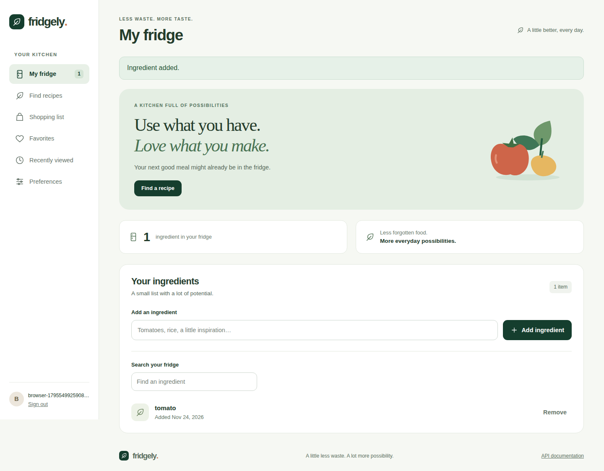
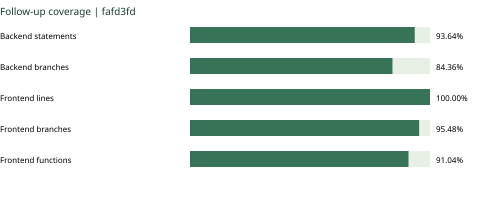
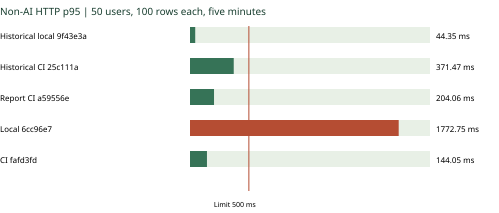
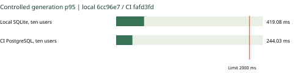
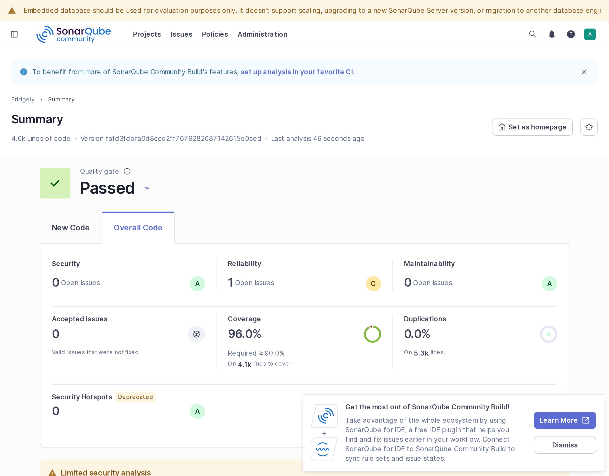

# Fridgely
Software Testing Report

2026-11-24 | Prepared for the CMPE331 submission review

Historical application snapshot; reproducibility/provenance correction dated 2026-11-26. Measurements retain their original source identities.

## Latest review corrections: from page 9

The instructor-review results, AC/NFR assertion mapping, evaluated Sonar gate, standard authenticated scan and embedded result figures are in the follow-up. Earlier pages retain the explicitly dated a59556e snapshot.

## Historical verified candidate

Verified integration candidate; final team selection and course upload pending

Tested source: a59556e366ffd65adf799bb8aa9bc47e95dea16e

[Exact-source CI run 45474025963](https://github.com/SarpCizer/CMPE331-Project/actions/runs/45474025963) | [Source commit](https://github.com/SarpCizer/CMPE331-Project/commit/a59556e366ffd65adf799bb8aa9bc47e95dea16e) | [ZIP verification, #48](https://github.com/SarpCizer/CMPE331-Project/issues/48#issuecomment-7143013023)

The historical report replaced 25c111a evidence with measured a59556e results. This correction preserves that snapshot and separately identifies the instructor-review follow-up. Report-only commits do not change which application source each recorded test exercised.

| Verification layer | Recorded result |
| --- | --- |
| PostgreSQL / backend | 133 passed; 0 skipped |
| Requirement acceptance | 28 passed |
| Browser / accessibility / keyboard | 22 passed |
| HTTP security / scoped penetration | 12 HTTP cases and 4 penetration probes passed |
| CI delivery checks | All 7 jobs successful; source ZIP verified |
| Live public web service | 6 read-only HTTPS checks passed; no AI request |

## What this evidence establishes

The integrated frontend, API, ownership rules and PostgreSQL persistence are compatible within the recorded tests. Recipe workflows use controlled external provider responses. Actual paid or free model inference was not exercised, and the live service has no verified recipe-provider credentials.

Original report: Berfin Gökgöz with Codex assistance. Review corrections: Sarp Çizer with Codex assistance. No instructor acceptance or course-platform upload is inferred.

# Functional traceability

All 15 approved user stories have recorded acceptance assertions in tests/functional/requirements.test.mjs. The real application host and SQL are exercised; provider behavior is controlled. Acceptance and backend/browser counts overlap in coverage of requirements and must not be added as unique requirements.

| Story | Verified behavior | Acceptance IDs |
| --- | --- | --- |
| US-01 | Registration, duplicate and invalid input rejection | T01-T02 |
| US-02 | Correct and incorrect sign-in | T01 |
| US-03 | Save and clear dietary/allergen preferences | T01 |
| US-04 | Add ingredient; timestamp; blank rejection | T01-T02 |
| US-05 | Owned inventory, original dates and repeated names | T01-T02 |
| US-06 | Delete selected ingredient only | T01 |
| US-07 | Fridge/preferences to provider, allergens, empty fridge; no deduction | T01-T03 |
| US-08 | Recipe details and six malformed-output cases | T01-T07 |
| US-09 | Retryable provider error preserves saved state | T01 |
| US-10 | Missing ingredients only; stable IDs on repeat | T01 |
| US-11 | Manual shopping list add/list/remove | T01 |
| US-12 | Idempotent favorites; inventory unchanged | T01 |
| US-13 | Remove favorite, retain history | T01 |
| US-14 | Newest-first view history | T01 |
| US-15 | Missing, malformed and expired JWT; cross-owner isolation | T01-T03 |

Each short ID is prefixed by its story, for example US-07-T01. Full historical case names and PASS counts are in acceptance.log; backend-junit.xml and browser-junit.xml retain individual cases. The current coverage/traceability.csv identifies its separate immutable assertion source; the follow-up explains its additional AC/NFR detail.

## Database and transaction boundaries

The 133 backend tests include real PostgreSQL with no skips. JWT subjects supply identity; client-supplied owner fields cannot transfer ownership. Inventory changes through manual add/delete. Collection regressions check commit-before-success and rollback behavior; duplicate ingredient rows remain distinct and retain their addition dates.

# Coverage and security

| Metric | Measured | Unchanged minimum |
| --- | --- | --- |
| Backend statements | 91.72% | 90% |
| Backend branches | 76.06% | 70% |
| Frontend lines | 97.10% | 90% |
| Frontend branches | 94.03% | 85% |
| Frontend functions | 94.36% | 85% |

The independent coverage gate and its deliberately failing synthetic canary passed. Production backend source and mapped frontend/src are in scope; line/statement coverage is separate from branch coverage.

## Security results

The 12 real HTTP cases check account validation, signed finite-expiry JWTs, tamper/unsigned-token rejection, protected endpoints and two-account isolation. Four targeted penetration probes passed: literal SQL injection payload handling, mass-assignment rejection, configuration/source/path-traversal denial and stored XSS rendered as inert text. This is a scoped automated assessment, not a complete independent penetration audit.

Python and frontend dependency audits passed with no recorded advisories in their exported results. The reachable-history secret scan returned zero findings; a synthetic credential canary proved the scanner fails on its test secret. Secrets and account tokens are not retained in report evidence.

## SonarQube: source identity and limitations

SonarQube 26.11.0.134175 ran in an ephemeral loopback-only CI server. Analysis and test revision both equal a59556e; test_artifacts_reused=false. Recorded issues: 0; bugs, vulnerabilities, code smells and security_hotspots metrics: 0. Its aggregate coverage is 93.9%, which has a different scope from the per-language policy above.

The recorded quality gate is OK, but conditions=[]; that alone is not an independent threshold decision. The detailed security-hotspots endpoint returned API_UNAVAILABLE (HTTP 400). A zero hotspot metric does not establish a completed manual hotspot review. Raw issues, metrics, gate and source identity are retained.

# Performance and persistence

Environment: GitHub Actions Ubuntu, PostgreSQL 17, one application worker; Linux x86_64, Python 3.12.16, 2 reported CPUs. Scenario: 50 users, 100 inventory rows per user, 1-second think time and 300 seconds configured duration. Shopping/favorites are empty owned collections. No model call occurs in the measured loop.

| Route / total | Requests | Errors | p95 ms |
| --- | --- | --- | --- |
| Inventory | 11,850 | 0 | 226.92 |
| Profile | 11,850 | 0 | 196.92 |
| Shopping | 11,850 | 0 | 195.11 |
| Favorites | 11,850 | 0 | 195.96 |
| Overall | 47,400 | 0 | 204.06 |

Measured duration: 301.10 seconds. Overall mean 66.05 ms; maximum 1647.51 ms. The original p95 <= 500 ms and error rate < 1% limits pass overall and per route. This is CI evidence, not a Render or AI-provider benchmark.

## Timeout and cancellation

Controlled delayed provider: configured deadline 28 seconds; observed 28.03 seconds. Provider cancellation and all five saved collections remaining unchanged passed. This measures application timeout handling, not a real provider service-level guarantee.

## Container and PostgreSQL restart

Production image smoke checks passed for the frontend, health, OpenAPI and Swagger. A real PostgreSQL-backed restart preserved inventory, preferences and shopping data; relogin and two-account isolation passed. With provider credentials absent, recipe generation returned 503 as expected. The database and JWT secret were not reset for this report.

## Live deployment: separate observation

[Fridgely on Render](https://fridgely-web.onrender.com) runs the original repository on the FREE plan. Deploy dep-dc2uq60473hc73bfhqs0 reached LIVE at a59556e via new_commit. On 24 November at 20:06 UTC, root, health, OpenAPI, Swagger and referenced JS/CSS returned 200. Six read-only checks used no account credentials or inference. This establishes the feature branch CI-to-deployment path; main deployment is not claimed.

# Historical delivery evidence and actions

This page records the a59556e checkpoint as of 24 November 2026. Its pending decisions and draft-PR statuses are historical, not a description of current main. The instructor-review follow-up has its own source and status.

Source-only ZIP: 243 manifest source files. CRC, every file length/hash and declared Git blobs were verified; two independent builds were byte-identical. The generic contribution placeholder is absent. ZIP SHA-256: 21141bcffb2c01f1e203d7c045fc141d64147f9f81e46a08d9698579ac339c3a

The archive for this historical checkpoint is in CI run 45474025963. Raster evidence and report PDFs were outside its source-only ZIP. That PDF/archive pairing belongs to a59556e; the instructor-review follow-up has its own source and does not replace the frozen course submission package.

## TDD and independent tooling review

[PR #66](https://github.com/SarpCizer/CMPE331-Project/pull/66) records the genuine RED sidecar regression at 282afeb and the GREEN fix at 39b7b54. Berfin independently reran all 8 packaging tests and both default/nested report exports and approved that exact head (review 6046700031). CI run 45476946238 passed all 7 jobs. These are separate tooling results; the a59556e archive job had 7 packaging regressions. Later tooling changes do not retroactively change that application snapshot.

This report refresh has its own RED regression, 5140116: the old exporter accepted a false all-zero source revision and wrote a PDF. The refreshed exporter rejects mismatched identities before publishing. It validates retained raw evidence hashes and checks backend/browser JUnit totals. No retroactive TDD claim is made for older implementation work.

## Reproduction and provenance

Install scripts/tests/requirements-report.txt, then run python scripts/tests/export_report.py. Set FRIDGELY_REPORT_OUTPUT for another directory. Run python scripts/tests/test_export_report.py for source-identity and nested-output regressions. Inputs: docs/tests/report-input.json and its evidence_root; evidence-index.json records each retained file SHA-256 and all six downloaded artifact archive digests. No network, provider key or inference is required to export.

[CI artifacts](https://github.com/SarpCizer/CMPE331-Project/actions/runs/45474025963) | [Integration decision, #24](https://github.com/SarpCizer/CMPE331-Project/issues/24) | [Report review, #44](https://github.com/SarpCizer/CMPE331-Project/issues/44) | [Submission tracking, #48](https://github.com/SarpCizer/CMPE331-Project/issues/48)

## Open release decisions

1. At this checkpoint the team / product owner had not selected the submission SHA in #24. Berfin proposed a59556e; remaining team/owner approval and any later source/archive/evidence pairing were separate decisions.

2. Live inference had not been verified for this snapshot. #65 was still draft and Cloudflare Free configuration was separate work. This historical status does not describe later deployments.

3. Independent report review and the learn.bilgi upload/receipt were pending at the checkpoint. These notes do not establish present approval or submission; the instructor-review follow-up states its own status.

# Reproducibility and evidence versions

The default exporter creates build/reports, including missing parents, after validating the evidence. An explicit FRIDGELY_REPORT_OUTPUT supports a new nested directory. Windows checkouts preserve raw evidence bytes; UTF-8 text is read and written explicitly. Regressions exercise default and nested outputs plus rejection of mismatched source identities.

## Browser files in the tested snapshot

Inventory source: a59556e366ffd65adf799bb8aa9bc47e95dea16e. Each link targets this immutable source. The recorded JUnit contains 22 cases across four files; helper modules are not counted as test cases.

| Recorded test file | JUnit cases |
| --- | --- |
| [frontend/tests/completion.spec.js](https://github.com/SarpCizer/CMPE331-Project/blob/a59556e366ffd65adf799bb8aa9bc47e95dea16e/frontend/tests/completion.spec.js) | 10 |
| [frontend/tests/kitchen.spec.js](https://github.com/SarpCizer/CMPE331-Project/blob/a59556e366ffd65adf799bb8aa9bc47e95dea16e/frontend/tests/kitchen.spec.js) | 8 |
| [frontend/tests/preferences-fidelity.spec.js](https://github.com/SarpCizer/CMPE331-Project/blob/a59556e366ffd65adf799bb8aa9bc47e95dea16e/frontend/tests/preferences-fidelity.spec.js) | 2 |
| [frontend/tests/text-format.spec.js](https://github.com/SarpCizer/CMPE331-Project/blob/a59556e366ffd65adf799bb8aa9bc47e95dea16e/frontend/tests/text-format.spec.js) | 2 |

[completion.spec.js in the reviewed report head](https://github.com/SarpCizer/CMPE331-Project/blob/2d53035de40caf4ae472ce033a5f9977295e0d19/frontend/tests/completion.spec.js) has the same recorded Git blob as the tested source. fixtures.js and global-setup.js are supporting modules. This inventory belongs to the historical snapshot.

## Three distinct performance measurements

| Measurement | Source | Environment | p95 ms |
| --- | --- | --- | --- |
| Historical local | [9f43e3a](https://github.com/SarpCizer/CMPE331-Project/commit/9f43e3af07f08d070251e371fb6112c989db330e) | local-macOS-ARM64-SQLite-one-worker | 44.35 |
| Historical CI | [25c111a](https://github.com/SarpCizer/CMPE331-Project/commit/25c111aa5a8d678b60c17745289675821b62f91d) | GitHub-Actions-Ubuntu-PostgreSQL17-one-worker | 371.47 |
| Report CI | [a59556e](https://github.com/SarpCizer/CMPE331-Project/commit/a59556e366ffd65adf799bb8aa9bc47e95dea16e) | GitHub-Actions-Ubuntu-PostgreSQL17-one-worker | 204.06 |

Different revisions and environments were measured. The local run used macOS ARM64, 8 reported CPUs and SQLite; historical CI used Linux x86_64, 2 reported CPUs and PostgreSQL. The 44.35 ms and 371.47 ms p95 values are not a controlled comparison of identical code. The later a59556e CI measurement is 204.06 ms. No local performance run at a59556e is retained.

Historical CI is about 8.38 times the local value, with 128.53 ms below the 500 ms limit. Hardware, database access and intervening code changes are plausible contributors; the retained runs do not isolate their effects. A same-revision paired experiment is needed for causal attribution. The a59556e CI run leaves 295.94 ms of p95 headroom in its named environment.

# Responsive evidence: desktop

Actual browser screenshots from the same CI run and a59556e source. Synthetic test-account contents are used; no live account credentials are shown. The 22 Chromium cases cover the functional flow, loading/error/cancellation states, responsive layout, accessibility checks and keyboard interaction.

Desktop viewport: 1440 px. The inventory, recipe controls and supporting navigation are exercised through the production frontend build and integrated API.

# Responsive evidence: mobile / tablet

The 360 px and 768 px viewport captures below are CI presentation evidence. They do not replace the automated assertions or establish universal accessibility conformance.

# Instructor review follow-up

2026-11-27 Europe/Istanbul

Corrections by Sarp Çizer with Codex assistance. Historical pages retain a59556e measurements. Follow-up CI source: fafd3fdbfa0d8ccd2ff7679282687142615e0aed. Local benchmarks retain their actual 6cc96e729eaf07d739bcedefee22fbb7ce4c45f9 revision; measured source equivalence is explained below. This branch has not been merged or deployed by this correction.

[Follow-up CI run 45899635960](https://github.com/SarpCizer/CMPE331-Project/actions/runs/45899635960) | [Source fafd3fd](https://github.com/SarpCizer/CMPE331-Project/commit/fafd3fdbfa0d8ccd2ff7679282687142615e0aed) | [Review corrections PR #94](https://github.com/SarpCizer/CMPE331-Project/pull/94)

| Review item | Concrete correction |
| --- | --- |
| Rebuild / inventory / versions | Create absent parent folders; UTF-8 and raw-byte guards; immutable browser inventory; every load value keeps its source/environment. |
| AC and NFR traceability | 48 AC and 9 NFR rows name concrete assertions with immutable line links; physical IDs validated unique. |
| Security / generation load | Bound login guesses; authenticated bounded ZAP plus original probes; real HTTP concurrency and five simultaneous provider deadlines. |
| Sonar / interpretation / figures | Five evaluated server conditions and independent zero-hotspot policy; twelve S2970 false positives labelled; actual dashboard and coverage/performance plots embedded. |

| Actual follow-up evidence | Result |
| --- | --- |
| PostgreSQL/backend JUnit | 969 passed; 3 SQLite-only interleaving cases skipped in PostgreSQL |
| Browser JUnit | 50 passed |
| Acceptance / real HTTP checks | 32 / 12 passed |
| CI delivery and analysis | All eight jobs successful; no earlier failed attempt counted as a pass |
| ZAP authenticated requests | 514 |
| ZAP high / medium | 0 / 0 |

Separate SQLite run at 32c73de: 3 interleaving cases passed, with 3 PostgreSQL variants skipped locally. This complements the CI engine-specific skips; skipped cases are not reclassified as passes.

## Current browser inventory

[completion.spec.js (10 cases)](https://github.com/SarpCizer/CMPE331-Project/blob/fafd3fdbfa0d8ccd2ff7679282687142615e0aed/frontend/tests/completion.spec.js); [cooking.spec.js (6 cases)](https://github.com/SarpCizer/CMPE331-Project/blob/fafd3fdbfa0d8ccd2ff7679282687142615e0aed/frontend/tests/cooking.spec.js); [kitchen.spec.js (8 cases)](https://github.com/SarpCizer/CMPE331-Project/blob/fafd3fdbfa0d8ccd2ff7679282687142615e0aed/frontend/tests/kitchen.spec.js); [moods.spec.js (3 cases)](https://github.com/SarpCizer/CMPE331-Project/blob/fafd3fdbfa0d8ccd2ff7679282687142615e0aed/frontend/tests/moods.spec.js); [preferences-fidelity.spec.js (2 cases)](https://github.com/SarpCizer/CMPE331-Project/blob/fafd3fdbfa0d8ccd2ff7679282687142615e0aed/frontend/tests/preferences-fidelity.spec.js); [quantities.spec.js (2 cases)](https://github.com/SarpCizer/CMPE331-Project/blob/fafd3fdbfa0d8ccd2ff7679282687142615e0aed/frontend/tests/quantities.spec.js); [shopping-quantity.spec.js (7 cases)](https://github.com/SarpCizer/CMPE331-Project/blob/fafd3fdbfa0d8ccd2ff7679282687142615e0aed/frontend/tests/shopping-quantity.spec.js); [shortage.spec.js (1 cases)](https://github.com/SarpCizer/CMPE331-Project/blob/fafd3fdbfa0d8ccd2ff7679282687142615e0aed/frontend/tests/shortage.spec.js); [surprise.spec.js (2 cases)](https://github.com/SarpCizer/CMPE331-Project/blob/fafd3fdbfa0d8ccd2ff7679282687142615e0aed/frontend/tests/surprise.spec.js); [text-format.spec.js (2 cases)](https://github.com/SarpCizer/CMPE331-Project/blob/fafd3fdbfa0d8ccd2ff7679282687142615e0aed/frontend/tests/text-format.spec.js); [weekly-plan.spec.js (7 cases)](https://github.com/SarpCizer/CMPE331-Project/blob/fafd3fdbfa0d8ccd2ff7679282687142615e0aed/frontend/tests/weekly-plan.spec.js). File names and counts come from the actual follow-up JUnit; this inventory is separate from the four-file historical snapshot.

Test-first history is retained: the missing sign-in limit and incomplete Sonar conditions failed before their implementation commits. Added display assertions verify the actual saved addition date, estimate labels, calories and servings. Tests use disposable databases and controlled providers; no production attack or load was performed.

# Coverage: results and missed branches

Executing a line does not exercise every branch leaving it. A valid recipe can execute a validation line while leaving its malformed-output exit untested. The older local summary records 933/1016 statements (91.83%) and 136/184 branches (73.91%); the a59556e CI snapshot records 941/1026 statements (91.72%) and 143/188 branches (76.06%). These are different snapshots, not one combined result.

At a59556e the raw branch report identifies 45 missed exits. Seven are in provider parsing/initialization, including missing outputs, malformed content, missing credentials and explicit failed status; five in frontend host routing with/without built assets; five in ordered-preference migration paths for different pre-existing schemas. Three security exits include invalid signing-key length, out-of-range token lifetime and an excessive-length token. The fixtures did not exercise every input shape or error exit. Exact source arcs are preserved; high statement coverage does not make these branches tested.

| Current file | Missed exits / example source arcs |
| --- | --- |
| fridgely_recipes/provider.py | 10 / 121->122, 126->127, 129->130, 134->131 |
| fridgely_app/host.py | 5 / 77->78, 78->79, 78->81, 83->84 |
| fridgely_app/migrations/versions/0002_ordered_preferences.py | 5 / 24->22, 39->40, 39->46, 41->42 |
| fridgely_collections/service.py | 5 / 34->45, 42->44, 51->52, 59->60 |
| fridgely_app/availability.py | 4 / 114->115, 114->118, 116->114, 116->117 |

A positive exit number is a source line; a negative number denotes function exit. Statement and branch denominators come directly from coverage.py, not test counts. Current missed arcs are diagnostic follow-up work; passing the unchanged coverage floor is not a claim of complete branch coverage.

# Performance: version-qualified comparison

Local run: 6cc96e729eaf07d739bcedefee22fbb7ce4c45f9. CI run: fafd3fdbfa0d8ccd2ff7679282687142615e0aed. Every result retains its actual full commit; the runner rejects guessed SHAs or uncommitted application/test changes. An indexed comparison of both complete scoped Git trees verifies identical backend, frontend source/dependencies, performance profiles and test helpers. Full commits can differ in report/scanner/dashboard tooling without relabelling a benchmark. Local: Windows-x86_64-SQLite-one-worker-fresh-database-sequential. CI: GitHub-Actions-Ubuntu-PostgreSQL17-one-worker. Database/CPU/OS still differ, so the comparison does not isolate a cause.

The older 371.47ms CI p95 was 8.38 times the 44.35ms local p95 and only 128.53ms below the 500ms limit. Those runs also used different application revisions. Database/runner contention and intervening code are plausible explanations, not established causes; no CPU/SQL trace from those old runs exists. The a59556e result was 204.06ms. All historical observations, including errors/outliers, remain retained.

| Environment / source | Requests / errors | p95 / margin to 500ms |
| --- | --- | --- |
| Local SQLite | 16900 / 0 | 1772.75 / -1272.75 ms |
| CI PostgreSQL | 50532 / 0 | 144.05 / 355.95 ms |

Local NFR-03 profile: FAIL; CI profile: PASS. A negative margin means that environment exceeded the limit. Failed local measurements are retained and do not become CI passes. This is an isolated agreed CI-environment assessment; neither row is a production SLA. Each route must also satisfy p95 <=500ms and errors<1%. Provider calls are excluded from this measurement.

# Generation load and security results

Ten users, one-second think time, 60 measured seconds, controlled 200ms provider: CI completed 498 HTTP requests with 0 errors. The experimental 2,000ms p95 gate is separate from the non-AI 500ms NFR. Accepted recipes persisted and inventory remained unchanged.

Five simultaneous stalled-provider requests returned retryable 503 in 28.02–28.06s, within the 30s requirement. All five providers were cancelled at the configured 28s deadline; no partial recipe rows or stock changes occurred. External model calls: zero.

## Authenticated security assessment

Login guessing is now bounded before expensive hashing: five failed attempts per account/transport-client per minute, plus 200 total attempts per transport client. HTTP 429 includes Retry-After. Known/unknown account, expiry, spoofed header, parallel reservation and memory-cap regressions pass. This process-local control resets on restart and needs shared atomic storage before deploying multiple workers/replicas.

OWASP ZAP ghcr.io/zaproxy/zaproxy:2.17.0 completed an authenticated OpenAPI active scan with a four-minute active budget against a disposable loopback host: 4129 observed requests, including 514 protected successful requests. Alert groups: 0 high, 0 medium, 2 low and 3 informational. The raw report retains each group and its individual instances; failed setup attempts are not counted as clean scans.

ZAP 100000: A Server Error response code was returned by the server — Low (High); 1 instances. One HTTP 503 on PUT /api/profile/preferences during active scanning. Its cause was not isolated; this remains an availability follow-up, not a repaired finding.

ZAP 90004: Cross-Origin-Resource-Policy Header Missing or Invalid — Low (Medium); 5 instances. The CORP header is absent. Bearer authentication, CSP and no-store are separate protections; explicit cross-origin resource policy remains header-hardening follow-up.

ZAP 100000: A Client Error response code was returned by the server — Informational (High); 77 instances. Invalid/unauthorized probes produced expected 4xx responses. Their rejection is not proof that every business workflow is secure.

ZAP 10111: Authentication Request Identified — Informational (Low); 2 instances. The scanner identified synthetic registration/sign-in operations. This informational classification does not report a leaked credential.

ZAP 10049: Non-Storable Content — Informational (Medium); 5 instances. Cache-Control: no-store is intentional for personal API data; this is an informational observation.

The scanner complements four targeted probes, the owner/method JWT matrix and dependency/secret checks. Bounded active scanning is not a complete penetration audit. Synthetic credentials are redacted; no production host, paid resource or live inference was used.

# Sonar: actual evaluated dashboard

Upper viewport of the actual ephemeral Sonar UI after analysis of fafd3fd. The original full capture is embedded unchanged and retained with the raw metrics and gate conditions; this layout displays the summary and coverage cards. The temporary loopback URL is not a persistent public service. Community Build has limited injection analysis; the dynamic scan and ownership tests are complementary.

| Evaluated metric | Error condition | Observed |
| --- | --- | --- |
| coverage | LT 90 | 96.0 |
| blocker_violations | GT 0 | 0 |
| bugs | GT 0 | 0 |
| critical_violations | GT 0 | 0 |
| vulnerabilities | GT 0 | 0 |

# Traceability and reproducible review

All 48 approved acceptance criteria and nine NFRs map to concrete assertion locations. The 28 physical US-xx-Txx IDs are unique. Assertions are pinned to 08c3a4c3cda165c18168cce9805c8692976da458; the validation run verifies that the mapped test files are unchanged in the follow-up source. A shared scenario is acceptable when each row names its relevant verification, rather than repeating a whole-case ID as coverage proof.

[Detailed AC/NFR matrix](https://github.com/SarpCizer/CMPE331-Project/blob/fafd3fdbfa0d8ccd2ff7679282687142615e0aed/docs/tests/coverage/traceability.md) contains the criterion, case, exact assertion, immutable source link, purpose and scope. The CSV and JSON preserve all 57 rows. Mapping completeness is not an assertion of 100% code coverage or live-provider safety.

[Retained raw evidence index](https://github.com/SarpCizer/CMPE331-Project/blob/40f112e62e18047413b72b20a4e0732d5201f422/docs/tests/evidence/review94-fafd3fd/evidence-index.json) records SHA-256 and byte lengths for this follow-up bundle. Raw results remain separate from historical a59556e evidence.

| Requirement group | Specific evidence |
| --- | --- |
| US-01–03 / NFR-01–02 | Account/JWT/preferences assertions; every personal method and foreign owner IDs; salted hashes/seeded secret inspection; bounded login windows. |
| US-04–06 / NFR-05–07 | Addition timestamp and date display; empty/owned inventory; isolated deletion; widths/keyboard/axe; two-process persistence. |
| US-07–09 / NFR-04,08 | Current provider inputs, allergen/malformed batch rejection, complete labelled details, unchanged collections and concurrent deadlines. |
| US-10–15 / NFR-01,03,09 | Missing-only/idempotent shopping, favorites/history, JWT/owner guards, source-qualified load, container/CI and historical HTTPS evidence. |

## Sonar findings and classification

Current scan: 1 open issue(s). The quality gate is a threshold decision, not a claim of zero findings.

python:S8786, MAJOR: backend/src/fridgely_app/availability.py:16. The amount regex has a backtracking warning. Public IngredientAmount DTOs are limited to 64 characters, bounding ordinary inputs; a linear parser remains follow-up work. This remains an open performance finding, not a false positive.

The twelve historical javascript:S2970 BLOCKER alerts were false positives: a custom helper already called Node assert.equal, but its name expect triggered Jest matcher analysis. Renaming it assertResponse corrected framework detection while retaining assertions; it did not fix twelve security vulnerabilities. Original exports and the mitigation register are preserved.

## Rebuild and review status

Install scripts/tests/requirements-report.txt, then run python scripts/tests/export_report.py. The exporter validates every indexed raw file, source/run identity, complete CI outcomes and evaluated Sonar conditions before publishing. It creates build/reports automatically; FRIDGELY_REPORT_OUTPUT can name a new nested folder. Follow-up figure data and dashboard images are embedded directly in this PDF.

The retained failed initial ZAP setup is diagnostic evidence, not a passed test. Original course ZIP/PDF on the frozen delivery branch is unchanged. This corrected review copy requires independent review; no instructor approval, merge, production deployment or learn.bilgi upload is inferred from these results.
