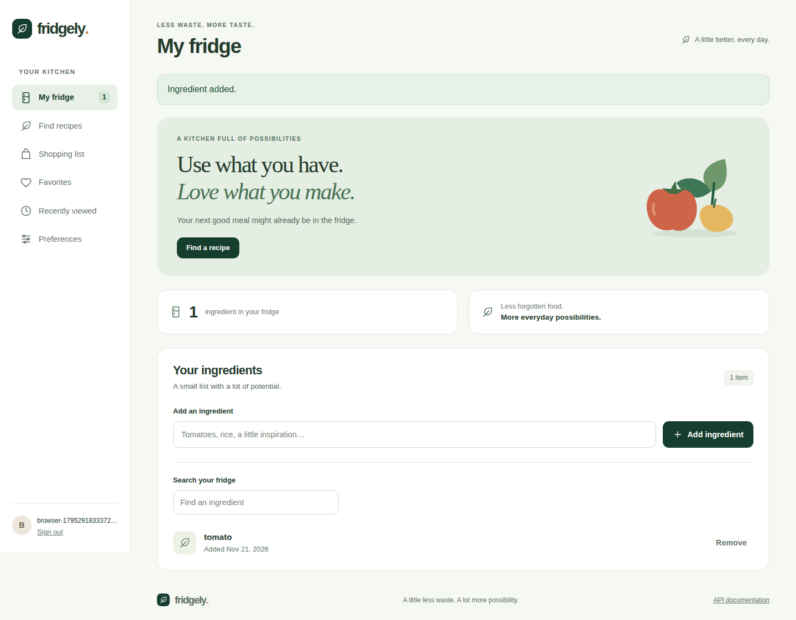
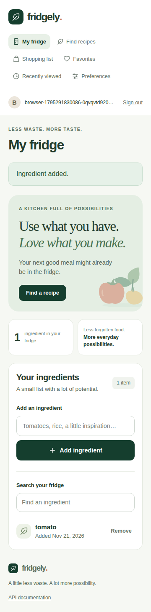
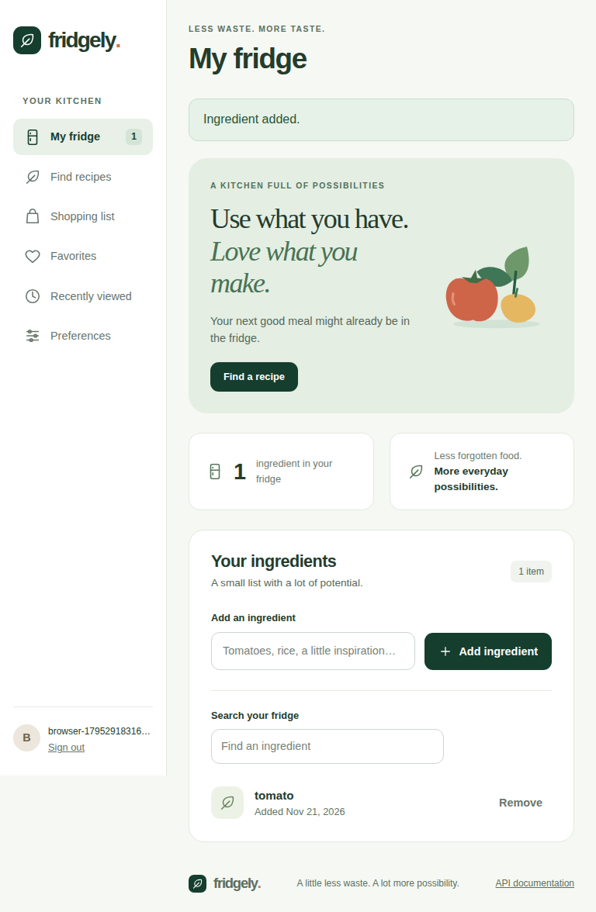
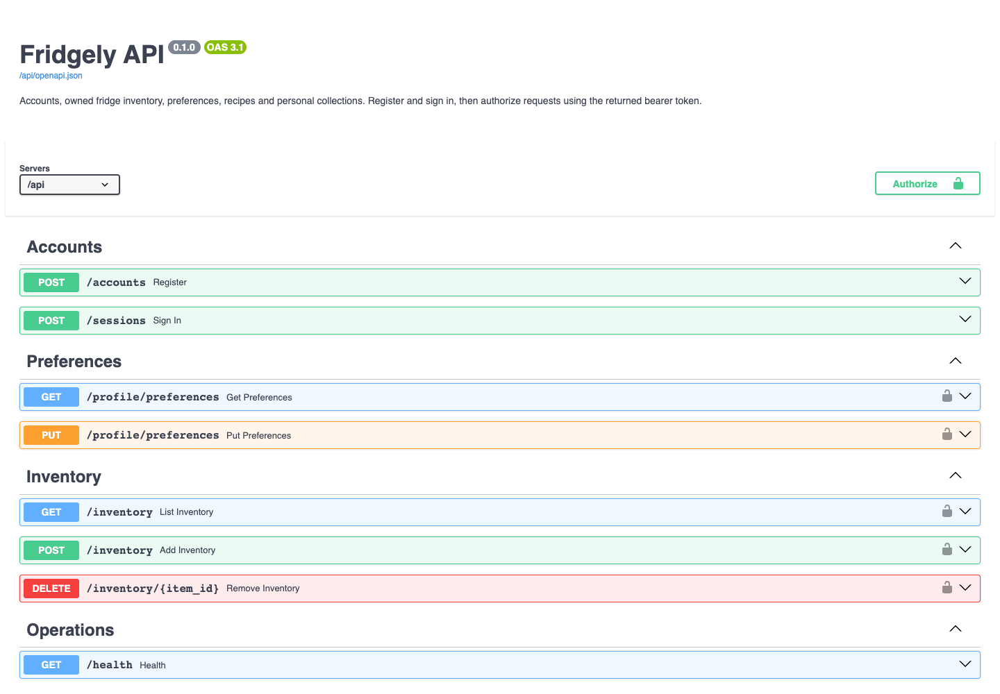
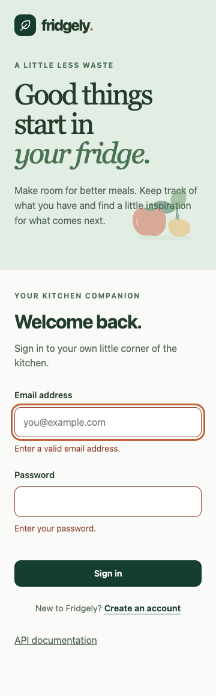
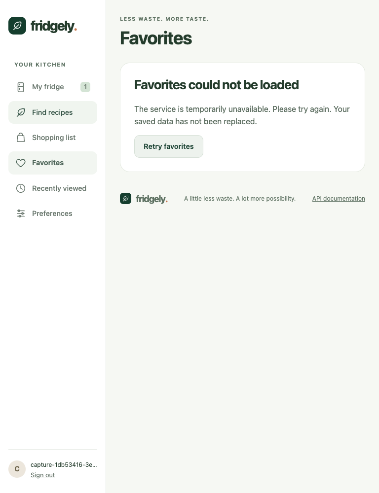

# Fridgely Software Test Report

CMPE 331  /  SOFTWARE TESTING

Berfin Gökgöz | Full-stack and database integration
21 November 2026 | Review copy for pull-request assessment

## What was verified

A single FastAPI host now connects real account registration, signed JWT sessions, saved preferences and SQL inventory to the existing recipe and personal-collection modules. The React client uses that same authenticated API. This report records executed tests and their limits; it does not infer a result from the presence of test code or a CI file.

| Verification | Recorded result |
| --- | --- |
| Local Python backend | 105 passed; 1 explicit PostgreSQL skip; 1 upstream warning |
| Functional acceptance | 27 passed through the actual FastAPI/SQL host |
| Real HTTP account/security suite | 12 passed; every protected route checked without/with malformed tokens |
| Local browser suite | 18 passed; core flows, three widths, WCAG audit and keyboard use |
| Targeted penetration probes | 4 passed: SQL payload, mass assignment, file disclosure and stored XSS |
| PostgreSQL CI backend | 106 passed in the cited run; separate processes verify persistence |
| CI browser suite | 18 passed on the cited source revision |
| Five-minute load scenarios | Targets met in both local SQLite and CI PostgreSQL environments |
| Dependency audits | No known vulnerabilities reported by the recorded Python/npm audits |
| SonarQube quality gate | OK |

The production Docker image also passed a real PostgreSQL restart/isolation smoke test. Public HTTPS hosting is still blocked by Render GitHub repository access, and live recipe generation requires the team provider credential. Controlled provider fixtures are explicitly separate from these release checks.

[GitHub verification run](https://github.com/SarpCizer/CMPE331-Project/actions/runs/44944497368) | [Feature PRs](https://github.com/SarpCizer/CMPE331-Project/pulls)

Application verification revision: 25c111aa5a8d678b60c17745289675821b62f91d. Report and current frontend handoff are proposed in PR #56; main remains unmerged.

# 1. Scope, baseline and test design

The repository is authoritative. The initial main inspection at 48b77e9 and latest check at cb99673 both contain the historical 501 acceptance scaffold. The collections module was taken from backend_work at 862005f and the recipe module from Ayse's PR #7 at e5391fe. Their history was preserved on the integration branch. No merge to main was performed.

FastAPI/SQLAlchemy was retained to compose the implemented teammate modules. PostgreSQL is the shared database target; SQLite provides a reproducible local environment. The legacy ZIP files were reference material only. Their unowned global recipes, localStorage lists, reset schema, pickle models and spoilage/expiry scope were not substituted for current GitHub code.

| Boundary | Execution and interpretation |
| --- | --- |
| Account and access | Real normalized email uniqueness, salted Argon2id hashes, signed HS256 JWTs, issuer/audience/expiry checks and existing-account lookup. Owner IDs in request data cannot select another account. |
| Data and transactions | Versioned migration, owner-qualified queries, foreign keys, composite recipe ownership, atomic preferences and full recipe batches. No success is returned before commit. |
| Provider and clock | Only the external provider response and clock are injected. Node acceptance cases send requests through the actual FastAPI host and a fresh migrated SQL database. No parallel fake application is used. |
| Browser | Production React build and the actual HTTP host run together. Tests use isolated accounts, real SQL persistence, a controlled provider and tab-scoped sessions. |
| Reproducibility | Pinned Python and frontend lockfiles, recorded source hashes, test commands, JUnit, coverage, screenshots and CI artifacts identify what was executed. |

## Important test outcomes

US-15: authentic tokens work before expiry and fail afterward; malformed, tampered and unsigned JWTs are rejected. Two real accounts cannot access each other's inventory, recipes, shopping, favorites or history. Database ownership constraints also reject foreign recipe associations.

US-03/US-07: preferences can be replaced and cleared atomically. Generating again after a saved update supplies the latest committed lists to the provider. US-09: a provider failure preserves all five personal collections; malformed/allergen-conflicting batches are rejected without partial persistence.

Timestamp scenarios explicitly sign in again after advancing beyond the one-hour session lifetime. This preserves both the original date/history assertions and real expiration enforcement. The separate expired-token test still expects 401.

Review #17 is addressed by the ordered relational preference migration. The actual test-first commit 9450fac contains two failing relational tests before the implementation commit 775e8b7. The following green run includes legacy-data preservation, repeated upgrade, duplicates/order, foreign keys, replacement/clear, two-account isolation and concurrent case-variant registration. Older work is not retroactively labelled as TDD.

Frontend completion in #56 retains nine browser regressions in commit 2b2797f that failed against a7c7456 before implementation. The fixed application passes those regressions and the original complete flows. A further committed-write/failed-refresh regression was added during review; no earlier test-first history is claimed for it. Coverage and JUnit are retained under evidence/frontend-completion.

# 2. Requirement and code coverage

The denominator is the 15 user stories and 48 acceptance criteria stored under docs/requirements. Each criterion has an assertion mapping in docs/tests/coverage/traceability.csv. Mapping coverage is 48/48; executed assertions within the stated fixture/SQL/browser scope support the recorded passes. Mapping is separate from line/branch coverage and from release approval.

| Story | Requirement | Criteria | Representative cases |
| --- | --- | --- | --- |
| US-01 | Registration | 3 | US-01-T01 + mapped companion cases |
| US-02 | Sign-in | 2 | US-02-T01 + mapped companion cases |
| US-03 | Preferences | 3 | US-03-T01 + mapped companion cases |
| US-04 | Add inventory | 3 | US-04-T01 + mapped companion cases |
| US-05 | List inventory/dates | 3 | US-05-T01 + mapped companion cases |
| US-06 | Delete inventory | 3 | US-06-T01 + mapped companion cases |
| US-07 | Generate recipes | 4 | US-07-T01 + mapped companion cases |
| US-08 | Recipe details/estimates | 3 | US-08-T01..T07 + browser |
| US-09 | Provider failures | 3 | US-09-T01 + mapped companion cases |
| US-10 | Missing ingredients | 4 | US-10-T01 + mapped companion cases |
| US-11 | Shopping management | 4 | US-11-T01 + mapped companion cases |
| US-12 | Save favorite | 3 | US-12-T01 + mapped companion cases |
| US-13 | List/remove favorites | 3 | US-13-T01 + mapped companion cases |
| US-14 | Viewed history | 4 | US-14-T01 + mapped companion cases |
| US-15 | Personal-data protection | 3 | US-15-T01..T03 + B-SEC |

| Code measurement | Lines/statements | Branches | Functions |
| --- | --- | --- | --- |
| Python / local | 91.83% | 73.91% | - |
| Python / CI | 91.44% | 72.83% | - |
| React / local V8 mapped | 100.00% | 92.24% | 92.45% |
| React / CI V8 mapped | 96.39% | 92.18% | 92.45% |

Python coverage includes backend/src and the migration; it excludes the test-only acceptance bridge. Frontend coverage maps the production build back to frontend/src using source maps and exports LCOV. Third-party modules and generated assets are not product-source coverage. V8 mapped line totals are instrumentation-specific: even 100% mapped lines would not imply all branches, functions or acceptance conditions were tested. Preserve the raw summaries and use the branch/function measures alongside line coverage.

# 3. Non-functional results

| NFR | Executed evidence | Interpretation |
| --- | --- | --- |
| NFR-01 | JWT signature/claims/expiry, all protected methods without/malformed tokens; cross-user objects and SQL ownership. | Passed in recorded suites. |
| NFR-02 | Distinct salted Argon2id hashes; wrong credentials; sanitized provider failures; dependency audits. | No real secrets are committed in evidence. This is not a complete penetration test. |
| NFR-03 | 50 signed-in users, 100 inventory entries each, 300 measured seconds; four non-AI list routes. | Targets met in named local/CI environments; agreed deployment still needs measurement. |
| NFR-04 | Default 28-second budget observed at 28.038s; provider cancelled; five collections unchanged. | Passed (<30s); controlled stalled provider. |
| NFR-05 | All six core screens at 360, 768 and 1440 px; no horizontal page overflow. | Passed; screenshots embedded in this report. |
| NFR-06 | Automated WCAG A/AA audit of core screens, labels/focus and keyboard-only registration/kitchen/collection flow. | Passed in the automated scope; audit is not an accessibility certification. |
| NFR-07 | Two separate processes, two accounts and five collections compared before/after restart; SQLite and real PostgreSQL. | Passed in recorded environments. |
| NFR-08 | Missing/invalid fields, non-finite/negative numeric rules, whole-batch rejection and declared allergen conflicts; estimate labels. | Passed with controlled outputs; hidden ingredients/cross-contamination are not established. |
| NFR-09 | Locked install, explicit migrations, production build, CI tests and artifacts. | CI/local reproduction verified. HTTPS staging and live-provider smoke checks remain release gates. |

## Performance measurements

| Environment | Requests | p95 | Errors | Result |
| --- | --- | --- | --- | --- |
| Local macOS ARM64, SQLite, one worker | 57400 | 44.35 ms | 0.00000% | PASS |
| GitHub Actions, PostgreSQL 17, one worker | 40336 | 371.47 ms | 0.00248% | PASS |

Thresholds: p95 <= 500 ms and error rate < 1%, also checked per route. Setup creates 5,000 entries before timing; signed-in users query inventory/profile/shopping/favorites with one-second think time. Shopping/favorites are initially empty; AI calls are excluded. The CI results retain connection-level failures and latency outliers in their exported measurements rather than omitting them. Neither result is represented as a production SLA.

# 4. Quality analysis and mitigation

Dependency audits checked the committed Python and pnpm dependency resolutions and reported no known vulnerabilities at the run time. This finding is time-bound and does not prove the application is free of vulnerabilities.

The first integrated CI run passed its full-stack job but its scanner could not write the default working directory. A second scan completed but an optional metric export failed. The corrected job uses a writable project directory and supported export fields. These failures remain distinct from completed source findings.

| SonarQube evidence | Recorded value |
| --- | --- |
| Server version | 26.11.0.134175 |
| Analysis revision | 25c111aa5a8d678b60c17745289675821b62f91d |
| Quality gate | OK |
| Reported issues | 0 |
| High/blocker impact or legacy critical/blocker | 0 |
| Coverage reported by scanner | 92.5 |
| Security hotspots | 0 |

The initial scan recorded 17 findings: one email regex concern, four implicit form-submit types and twelve assertion-helper classification findings. PR #13 replaces the regex with a maintained parser, makes submit types explicit, and renames the custom HTTP helper while retaining its assertions. Completed scans of the corrected and current application report zero issues. Both initial exports and rule-specific mitigation evidence are committed.

The quality-gate export is OK with an empty conditions array on this initial project analysis. The explicit zero issue/high-severity/hotspot totals and actual measured tests are preserved; gate OK is not presented as proof that a custom release policy was evaluated.

The first frontend-completion scan at 522e0db reported one MAJOR javascript:S9383 finding on the unmarked background load. Its selected original fields and artifact identity are retained in quality/frontend-522-findings.json. Commit 25c111a explicitly marks this internally handled promise with void; the follow-up scan and measured tests are recorded against that source. No runtime rejection incident is claimed from the static finding alone.

Separate CI policy checks enforce backend statement/branch floors of 90%/70% and frontend line/branch/function floors of 90%/85%/85%. Their observed job status is recorded separately from the application run. A full-history secret scan initially flagged documentation prose and a deliberately invalid unsigned test JWT; only specific verified historical fingerprints are scoped as false positives. No broad file exclusion or history rewrite is used.

Current verification run 44944497368 executes the application and browser suites on the cited source revision. Its coverage-policy and secret-scan jobs enforce the explicit floors and their negative canaries. Historical policy-only run 44933945505 separately verified source identity before reusing immutable application evidence from run 44932416317; those older results are not relabelled as a new source run.

The scan runs against a disposable loopback-only SonarQube server inside CI. It does not require uploading this private repository to an unrelated hosted analysis account. The temporary initial admin password is rotated, tokens are masked and the server is removed after export. The exported JSON remains reviewable after the server is destroyed.

# 5. Review, interpretation and release gates

The tests establish a working integrated application within the recorded environments, not a guarantee that every possible input or deployment condition is covered. The strongest evidence is the agreement between real JWT/SQL behavior, fixture-backed provider boundary tests, independent-process persistence, browser user switching and measured PostgreSQL load.

| PR | Review scope |
| --- | --- |
| #9 Accounts/database | Normalized registration, Argon2id, signed JWT, preferences, inventory and shared migration. |
| #10 Application integration | Existing recipe/collections module history, real host composition and the 27-case acceptance adapter. |
| #11 Web integration | React screens, server-owned state, explicit failures, responsive layout, browser/accessibility evidence. |
| #12 CI verification | PostgreSQL, process restart, HTTP security, browser coverage, five-minute load, dependency and SonarQube jobs. |
| #13 / #14 / #15 | Quality fixes; self-host API documentation and production image; four penetration probes. |
| #49 / #50 / #51 / #52 | Relational migration with actual TDD; review/version policies; AI evidence; coverage and secret failure gates. |
| test_work Test report | Traceability, measured results, non-functional evidence, quality findings/mitigations and this PDF. |
| #56 Frontend completion | Linked validation, independent loading/retry, committed-write acknowledgement, safe modal feedback, team setup guide and current evidence. |

Each PR is opened from Berfin's account with an English title/description. The dependent bases keep feature reviews separate and preserve teammate commits. Yeşim's verified reviewer handle is yesimyigitbasi. No PR has been merged to main by this work.

## Remaining release checks

Render GitHub access must be granted for the private source repository or an authorized private fork before public hosting can complete. Supply the team's real provider credential outside source control and run live recipe checks, then record deployment-specific smoke/performance results. Obtain independent reviews, owner-applied main protection, team contribution/Project evidence and course-platform submission. These human/account actions are not inferred from test execution.

## Submission schedule

Internal preparation target: 22 November 2026. The supplied updated instructor email sets the test PR/reviewer deadline to 25 November and the approved PDF submission to 29 November 2026. This is a review copy. Submission to learn.bilgi follows PR approval and is not claimed here.

Artifacts: [verification run](https://github.com/SarpCizer/CMPE331-Project/actions/runs/44944497368), [criterion CSV](https://github.com/SarpCizer/CMPE331-Project/blob/feature/berfin-cloud-candidate/docs/tests/coverage/traceability.csv), [quality evidence](https://github.com/SarpCizer/CMPE331-Project/tree/feature/berfin-cloud-candidate/docs/tests/quality), [non-functional results](https://github.com/SarpCizer/CMPE331-Project/tree/feature/berfin-cloud-candidate/docs/tests/non-func-tests). Images are embedded on the following pages, as required.

# 6. Desktop browser evidence

1440 px viewport, production React build served by the actual API host. The displayed ingredient and addition date were created through the authenticated SQL-backed endpoint. Synthetic test accounts are used throughout.

Browser assertions also verify preferences, full recipe details, missing shopping ingredients, favorites/history, reload persistence, account switching, provider failure and empty states. Passing browser results use a controlled recipe provider; they do not establish live-provider correctness.

# 7. Mobile browser evidence

360 px viewport. The same core actions remain available without horizontal page overflow. Long ingredient names are also checked by the test suite. The matching 768 px screenshot is committed with the evidence.

# 8. Tablet browser evidence

768 px viewport, same authenticated application and owned ingredient workflow. This image accompanies the executable width/overflow/label assertions; the measured suite also visits recipes, shopping, favorites, history and preferences.

# 9. API and cloud verification boundary

The real API schema and locally bundled Swagger UI are available at /api/openapi.json and /api/docs. The screenshot below loads actual account, preference, inventory, recipe and collection operations with JWT bearer authorization; it is not a static API mock.

The production image was built and started against PostgreSQL in CI. Two users, persisted inventory/preferences/shopping, relogin and an unchanged signed token were checked after an actual container restart. Missing provider credentials correctly produce 503. This proves the packaged host and managed-database contract in the named CI environment, not public Render availability or live recipe generation.

Render workspace access succeeds and the free PostgreSQL instance exists. The attempted Blueprint import returns repository/branch/file access denied, so there is no verified public web URL. A repository-owner GitHub grant or authorized private fork is required. The free database created on 20 November is scheduled to expire on 20 December 2026; longer retention needs a reviewed plan. These remaining actions are tracked explicitly.

# 10. Frontend validation and recovery

Current #56 screenshots use isolated accounts and the actual React/API host. Validation is associated with the input and blocks invalid writes. An unavailable favorites collection has its own retry; the fridge and other collections remain usable. These error states are included in the three-width accessibility checks.

Recipe actions also display their error/success feedback inside the dialog, prevent duplicate submissions and provide a View shopping list link after missing ingredients are added. A completed write with a failed list refresh is acknowledged separately; retrying reads data without repeating the write. A 401 from any request clears personal state even during another collection outage.

