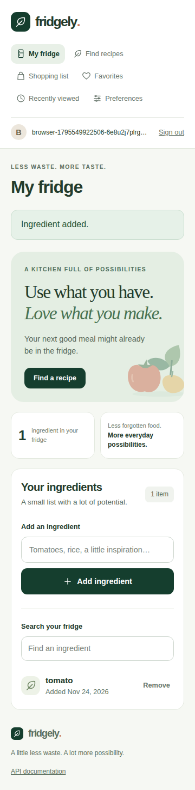

# Fridgely
Software Testing Report

2026-11-24 | Prepared for the CMPE331 submission review

## Verified integration candidate

Verified integration candidate; final team selection and course upload pending

Tested source: a59556e366ffd65adf799bb8aa9bc47e95dea16e

[Exact-source CI run 45474025963](https://github.com/SarpCizer/CMPE331-Project/actions/runs/45474025963) | [Source commit](https://github.com/SarpCizer/CMPE331-Project/commit/a59556e366ffd65adf799bb8aa9bc47e95dea16e) | [ZIP verification, #48](https://github.com/SarpCizer/CMPE331-Project/issues/48#issuecomment-7143013023)

This report replaces the historical 25c111a evidence with the measured results for a59556e. A later report-only commit stores this document; it does not change which application source these tests exercised. A new selected application SHA requires matching evidence and a regenerated report.

| Verification layer | Recorded result |
| --- | --- |
| PostgreSQL / backend | 133 passed; 0 skipped |
| Requirement acceptance | 28 passed |
| Browser / accessibility / keyboard | 22 passed |
| HTTP security / scoped penetration | 12 HTTP cases and 4 penetration probes passed |
| CI delivery checks | All 7 jobs successful; source ZIP verified |
| Live public web service | 6 read-only HTTPS checks passed; no AI request |

## What this evidence establishes

The integrated frontend, API, ownership rules and PostgreSQL persistence are compatible within the recorded tests. Recipe workflows use controlled external provider responses. Actual paid or free model inference was not exercised, and the live service has no verified recipe-provider credentials.

Prepared by Berfin Gökgöz with Codex assistance. No team-wide approval, live AI success or course-platform upload is asserted.

# Functional traceability

All 15 approved user stories have recorded acceptance assertions in tests/functional/requirements.test.mjs. The real application host and SQL are exercised; provider behavior is controlled. Acceptance and backend/browser counts overlap in coverage of requirements and must not be added as unique requirements.

| Story | Verified behavior | Acceptance IDs |
| --- | --- | --- |
| US-01 | Registration, duplicate and invalid input rejection | T01-T02 |
| US-02 | Correct and incorrect sign-in | T01 |
| US-03 | Save and clear dietary/allergen preferences | T01 |
| US-04 | Add ingredient; timestamp; blank rejection | T01-T02 |
| US-05 | Owned inventory, original dates and repeated names | T01-T02 |
| US-06 | Delete selected ingredient only | T01 |
| US-07 | Fridge/preferences to provider, allergens, empty fridge; no deduction | T01-T03 |
| US-08 | Recipe details and six malformed-output cases | T01-T07 |
| US-09 | Retryable provider error preserves saved state | T01 |
| US-10 | Missing ingredients only; stable IDs on repeat | T01 |
| US-11 | Manual shopping list add/list/remove | T01 |
| US-12 | Idempotent favorites; inventory unchanged | T01 |
| US-13 | Remove favorite, retain history | T01 |
| US-14 | Newest-first view history | T01 |
| US-15 | Missing, malformed and expired JWT; cross-owner isolation | T01-T03 |

Each short ID is prefixed by its story, for example US-07-T01. Full case names and PASS counts are in acceptance.log; backend-junit.xml and browser-junit.xml retain individual cases. The repository coverage/traceability.csv retains the detailed criterion mapping.

## Database and transaction boundaries

The 133 backend tests include real PostgreSQL with no skips. JWT subjects supply identity; client-supplied owner fields cannot transfer ownership. Inventory changes through manual add/delete. Collection regressions check commit-before-success and rollback behavior; duplicate ingredient rows remain distinct and retain their addition dates.

# Coverage and security

| Metric | Measured | Unchanged minimum |
| --- | --- | --- |
| Backend statements | 91.72% | 90% |
| Backend branches | 76.06% | 70% |
| Frontend lines | 97.10% | 90% |
| Frontend branches | 94.03% | 85% |
| Frontend functions | 94.36% | 85% |

The independent coverage gate and its deliberately failing synthetic canary passed. Production backend source and mapped frontend/src are in scope; line/statement coverage is separate from branch coverage.

## Security results

The 12 real HTTP cases check account validation, signed finite-expiry JWTs, tamper/unsigned-token rejection, protected endpoints and two-account isolation. Four targeted penetration probes passed: literal SQL injection payload handling, mass-assignment rejection, configuration/source/path-traversal denial and stored XSS rendered as inert text. This is a scoped automated assessment, not a complete independent penetration audit.

Python and frontend dependency audits passed with no recorded advisories in their exported results. The reachable-history secret scan returned zero findings; a synthetic credential canary proved the scanner fails on its test secret. Secrets and account tokens are not retained in report evidence.

## SonarQube: source identity and limitations

SonarQube 26.11.0.134175 ran in an ephemeral loopback-only CI server. Analysis and test revision both equal a59556e; test_artifacts_reused=false. Recorded issues: 0; bugs, vulnerabilities, code smells and security_hotspots metrics: 0. Its aggregate coverage is 93.9%, which has a different scope from the per-language policy above.

The recorded quality gate is OK, but conditions=[]; that alone is not an independent threshold decision. The detailed security-hotspots endpoint returned API_UNAVAILABLE (HTTP 400). A zero hotspot metric does not establish a completed manual hotspot review. Raw issues, metrics, gate and source identity are retained.

# Performance and persistence

Environment: GitHub Actions Ubuntu, PostgreSQL 17, one application worker; Linux x86_64, Python 3.12.16, 2 reported CPUs. Scenario: 50 users, 100 inventory rows per user, 1-second think time and 300 seconds configured duration. Shopping/favorites are empty owned collections. No model call occurs in the measured loop.

| Route / total | Requests | Errors | p95 ms |
| --- | --- | --- | --- |
| Inventory | 11,850 | 0 | 226.92 |
| Profile | 11,850 | 0 | 196.92 |
| Shopping | 11,850 | 0 | 195.11 |
| Favorites | 11,850 | 0 | 195.96 |
| Overall | 47,400 | 0 | 204.06 |

Measured duration: 301.10 seconds. Overall mean 66.05 ms; maximum 1647.51 ms. The original p95 <= 500 ms and error rate < 1% limits pass overall and per route. This is CI evidence, not a Render or AI-provider benchmark.

## Timeout and cancellation

Controlled delayed provider: configured deadline 28 seconds; observed 28.03 seconds. Provider cancellation and all five saved collections remaining unchanged passed. This measures application timeout handling, not a real provider service-level guarantee.

## Container and PostgreSQL restart

Production image smoke checks passed for the frontend, health, OpenAPI and Swagger. A real PostgreSQL-backed restart preserved inventory, preferences and shopping data; relogin and two-account isolation passed. With provider credentials absent, recipe generation returned 503 as expected. The database and JWT secret were not reset for this report.

## Live deployment: separate observation

[Fridgely on Render](https://fridgely-web.onrender.com) runs the original repository on the FREE plan. Deploy dep-dc2uq60473hc73bfhqs0 reached LIVE at a59556e via new_commit. On 24 November at 20:06 UTC, root, health, OpenAPI, Swagger and referenced JS/CSS returned 200. Six read-only checks used no account credentials or inference. This establishes the feature branch CI-to-deployment path; main deployment is not claimed.

# Delivery evidence and remaining work

Source-only ZIP: 243 manifest source files. CRC, every file length/hash and declared Git blobs were verified; two independent builds were byte-identical. The generic contribution placeholder is absent. ZIP SHA-256: 21141bcffb2c01f1e203d7c045fc141d64147f9f81e46a08d9698579ac339c3a

The matching source archive is the source-archive artifact of CI run 45474025963. Raster evidence and report PDFs are deliberately outside the source-only ZIP. Pair this PDF with that exact archive; do not substitute the historical #60 / 90529bb package.

## TDD and independent tooling review

[PR #66](https://github.com/SarpCizer/CMPE331-Project/pull/66) records the genuine RED sidecar regression at 282afeb and the GREEN fix at 39b7b54. Berfin independently reran all 8 packaging tests and both default/nested report exports and approved that exact head (review 6046700031). CI run 45476946238 passed all 7 jobs. Those are separate tooling results; the a59556e source archive job had 7 packaging regressions. #66 remains outside the tested application source of this report until merged and selected.

This report refresh has its own RED regression, 5140116: the old exporter accepted a false all-zero source revision and wrote a PDF. The refreshed exporter rejects mismatched identities before publishing. It validates retained raw evidence hashes and checks backend/browser JUnit totals. No retroactive TDD claim is made for older implementation work.

## Reproduction and provenance

Install scripts/tests/requirements-report.txt, then run python scripts/tests/export_report.py. Set FRIDGELY_REPORT_OUTPUT for another directory. Run python scripts/tests/test_export_report.py for source-identity and nested-output regressions. Inputs: docs/tests/report-input.json and its evidence_root; evidence-index.json records each retained file SHA-256 and all six downloaded artifact archive digests. No network, provider key or inference is required to export.

[CI artifacts](https://github.com/SarpCizer/CMPE331-Project/actions/runs/45474025963) | [Integration decision, #24](https://github.com/SarpCizer/CMPE331-Project/issues/24) | [Report review, #44](https://github.com/SarpCizer/CMPE331-Project/issues/44) | [Submission tracking, #48](https://github.com/SarpCizer/CMPE331-Project/issues/48)

## Open release decisions

1. The team / product owner must confirm the exact submission SHA in #24. Berfin supports the verified a59556e candidate; this does not substitute for other team members or owner approval. If #66 or another change is included, select the resulting source and regenerate its archive/evidence/report pairing.

2. Live recipe generation remains unverified. Draft #65 and the team Cloudflare Free account/credential configuration are separate work. After reviewed integration, validate generated recipes, missing-ingredient shopping and unchanged inventory using an authorized free account.

3. Independent report review and the actual learn.bilgi upload/receipt remain pending. Main was not merged; no paid resource or provider request was created by this work.

# Responsive evidence: desktop

Actual browser screenshots from the same CI run and a59556e source. Synthetic test-account contents are used; no live account credentials are shown. The 22 Chromium cases cover the functional flow, loading/error/cancellation states, responsive layout, accessibility checks and keyboard interaction.

Desktop viewport: 1440 px. The inventory, recipe controls and supporting navigation are exercised through the production frontend build and integrated API.

# Responsive evidence: mobile / tablet

The 360 px and 768 px viewport captures below are CI presentation evidence. They do not replace the automated assertions or establish universal accessibility conformance.

